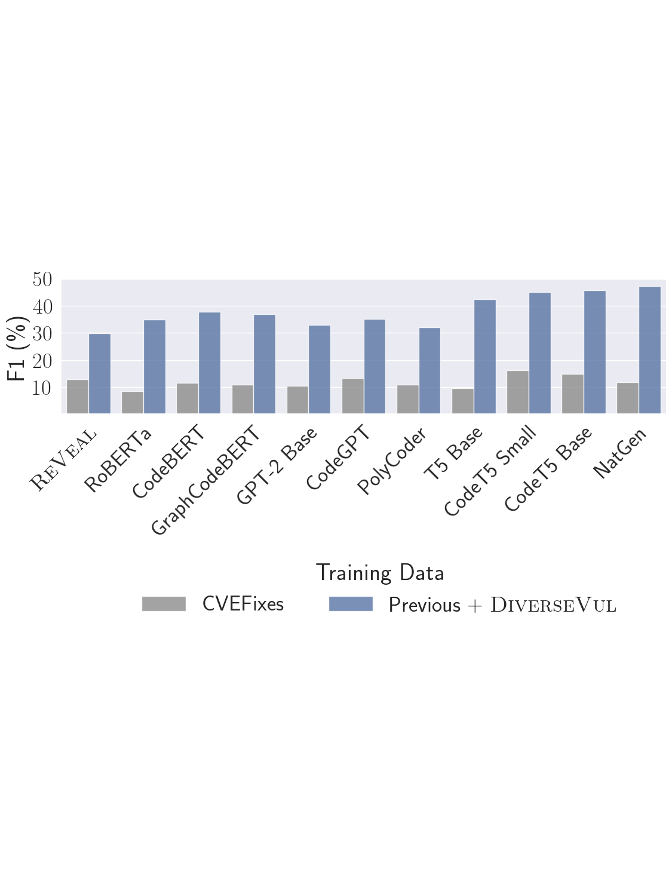
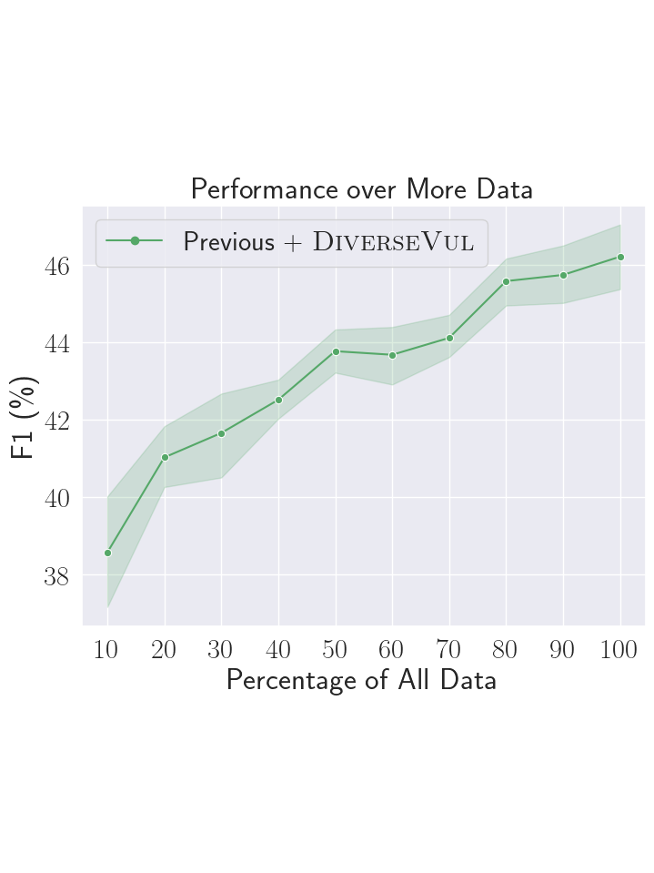
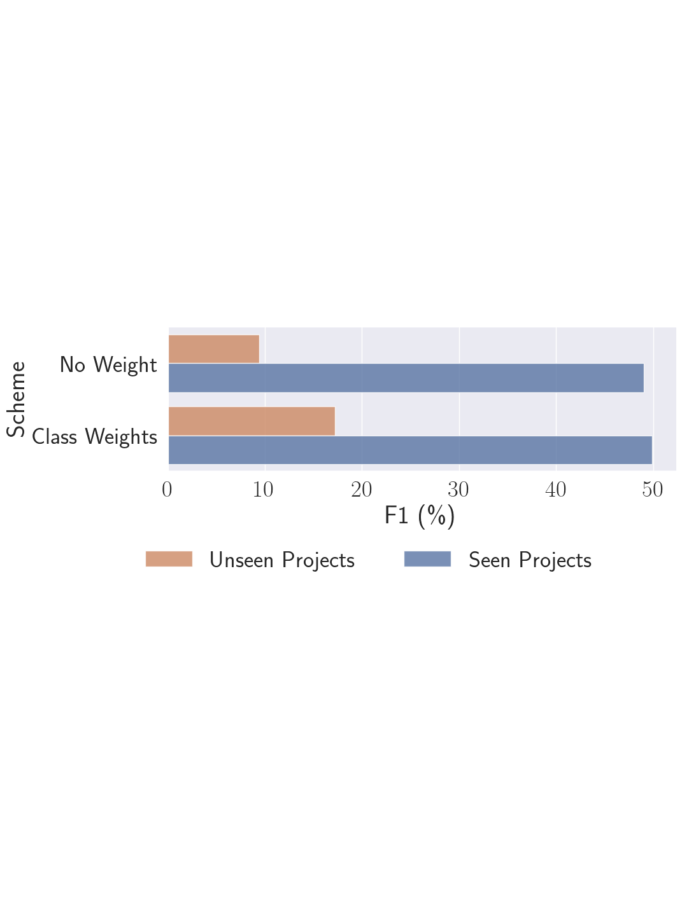
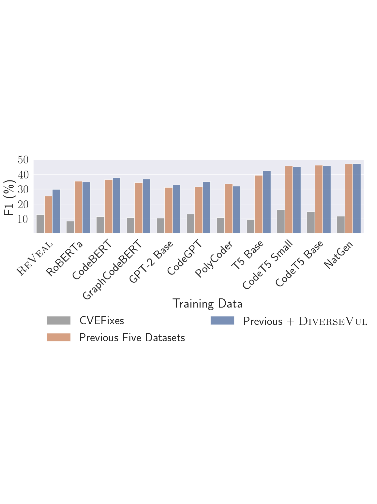

#slide 1
## layout
title
## slide title
AI w wykrywaniu podatności i exploitów
## subtitle
Wykład przeglądowy z praktycznym wprowadzeniem do metod, danych i ograniczeń
## teleprompter:
Ta prezentacja porządkuje obszar wykorzystania AI w cyberbezpieczeństwie z naciskiem na wykrywanie podatności, lokalizację błędów, generowanie exploitów i automatyzację analizy kodu. Najpierw ustawiamy słownictwo i problem, a potem przechodzimy przez główne rodziny metod oraz najważniejsze publikacje i raporty.

#slide 2
## layout
bullet
## slide title
Co dokładnie rozważamy
## bullets
- Wykrywanie podatności w kodzie źródłowym, także w komponentach mobilnych.
- Lokalizacja linii lub fragmentu odpowiedzialnego za błąd.
- Ocena exploitability i prawdopodobieństwa wykorzystania.
- Generowanie exploitów, patchy i testów bezpieczeństwa.
## teleprompter:
To nie jest jeden problem, tylko kilka powiązanych zadań. Część prac próbuje odpowiedzieć, czy kod jest podatny. Inne próbują wskazać konkretną linię, a jeszcze inne oceniają, czy podatność da się wykorzystać albo naprawić. W kontekście bezpieczeństwa systemów mobilnych chodzi też o aplikacje Android i iOS, ich biblioteki natywne, WebView, SDK i warstwę integracji z systemem. W tej prezentacji będziemy rozdzielać te zadania, bo mieszanie ich razem prowadzi do fałszywych porównań.

#slide 3
## layout
bullet
## slide title
Dlaczego ten temat urósł
## bullets
- Zbiory podatności rosną szybciej niż możliwości ręcznej analizy.
- Wiele błędów trafia do kodu zanim pojawi się CVE.
- Duże modele wprowadziły nowe możliwości, ale też nowe ryzyko dual-use.
- Security stało się jednym z głównych zastosowań agentów i LLM-ów.
## teleprompter:
Przyspieszenie nie wynika tylko z większej liczby modeli. Zmieniła się skala użycia kodu, liczba bibliotek i tempo publikowania podatności. Jednocześnie LLM-y zaczęły być używane zarówno po stronie obrony, jak i ataku. To właśnie dlatego temat jest dziś ważny: ta sama klasa narzędzi może pomagać w audycie, patchowaniu i analizie, ale może też wspierać eksplorację exploitów.

#slide 4
## layout
bullet
## slide title
Jak czytać ten obszar
## bullets
- Nie każda praca „LLM security” robi to samo.
- Jedne modele wykrywają podatności, inne je lokalizują, a jeszcze inne naprawiają.
- Osobna grupa bada generowanie exploitów i agentów ofensywnych.
- Warto patrzeć na dane, zadanie i protokół ewaluacji, nie tylko na nazwę modelu.
## teleprompter:
To jest kluczowy slajd porządkujący. Sam napis „LLM” niewiele znaczy, jeśli nie wiemy, czy praca dotyczy klasyfikacji funkcji, repozytorium, patchowania, czy exploit generation. W praktyce różne zadania mają różne potrzeby reprezentacyjne i różne punkty awarii. Dla tego kursu ważne jest też to, że w systemach mobilnych te zadania często dotyczą nie tylko czystego C/C++, ale także komponentów natywnych, frameworków aplikacji i bibliotek używanych przez aplikacje mobilne. Dlatego będziemy konsekwentnie oddzielać zadania i typy metod.
## teleprompter:
To jest kluczowy slajd porządkujący. Sam napis „LLM” niewiele znaczy, jeśli nie wiemy, czy praca dotyczy klasyfikacji funkcji, repozytorium, patchowania, czy exploit generation. W praktyce różne zadania mają różne potrzeby reprezentacyjne i różne punkty awarii. Dlatego będziemy konsekwentnie oddzielać zadania i typy metod.

#slide 5
## layout
bullet + image
## slide title
Trzy główne rodziny metod
## bullets
- Reprezentacje sekwencyjne: tokeny, subwordy, pretraining językowy.
- Reprezentacje strukturalne: grafy, slicing, control/data flow.
- Reprezentacje hybrydowe: łączenie kodu, grafu, opisu i kontekstu repozytorium.
## image

## teleprompter:
To jest podstawowy podział, który później widać w konkretnych publikacjach. Modele sekwencyjne próbują zrozumieć kod podobnie jak język naturalny. Modele strukturalne dodają zależności sterowania i danych. Hybrydy próbują połączyć oba światy i często właśnie tam uzyskuje się najlepsze wyniki praktyczne. Obrazek przypomina, że bez dobrej struktury danych nawet mocny model może mierzyć coś innego niż zakładaliśmy.

#slide 6
## layout
bullet + image
## slide title
Dlaczego same tokeny nie wystarczają
## bullets
- Vulnerability często zależy od relacji między liniami, a nie od jednego tokenu.
- Kontekst danych i sterowania decyduje o tym, czy fragment jest bezpieczny.
- Wiele podatności ujawnia się dopiero po połączeniu kilku operacji.
- To tłumaczy popularność slicing, data flow i program graphs.
## image

## teleprompter:
W kodzie źródłowym pojedynczy token rzadko przesądza o podatności. Znacznie częściej liczy się sekwencja zależności: skąd przyszła wartość, gdzie została sprawdzona, czy została przepisana i czy została użyta w kontekście niebezpiecznym. Stąd zainteresowanie graph-based methods i slicingiem. Ten slajd pokazuje też, że jakość danych i ewolucja benchmarków są równie ważne jak sam model.

#slide 7
## layout
bullet + image
## slide title
Dane są częścią metody
## bullets
- Datasets tworzą często większe różnice niż architektura.
- Label noise jest w vulnerability detection bardzo wysoki.
- Duplicates i leakage potrafią sztucznie zawyżać wyniki.
- Realistyczne testy wymagają ostrego rozdzielenia train / test.
## image

## teleprompter:
W tym obszarze nie wystarczy mieć lepszego modelu. Jeśli dane są źle zbudowane, model po prostu uczy się skrótów. Dlatego tak wiele późniejszych prac poświęca sporo miejsca na data curation, deduplikację, odseparowanie commitów i kontrolę leaku między train i test. Dobre wyniki bez tej dyscypliny są zwykle mało wiarygodne.

#slide 8
## layout
bullet + image
## slide title
Jak mierzyć sukces
## bullets
- Accuracy bywa mylące przy niezbalansowanych zbiorach.
- F1, MCC, precision i recall odpowiadają na różne pytania.
- Przy lokalizacji linii liczą się metryki rankingowe.
- Dla exploitability ważny jest też pass@k i skuteczność narzędzi.
## image

## teleprompter:
Dwa modele mogą mieć podobny accuracy i zupełnie inne zachowanie operacyjne. W security false negative bywa znacznie droższy niż false positive, dlatego trzeba patrzeć na F1, MCC i metryki rankingowe. Jeśli model ma wskazać podatną linię, ważniejsze od samej klasyfikacji jest to, czy właściwy fragment ląduje wysoko na liście podejrzanych miejsc.

#slide 9
## layout
bullet
## slide title
pass@k: co to znaczy
## bullets
- `pass@k` mierzy sukces wśród `k` prób generacji.
- `pass@1` sprawdza pierwszy wynik modelu.
- `pass@5` pyta, czy przynajmniej jedna z pięciu prób była poprawna.
- To metryka dla zadań generatywnych, a nie klasyfikacyjnych.
## teleprompter:
`pass@k` nie mówi, czy model „zawsze” umie wygenerować poprawne rozwiązanie. Mówi tylko, jaka jest szansa sukcesu, jeśli damy mu kilka prób. To ma sens przy generowaniu patchy, testów albo exploitów, gdzie model może produkować kilka wariantów i jeden z nich może być użyteczny. W praktyce wyższe `pass@k` oznacza, że model ma większy potencjał do znalezienia poprawnej odpowiedzi przy ograniczonej liczbie prób.

#slide 10
## layout
bullet
## slide title
pass@k w security: dlaczego to ważne
## bullets
- W security rzadko wystarcza pojedynczy strzał.
- Modele mogą generować kilka wariantów exploita, patcha lub testu.
- Liczy się praktyczna skuteczność przy ograniczonym budżecie prób.
- Dlatego `pass@k` jest naturalne dla exploit generation i repair.
## teleprompter:
W security `pass@k` jest ważne, bo wiele zadań ma charakter poszukiwawczy. Exploit, patch albo test nie musi wyjść za pierwszym razem. Model może spróbować kilku rozwiązań, a my oceniamy, czy przynajmniej jedno z nich działa. To daje bliższy praktyce obraz skuteczności niż sama klasyfikacja. Właśnie dlatego metryka pojawia się w pracy o exploitability i generowaniu, a nie w zwykłym vulnerability classifierze.

#slide 11
## layout
bullet
## slide title
MCC, ROC-AUC i PR-AUC
## bullets
- `MCC` dobrze działa przy dużej nierównowadze klas.
- `ROC-AUC` mierzy separację klas w całym progu decyzyjnym.
- `PR-AUC` jest często bardziej czułe na klasę pozytywną.
- To nie są zamienniki dla F1, tylko inne pytania o model.
## teleprompter:
`MCC` to Matthews correlation coefficient, czyli współczynnik korelacji Matthewsa. `ROC-AUC` to area under the receiver operating characteristic curve, a `PR-AUC` to area under the precision-recall curve. Te metryki pojawiają się w vulnerability detection dlatego, że zwykłe accuracy często ukrywa problem klasy mniejszościowej. MCC daje stabilny obraz jakości przy nierównych klasach. ROC-AUC mówi, jak dobrze model oddziela klasy w ogóle, a PR-AUC bardziej skupia się na tym, jak wygląda klasa pozytywna. W praktyce trzeba je czytać razem, a nie wybierać jedną „najlepszą”.
#slide 12
## layout
bullet
## slide title
BPE, MLM i RTD
## bullets
- `BPE` rozbija rzadkie fragmenty na subwordy.
- `MLM` uczy model zgadywać zamaskowane tokeny z kontekstu.
- `RTD` sprawdza, czy token wygląda na oryginalny czy podmieniony.
- Razem dają mocny pretraining dla kodu i tekstu.
## teleprompter:
`BPE` to byte pair encoding, `MLM` to masked language modeling, a `RTD` to replaced token detection. To są trzy pojęcia, które wracają w CodeBERT i VulBERTa. BPE pomaga poradzić sobie z rzadkimi identyfikatorami i nie rozsadza słownika. MLM uczy model rekonstrukcji kontekstu. RTD idzie krok dalej i każe modelowi wykrywać podmienione tokeny. W praktyce to sprawia, że encoder nie tylko „widzi” tekst, ale też uczy się, które fragmenty wyglądają podejrzanie.
#slide 13
## layout
bullet
## slide title
CFG, DFG, PDG i slicing
## bullets
- `CFG` opisuje możliwe ścieżki wykonania.
- `DFG` opisuje przepływ wartości między zmiennymi.
- `PDG` łączy zależności sterowania i danych.
- `Slicing` wybiera fragment kodu istotny dla danego miejsca.
## teleprompter:
`CFG` to control flow graph, `DFG` to data flow graph, `PDG` to program dependence graph, a `slicing` to program slicing. To jest podstawowy słownik dla części grafowej i slicingowej. CFG mówi, którędy program może pójść. DFG pokazuje, skąd bierze się wartość i gdzie trafia. PDG scala oba spojrzenia. Slicing bierze interesujący nas punkt i wycina to, co naprawdę wpływa na jego zachowanie. To dlatego te pojęcia są tak ważne w SySeVR, Devign, IVDetect i LineVD.
#slide 14
## layout
bullet
## slide title
RAG, agent i workflow
## bullets
- `RAG` dokłada do modelu zewnętrzny kontekst z dokumentów lub kodu.
- Agent może wywoływać narzędzia, nie tylko generować tekst.
- W security ważne jest sprawdzanie odpowiedzi przez kompilator, testy lub skanery.
- To przesuwa LLM z roli czystego generatora do roli systemu działania.
## teleprompter:
`RAG` to retrieval-augmented generation. RAG i agentic workflows są ważne, bo w security sam tekst z modelu nie wystarcza. RAG pozwala dołączyć dokumentację, advisory albo fragmenty repozytorium. Agent może iteracyjnie czytać kod, uruchamiać testy i korygować odpowiedź. To właśnie robi różnicę między zwykłym czatem a narzędziem, które naprawdę pomaga w analizie podatności albo w patchowaniu.
#slide 17
## layout
bullet
## slide title
Tokeny, grafy i slicing
## bullets
- Token-based models są prostsze, ale mniej strukturalne.
- Graph-based models lepiej niosą control/data flow.
- Slicing potrafi wydobyć dokładnie ten fragment, który ma znaczenie.
- Najlepsze prace zwykle łączą kilka perspektyw naraz.
## teleprompter:
W praktyce linia między tokenami i grafami jest płynna. Część modeli działa dobrze, bo pretraining kompensuje brak struktury. Inne potrzebują jawnych krawędzi, bo bez nich nie rozumieją przepływu danych. Slicing jest osobnym narzędziem, które może obciąć szum i skupić model na naprawdę istotnym fragmencie.

#slide 18
## layout
bullet
## slide title
Główne źródła błędów
## bullets
- Etykiety są często niepełne albo zaszumione.
- Commit nie oznacza automatycznie, że każda zmieniona linia była podatna.
- Synthetic data daje wygodę, ale ogranicza realizm.
- Cross-project generalization jest dużo trudniejsza niż klasyczny test split.
## teleprompter:
To jest jedno z najważniejszych ograniczeń całej dziedziny. Wiele datasetów bierze patch jako sygnał podatności, ale to jest tylko przybliżenie. W praktyce pojedynczy commit może poprawiać kilka rzeczy naraz. W rezultacie model może nauczyć się korelacji z projektem, stylem kodu albo konkretnym typem zmian, a nie z samą podatnością.

#slide 19
## layout
bullet + image
## slide title
Co robią benchmarki
## bullets
- Benchmarki porządkują porównanie, ale też upraszczają rzeczywistość.
- Datasets takie jak BigVul, DiverseVul, CleanVul czy EyeballVul próbują poprawić realizm.
- Nie ma jednego uniwersalnego benchmarku dla wszystkich zadań.
- Warto patrzeć, czy benchmark odpowiada na nasze pytanie badawcze.
## image

## teleprompter:
Benchmark jest narzędziem, nie celem. Dobre porównanie pomaga nam zrozumieć model, ale zły benchmark potrafi całkowicie wypaczyć wnioski. Dlatego późniejsze prace coraz częściej nie tylko budują modele, ale też krytycznie oceniają jakość zbiorów i protokołów ewaluacyjnych.

#slide 20
## layout
bullet
## slide title
Dlaczego LLM-y zmieniły dyskusję
## bullets
- Wprowadziły lepsze pretraining i większe context windows.
- Umożliwiły RAG, prompt engineering i agentic workflows.
- Dobrze radzą sobie z tłumaczeniem między kodem a opisem problemu.
- Są użyteczne zarówno po stronie defense, jak i offense.
## teleprompter:
LLM-y nie są tylko większymi klasyfikatorami. Zmieniły sposób interakcji z kodem: można z nimi rozmawiać o problemie, prosić o wyjaśnienie fragmentu, generować patch albo uruchamiać narzędzia wokół modelu. To sprawiło, że bezpieczeństwo weszło w nową fazę: model nie tylko przewiduje etykietę, ale staje się elementem procesu audytu.

#slide 21
## layout
bullet
## slide title
GPT-4 jako punkt zwrotny
## bullets
- GPT-4 pokazał, że model ogólnego przeznaczenia może pomagać w security.
- W praktyce działa jako analityk, generator i asystent reasoningowy.
- Paper i system card OpenAI zaznaczają też ryzyko błędów i hallucinations.
- W security nie wolno mylić zdolności demonstracyjnej z niezawodnością.
## teleprompter:
GPT-4 stał się ważny nie dlatego, że rozwiązał vulnerability detection, tylko dlatego, że pokazał nowy styl pracy: model może wyjaśniać kod, proponować poprawki i uczestniczyć w analizie podatności. Jednocześnie OpenAI bardzo wyraźnie ostrzega, że model bywa pewny siebie, a jednak błędny. To dla security jest krytyczne.

#slide 22
## layout
bullet
## slide title
Claude i bezpieczeństwo operacyjne
## bullets
- Anthropic rozwija Claude jako model z naciskiem na bezpieczeństwo i praktyczne użycie.
- W security pojawiają się zarówno zastosowania defensywne, jak i ofensywne.
- Claude Security i programy CVD pokazują, że modele mogą wspierać triage i analizę.
- To ważny sygnał, że komercyjne modele zaczynają działać jak narzędzia bezpieczeństwa.
## teleprompter:
Claude jest dziś ważny nie tylko jako duży model do dialogu, ale też jako komponent w produktach security. W oficjalnych materiałach Anthropic widać dwa kierunki: automatyzację analizy bezpieczeństwa i wykorzystanie modelu do znajdowania podatności w kodzie. To przesuwa temat z eksperymentów na rzeczywiste procesy triage i disclosure.

#slide 23
## layout
bullet
## slide title
Gemini i bezpieczeństwo systemowe
## bullets
- Google DeepMind łączy Gemini z red teamingiem i hardeningiem.
- Sec-Gemini pokazuje kierunek modeli wyspecjalizowanych w cyberbezpieczeństwie.
- Gemini pojawia się też w agentach programujących i naprawiających kod.
- Tu liczy się nie tylko generacja, ale odporność na ataki i manipulację.
## teleprompter:
Gemini to drugi ważny filar komercyjnej strony tego tematu. Google DeepMind wyraźnie pokazuje, że modele ogólne można dostrajać do zadań bezpieczeństwa, a także poddawać ciągłemu red teamingu. W praktyce oznacza to większy nacisk na bezpieczeństwo modelu jako systemu, nie tylko na jego użycie do analizy kodu.

#slide 24
## layout
bullet
## slide title
Trzy zastosowania LLM w security
## bullets
- Defensywne: detekcja, lokalizacja, triage, patching.
- Eksploracyjne: analiza codebase, repo reasoning, test generation.
- Offensywne: exploit generation, chaining, proof-of-concept crafting.
- Te trzy osie trzeba rozdzielać, bo mają inny risk profile.
## teleprompter:
W tej prezentacji nie będziemy wrzucać wszystkiego do jednego worka. LLM może być narzędziem defensywnym, eksploracyjnym albo ofensywnym. Ten sam model może wspierać audit, ale też pomóc w tworzeniu exploita. To dlatego w dalszej części osobno omawiamy wykrywanie podatności, naprawę i exploitation.

#slide 25
## layout
bullet
## slide title
Najważniejsze ograniczenia LLM-ów
## bullets
- Halucynacje i nadmierna pewność odpowiedzi.
- Wrażliwość na prompt i format wejścia.
- Trudność w pracy na długich, zmiennych repozytoriach.
- Słaba odporność na zmyślone lub niestabilne sygnały.
## teleprompter:
To właśnie ograniczenia decydują o tym, czy model nadaje się do realnego security. Wysoka elokwencja nie oznacza prawidłowej analizy. W takich zadaniach trzeba kontrolować deterministyczność, źródła sygnału i możliwość walidacji odpowiedzi przez narzędzia zewnętrzne.

#slide 26
## layout
bullet
## slide title
Jak czytać dalszą część prezentacji
## bullets
- Najpierw metody bazowe i reprezentacje.
- Potem grafy, slicing i statement-level detection.
- Następnie LLM-y do detekcji, naprawy i benchmarków.
- Na końcu agentic exploitability oraz wnioski dla praktyki.
## teleprompter:
Od tego miejsca prezentacja przechodzi od wprowadzenia do pełnych bloków metod. Każdy kolejny segment ma omawiać jedną publikację albo jedną rodzinę podejść dokładnie: problem, architekturę, dane, wyniki i ograniczenia. Dzięki temu całość nie będzie już zbiorem haseł, tylko uporządkowanym przeglądem literatury.

#slide 27
## layout
bullet
## slide title
CodeBERT: po co w ogóle ten model
## bullets
- CodeBERT łączy programowanie i język naturalny w jednym encoderze.
- To nie był model „security-first”, tylko uniwersalna baza do transferu.
- W vulnerability detection ważne jest, że rozumie i kod, i opis kodu.
- Dzięki temu nadaje się do search, summarization i probingu.
## teleprompter:
CodeBERT był ważny nie dlatego, że od razu rozwiązał problem bezpieczeństwa, tylko dlatego, że dał bardzo mocną reprezentację wspólną dla kodu i języka naturalnego. W praktyce to ma duże znaczenie dla cyberbezpieczeństwa, bo dane o podatnościach nie żyją wyłącznie w samym kodzie. Część sygnałów jest w nazwach funkcji, komentarzach, dokumentacji, opisie commita, w ticketach i w advisory. Encoder, który potrafi utrzymać w jednym świecie kod i tekst, jest naturalnym punktem startowym do wielu zadań bezpieczeństwa. Ta praca pokazała też, że nie trzeba od razu projektować specjalnego modelu security, żeby uzyskać użyteczną bazę transferową.

#slide 28
## layout
bullet
## slide title
CodeBERT: skala danych i filtracja
## bullets
- 2,137,293 par bimodalnych NL-PL.
- 6,452,446 unimodalnych funkcji bez dokumentacji.
- 6 języków: Go, Java, JavaScript, PHP, Python, Ruby.
- Dane są filtrowane, aby usunąć szum, testy i słabe dokumentacje.
## teleprompter:
Najpierw trzeba zrozumieć, na czym CodeBERT w ogóle się uczył. Autorzy biorą duży korpus z GitHuba i rozdzielają go na dwa typy danych: pary dokumentacja-kod oraz sam kod. To jest ważne, bo bimodalne pary uczą model relacji między opisem a implementacją, a unimodalny kod daje dodatkowy sygnał do generatorów używanych w RTD. Zbiór został też przefiltrowany. Usuwane są między innymi zbyt krótkie opisy, zbyt krótkie funkcje i nazwy z `test`, żeby model nie uczył się przypadkowych lub mało użytecznych wzorców. To jest dobry przykład, że w pretrainingu czystość danych ma znaczenie porównywalne z samą architekturą.

#slide 29
## layout
bullet
## slide title
CodeBERT: architektura i reprezentacja wejścia
## bullets
- Rdzeń to wielowarstwowy bidirectional Transformer w stylu RoBERTa-base.
- Wejście łączy dwa segmenty: NL i PL, z separatorami `[CLS]`, `[SEP]`, `[EOS]`.
- Model zwraca embedding dla każdego tokena i embedding całej sekwencji.
- `[CLS]` staje się reprezentacją do rankingu i klasyfikacji.
## teleprompter:
Architektonicznie CodeBERT nie wygląda egzotycznie. I właśnie to jest jego siła. Autorzy biorą sprawdzony szkielet RoBERTa-base i uczą go na kodzie oraz tekście. Wejście jest zbudowane jako para segmentów, gdzie pierwszy segment to natural language, a drugi to kod. Dzięki temu model widzi jednocześnie kontekst opisowy i implementacyjny. Z perspektywy zastosowań bezpieczeństwa istotne jest to, że można z takiego encodera zrobić zarówno ranking dopasowania tekst-kod, jak i encoder do późniejszej generacji. W praktyce CodeBERT był ważnym krokiem w stronę modeli, które traktują kod jako tekst strukturalnie podobny do języka naturalnego, ale z własnymi regułami.

#slide 30
## layout
bullet
## slide title
CodeBERT: masked language modeling
## bullets
- Maskowane są tokeny w NL i w kodzie.
- Model ma przewidzieć brakujące tokeny z otoczenia.
- To uczy rozumienia lokalnego i globalnego kontekstu.
- W CodeBERT MLM działa na parze NL-PL, nie tylko na samym tekście.
## teleprompter:
MLM w CodeBERT działa podobnie jak w BERT, ale z ważnym rozszerzeniem: maskowane są zarówno tokeny natural language, jak i tokeny kodu. To oznacza, że model nie uczy się wyłącznie składni lub wyłącznie semantyki dokumentacji, tylko musi skleić oba światy. W praktyce to wzmacnia generalizację, bo wiele zadań bezpieczeństwa wymaga właśnie takiego połączenia: fragment kodu ma sens dopiero wtedy, gdy zestawi się go z komentarzem, opisem funkcji albo z nazwą API. MLM jest więc tu nie tylko klasycznym pretrainingiem, ale sposobem na naukę związku między opisem a implementacją. Dla pola security to dobry fundament, bo niektóre podatności są łatwiejsze do wykrycia, gdy model widzi też semantyczny kontekst z tekstu.

#slide 31
## layout
bullet
## slide title
CodeBERT: replaced token detection
## bullets
- Generator podpowiada plausybilne tokeny do maskowanych pozycji.
- Discriminator uczy się odróżniać tokeny oryginalne od zastąpionych.
- Osobne generatory dla NL i PL korzystają z różnych sygnałów.
- Unimodalny kod poprawia jakość generatora, więc pośrednio też modelu.
## teleprompter:
RTD jest najbardziej charakterystycznym elementem CodeBERT. Zamiast tylko zgadywać brakujący token, model dostaje token zastąpiony przez generator i musi rozstrzygnąć, czy jest oryginalny. To przesuwa problem z prostej rekonstrukcji na detekcję plausybilnych zamienników. Dla kodu to szczególnie istotne, bo błędne tokeny mogą wyglądać bardzo wiarygodnie, a mimo to zmieniać znaczenie programu. Właśnie dlatego RTD jest ciekawy w kontekście bezpieczeństwa: model uczy się wyłapywać subtelne różnice między oryginałem a czymś, co tylko wygląda poprawnie. To bardzo bliskie rzeczywistej analizie podatności, gdzie błąd często nie jest oczywisty na pierwszy rzut oka.

#slide 32
## layout
bullet
## slide title
CodeBERT: fine-tuning do code search
## bullets
- Query NL i kandydat kodu są kodowane tym samym encoderem.
- Relacja jest liczona z reprezentacji `[CLS]` lub podobnego score.
- Celem jest znalezienie semantycznie najbliższego fragmentu kodu.
- Model poprawia ranking względem RoBERTa i code-only pretraining.
## teleprompter:
W code search CodeBERT nie robi nic magicznego, ale robi to dobrze. Bierze opis w języku naturalnym i kod, koduje je w przestrzeń reprezentacji i porównuje. Ten mechanizm jest atrakcyjny również dla security, bo wiele zadań operacyjnych zaczyna się od pytania w stylu: gdzie w repozytorium jest funkcja, która robi X. W tym sensie code search jest bardzo blisko pracy analityka bezpieczeństwa, który szuka miejsca odpowiedzialnego za dany zachowanie lub za daną klasę podatności. CodeBERT pokazuje, że pretraining na dużej skali daje solidne wektory startowe, ale ostateczna jakość zależy od sposobu fine-tuningu na zadaniu docelowym.

#slide 33
## layout
bullet + image
## slide title
CodeBERT: przykład wyszukiwania kodu
## bullets
- Model zwraca trafniejsze wyniki niż czyste baseline'y tekstowe.
- W praktyce semantyka opisu i kodu zaczyna się naprawdę zgrywać.
- To ważne, bo vulnerability triage często zaczyna się od takiego wyszukiwania.
- Dobre dopasowanie opis-kod jest przydatne także przy patchach i advisory.
## image
assets/ai_vuln/13_codebert_search_case.png
## teleprompter:
Ten przykład pokazuje najprostszy i jednocześnie bardzo użyteczny scenariusz: zapytanie tekstowe i ranking wyników kodu. Z perspektywy bezpieczeństwa to jest operacja codzienna. Analityk chce znaleźć, gdzie w repozytorium występuje określony mechanizm, gdzie jest zapis danych, gdzie jest konwersja wejścia albo gdzie może powstać sink podatności. CodeBERT daje tu sygnał, który jest lepszy niż samo przeszukiwanie po słowach kluczowych, bo bierze pod uwagę semantykę. To ważny krok w stronę narzędzi, które pomagają nie tylko w nawigacji po kodzie, ale także w odkrywaniu miejsc potencjalnie wrażliwych z punktu widzenia bezpieczeństwa.

#slide 34
## layout
bullet + image
## slide title
CodeBERT: generowanie dokumentacji
## bullets
- Encoder wspiera model generacyjny w schemacie encoder-decoder.
- Cel: z kodu wygenerować naturalny opis funkcji.
- To testuje, czy model rozumie sens kodu, a nie tylko tokeny.
- Wyniki są lepsze niż RoBERTa i code-only pretraining.
## image
assets/ai_vuln/16_codebert_generation_case.png
## teleprompter:
W generacji dokumentacji CodeBERT jest używany jako encoder w modelu encoder-decoder. To ważny test, bo pokazuje, czy reprezentacja wyuczona przez pretraining rzeczywiście niesie znaczenie funkcjonalne, a nie tylko powierzchowny wzorzec tokenów. Jeśli model potrafi poprawnie wygenerować opis funkcji, oznacza to, że rozumie pewne relacje między argumentami, operacjami i rezultatem działania. Dla security to cenna właściwość, bo w analizie podatności bardzo często musimy zrozumieć, co kod robi, zanim ocenimy, czy robi to bezpiecznie. Z tego powodu task generation jest czymś więcej niż tylko „ładnym demo”. To test reprezentacji.

#slide 35
## layout
bullet
## slide title
CodeBERT: probing bez fine-tuningu
## bullets
- Autorzy budują NL-PL probing jako test wiedzy ukrytej w encoderze.
- Zadanie jest sformułowane jako multi-choice cloze.
- Modele mają odgadnąć brakujące tokeny z małego zestawu kandydatów.
- CodeBERT wypada lepiej niż RoBERTa w wiedzy o kodzie i tekście.
## teleprompter:
Probing jest ważne, bo pozwala sprawdzić, co model rzeczywiście wie, zanim dostanie sygnał z zadania docelowego. W CodeBERT autorzy pytają nie tylko o klasyczny token masking, ale o to, czy encoder umie odzyskiwać sensowne słowa i tokeny po obu stronach pary NL-PL. Taki test jest dużo bardziej diagnostyczny niż sama ocena na downstream task. Dla bezpieczeństwa to istotne, bo model, który dobrze działa po fine-tuningu, może nadal mieć bardzo kruche, powierzchowne reprezentacje. Probing daje więc wgląd w to, czy pretraining rzeczywiście nauczył czegoś użytecznego.

#slide 36
## layout
bullet
## slide title
CodeBERT: ograniczenia i lekcja dla security
## bullets
- Kodowanie bez AST nie zawsze łapie strukturę programu.
- Generacja i rozumienie nie są tym samym zadaniem.
- Najsilniejsze wyniki pojawiają się dopiero po sensownym fine-tuningu.
- CodeBERT to baza, a nie pełna odpowiedź na vulnerability detection.
## teleprompter:
Najważniejsza lekcja z CodeBERT jest taka, że dobry encoder jest konieczny, ale nie wystarcza. Ten model poprawia reprezentacje, daje lepszy start do transferu i sprawdza się w kilku zadaniach NL-PL, ale nie rozwiązuje problemu bezpieczeństwa sam z siebie. Nie ma tu jeszcze pełnego modelowania przepływu danych, nie ma interpretowalności na poziomie statementów i nie ma jawnego modelowania podatności. To dlatego CodeBERT jest świetnym fundamentem, ale nie końcem drogi. Następne prace próbują dodać strukturę, grafy, interpretable reasoning i lepsze dane.

#slide 37
## layout
bullet
## slide title
GraphCodeBERT: dlaczego sam token stream nie wystarcza
## bullets
- Kod ma relacje semantyczne, których sekwencja tokenów nie pokazuje.
- GraphCodeBERT przenosi pretraining z samej składni na przepływ danych.
- Autorzy traktują data flow jako strukturę semantyczną.
- To lepiej wspiera zadania code search, clone detection i refinement.
## teleprompter:
GraphCodeBERT zaczyna tam, gdzie CodeBERT zostawia jeszcze lukę. Sama sekwencja tokenów jest zbyt uboga, żeby dobrze uchwycić zachowanie programu, zwłaszcza gdy znaczenie wynika z przepływu wartości między zmiennymi. Autorzy świadomie wybierają data flow zamiast AST jako główny sygnał strukturalny, bo zależy im na semantyce „skąd bierze się wartość”, a nie tylko na hierarchii składni. To jest bardzo ważne dla bezpieczeństwa, bo wiele błędów i podatności wynika z tego właśnie poziomu. W praktyce GraphCodeBERT pokazuje, jak można włączyć strukturę programu do pretrainingu bez budowania zbyt ciężkiej architektury grafowej od zera.

#slide 38
## layout
bullet + image
## slide title
GraphCodeBERT: jak wyciąga się data flow
## bullets
- Kod trafia najpierw do AST, a potem do analizy zmiennych.
- Zmienna staje się węzłem grafu.
- Krawędź oznacza relację „where-the-value-comes-from”.
- To bardziej semantyczne niż sam AST.
## image
assets/ai_vuln/01_chain_overview.png
## teleprompter:
Ten slajd jest kluczowy, bo pokazuje samą konstrukcję data flow. Autorzy nie próbują od razu modelować całego programu jako ogromnego grafu składniowego. Najpierw wydobywają ścieżki przepływu wartości między zmiennymi, czyli dokładnie to, co programista chce wiedzieć, gdy rozumie logikę kodu. Jeżeli jedna zmienna powstaje z kilku innych, to ta zależność staje się jawna w grafie. W kontekście bezpieczeństwa to bardzo wartościowe, bo pozwala lepiej uchwycić sytuacje, w których wartość wejściowa propaguje się do miejsca krytycznego. Ta reprezentacja jest mniej złożona niż pełny AST, ale nadal niesie dużo więcej sensu niż zwykła sekwencja tokenów.

#slide 39
## layout
bullet
## slide title
GraphCodeBERT: wejście modelu
## bullets
- Wejście zawiera source code, komentarz i odpowiadający mu data flow.
- Tokeny i węzły grafu są kodowane w jednej przestrzeni.
- Model dalej jest Transformerem, ale już z sygnałem strukturalnym.
- Kluczowe jest połączenie tekstu, kodu i grafu.
## teleprompter:
W GraphCodeBERT data flow nie jest dodatkiem po fakcie, tylko częścią wejścia. Model widzi komentarz, kod i graf zależności między zmiennymi. To ważne, bo dzięki temu nie musi sam zgadywać, które zależności są istotne. Dla vulnerability detection to bardzo obiecujące, bo wiele błędów zależy od tego, jak wartość jest przenoszona przez program, a nie tylko od pojedynczego tokena czy jednego statementu. Transformer zachowuje elastyczność, ale dostaje bardziej bogaty i bardziej sensowny kontekst. Właśnie tak rodzą się hybrydy, które łączą korzyści pretrainingu i modelowania struktury programu.

#slide 40
## layout
bullet + image
## slide title
GraphCodeBERT: graph-guided masked attention
## bullets
- Attention jest ograniczany przez strukturę grafu.
- Model może patrzeć szerzej na węzły data flow niż na zwykłe tokeny.
- To ogranicza przypadkowe połączenia i wzmacnia semantyczne relacje.
- Ten mechanizm jest jednym z rdzeni pracy.
## image
assets/ai_vuln/04_graph_views.png
## teleprompter:
To jest mechaniczne serce GraphCodeBERT. Zamiast pozwolić self-attention patrzeć całkowicie dowolnie, autorzy maskują lub uprzywilejowują połączenia zgodnie z grafem przepływu danych. Dzięki temu uwaga modelu nie jest tylko statystyczną korelacją, ale częściowo odzwierciedla strukturę programu. W praktyce oznacza to, że model lepiej skupia się na relacjach między zmiennymi niż na przypadkowych współwystąpieniach tokenów. Dla bezpieczeństwa to ważne, bo podatność często nie jest zjawiskiem lokalnym w jednym tokenie, tylko efektem relacji między kilkoma elementami programu. Graph-guided attention to właśnie próba zakodowania tej różnicy w architekturze.

#slide 41
## layout
bullet
## slide title
GraphCodeBERT: pretraining task 1
## bullets
- Pierwszy dodatkowy task to prediction of data flow edges.
- Model uczy się, które węzły są połączone semantycznie.
- Maskowane są część krawędzi i zadaniem jest ich odtworzenie.
- To wymusza naukę struktury, nie tylko tokenów.
## teleprompter:
Pierwszy nowy task GraphCodeBERT-u to predykcja krawędzi data flow. Autorzy celowo ukrywają część połączeń i proszą model o ich odtworzenie. To jest bardzo sprytny sposób uczenia struktury, bo model musi zrozumieć nie tylko lokalną składnię, ale też to, które zmienne są ze sobą logicznie powiązane. W praktyce daje to lepszą reprezentację przepływu wartości i lepiej przygotowuje model do zadań, gdzie zależności między zmiennymi są kluczowe. W bezpieczeństwie jest to szczególnie przydatne, bo wiele vuln patterns wynika właśnie z nieprawidłowego przepływu danych.

#slide 42
## layout
bullet
## slide title
GraphCodeBERT: pretraining task 2
## bullets
- Drugi task to variable alignment między kodem i data flow.
- Model ma wskazać, z którego tokenu pochodzi zmienna w grafie.
- To spina reprezentację tokenową i grafową.
- Bez tego graf i tekst mogłyby się nauczyć osobno.
## teleprompter:
Drugi task jest równie ważny jak pierwszy, tylko działa na innym poziomie. Tu nie chodzi już o samo istnienie krawędzi, ale o to, czy reprezentacja tokenowa i grafowa rzeczywiście odnoszą się do tego samego fragmentu programu. Model ma rozpoznać, z którego miejsca w kodzie dana zmienna jest zidentyfikowana. To wymusza spójność między sekwencją a grafem. Dla bezpieczeństwa to bardzo użyteczne, bo wiele błędów polega na tym, że wartość wygląda niewinnie w jednym miejscu, ale jest krytyczna w innym. Alignment między kodem i grafem pomaga modelowi nie zgubić tej relacji.

#slide 43
## layout
bullet
## slide title
GraphCodeBERT: code search i clone detection
## bullets
- W code search GraphCodeBERT ma MRR lepsze niż wcześniejsze baselines.
- W clone detection wykorzystuje kod plus data flow jako argument klasyfikacji.
- Data flow pomaga odróżniać podobne powierzchownie funkcje.
- To szczególnie ważne przy bardzo podobnych fragmentach kodu.
## teleprompter:
W zadaniach wyszukiwania i klonów GraphCodeBERT pokazuje, że struktura danych naprawdę ma znaczenie. W code search pomaga dopasować zapytanie do funkcji nie tylko po słowach, ale po semantyce działania. W clone detection z kolei data flow potrafi rozróżnić funkcje, które wyglądają podobnie powierzchownie, ale zachowują się inaczej. To jest ważne dla bezpieczeństwa, bo bardzo podobny kod może być albo bezpieczny, albo podatny, zależnie od tego, jak przepływają wartości i jakie są warunki wykonania. Model, który widzi tylko tokeny, może tę różnicę przegapić.

#slide 44
## layout
bullet + image
## slide title
GraphCodeBERT: tłumaczenie i refinement
## bullets
- Model poprawia code translation między językami.
- W code refinement pomaga naprawiać błędy syntaktyczne i logiczne.
- Tutaj data flow wspiera generację, a nie tylko klasyfikację.
- To dobry wzorzec dla przyszłych systemów repair.
## image
assets/ai_vuln/14_graphcodebert_translation_case.png
## teleprompter:
Ta publikacja jest cenna, bo pokazuje, że data flow pomaga nie tylko w rozumieniu, ale też w generacji. W code translation GraphCodeBERT generuje lepsze odpowiedniki kodu między językami. W code refinement pomaga poprawiać błędne fragmenty i usuwać syntaktyczne lub semantyczne usterki. To ważne, bo dla bezpieczeństwa naprawa podatności jest często zadaniem bliższym code refinement niż klasyfikacji binarnej. Model, który rozumie przepływ wartości, może lepiej generować poprawki, które nie psują dalszej logiki programu. To jest jeden z powodów, dla których GraphCodeBERT jest często traktowany jako ważny krok w stronę modeli bardziej „inżynierskich” niż tylko predykcyjnych.

#slide 45
## layout
bullet + image
## slide title
GraphCodeBERT: model patrzy częściej na graf niż na tokeny
## bullets
- Autorzy analizują attention distribution.
- Model preferuje węzły data flow względem czystych tokenów.
- To potwierdza, że strukturę naprawdę wykorzystuje.
- Bez tej analizy łatwo byłoby przecenić samą architekturę.
## image
assets/ai_vuln/15_graphcodebert_refinement_case.png
## teleprompter:
Jednym z mocnych argumentów w GraphCodeBERT jest analiza tego, gdzie model kieruje uwagę. Autorzy pokazują, że uwaga częściej trafia do węzłów data flow niż do zwykłych tokenów. To ważne, bo bez takiej analizy można by tylko założyć, że struktura pomaga. Tutaj widać, że model rzeczywiście z niej korzysta. Dla bezpieczeństwa to bardzo dobry sygnał, bo oznacza, że model nie ogranicza się do dopasowywania powierzchownych wzorców. Zaczyna wykorzystywać to, co dla programu semantycznie najistotniejsze: zależności między zmiennymi i przepływ informacji.

#slide 46
## layout
bullet
## slide title
GraphCodeBERT: ograniczenia i wniosek
## bullets
- Data flow pomaga, ale nie zastępuje całego rozumienia programu.
- Źle wyciągnięty graf może zaszkodzić.
- GraphCodeBERT jest mocny, bo łączy Transformer i strukturę.
- To najlepszy punkt odniesienia dla kodu z semantyką przepływu.
## teleprompter:
GraphCodeBERT nie rozwiązuje wszystkiego. Jeśli data flow jest błędnie wyciągnięty albo nie obejmuje ważnych zależności, model też będzie miał problem. Mimo to praca jest bardzo ważna, bo pokazuje praktyczny sposób łączenia pełnego pretrainingu z jawną strukturą semantyczną kodu. W benchmarkach daje to wyraźny zysk, ale jeszcze ważniejsze jest to, że model ma bardziej sensowną interpretację niż czysty encoder sekwencyjny. Dla vulnerability detection to szczególnie ważne, bo podatności częściej wynikają z przepływu danych niż z samej kolejności tokenów. GraphCodeBERT ustawia więc bardzo wysoki punkt odniesienia dla późniejszych hybryd.

#slide 47
## layout
bullet
## slide title
Devign: od reprezentacji sekwencyjnej do kompozytowej
## bullets
- Devign chce wykrywać podatne funkcje, a nie całe pliki.
- Model łączy AST, CFG, DFG i NCS w jeden graf.
- Celem jest kompozytowa semantyka programu.
- To już nie jest encoder tekstowy, tylko graph classifier.
## teleprompter:
Devign to ważny krok, bo przenosi punkt ciężkości z samego token streamu na kompozytową reprezentację programu. Autorzy wychodzą z założenia, że podatności nie da się dobrze uchwycić bez jednoczesnego oglądu składni, przepływu sterowania, przepływu danych i naturalnej sekwencji kodu. Właśnie dlatego budują joint graph i uczą na nim model grafowy. To ma duże znaczenie dla bezpieczeństwa, bo wiele vuln patterns pojawia się dopiero wtedy, gdy połączymy kilka perspektyw. Devign jest więc bardziej „programowy” niż wcześniejsze modele językowe.

#slide 48
## layout
bullet
## slide title
Devign: problem formalny
## bullets
- Zadanie jest binarną klasyfikacją funkcji: vulnerable vs non-vulnerable.
- Każda funkcja staje się grafem `G(V, X, A)`.
- Węzły mają cechy, a krawędzie wiele typów zależności.
- Model minimalizuje loss klasyfikacyjny z regularizacją.
## teleprompter:
Autorzy Devign bardzo jasno formalizują problem. Nie klasyfikują całych repozytoriów ani plików. Klasyfikują pojedynczą funkcję, co jest bardziej praktyczne i bliższe temu, jak realnie analizuje się kod w większych projektach. Każda funkcja zamienia się w graf z węzłami, atrybutami i wieloma typami krawędzi. To oznacza, że model może korzystać jednocześnie z kilku rodzajów struktury. W bezpieczeństwie to ważne, bo luka zwykle nie jest cechą jednego tokena, tylko układu relacji w obrębie funkcji. Właśnie ta zmiana granularity robi dużą różnicę.

#slide 49
## layout
bullet
## slide title
Devign: kompozytowa semantyka programu
## bullets
- AST daje strukturę składniową.
- CFG daje ścieżki wykonania.
- DFG opisuje przepływ danych.
- NCS zachowuje naturalny porządek kodu.
## teleprompter:
Ten slajd streszcza główną ideę reprezentacji. Devign nie wybiera jednego grafu, tylko skleja kilka perspektyw w jedną wspólną strukturę. AST mówi, jak kod jest zbudowany. CFG pokazuje, jakie ścieżki wykonania są możliwe. DFG informuje, skąd biorą się wartości. NCS utrzymuje liniowy porządek tokenów, który nadal jest przydatny. Razem te cztery warstwy dają bogatszy opis niż sama sekwencja. To właśnie dlatego Devign był krokiem naprzód: nie dlatego, że użył grafu, ale dlatego, że potraktował program jako obiekt wielowarstwowy.

#slide 50
## layout
bullet
## slide title
Devign: graph embedding layer
## bullets
- Każda funkcja jest mapowana do joint graph.
- Węzeł ma kod i typ jako wejściowe cechy.
- Kod jest osadzany przez word2vec, typ przez label encoding.
- To tworzy startową reprezentację dla GNN.
## teleprompter:
Pierwszy etap Devign to embedding layer, który zamienia kod na graf z cechami. To ważne, bo sam graf bez cech nie wystarczyłby do uczenia. Każdy węzeł ma więc nie tylko relację z innymi węzłami, ale też lokalną informację o tym, co reprezentuje. Kod węzła jest osadzany przez word2vec, a typ węzła jest kodowany etykietą. Taka startowa reprezentacja nie jest jeszcze predykcją, ale daje modelowi sensowny punkt wejścia. W praktyce oznacza to, że Devign nie zaczyna od zera, tylko od uporządkowanego opisu struktury programu.

#slide 51
## layout
bullet
## slide title
Devign: gated graph recurrent layers
## bullets
- Gated graph recurrent network agreguje informacje z sąsiedztwa.
- Różne typy krawędzi mają osobne macierze sąsiedztwa.
- GRU kontroluje, co zachować, a co przepuścić dalej.
- To pozwala modelowi iść głębiej niż proste GCN-y.
## teleprompter:
Warstwa recurrent graph jest w Devign bardzo istotna. Autorzy chcą nie tylko propagować informacje po grafie, ale robić to w sposób kontrolowany, dlatego wybierają wariant gated i oparty o GRU. Każdy typ krawędzi ma własną reprezentację sąsiedztwa, więc model wie, czy informacja przyszła z AST, CFG, DFG czy NCS. To daje mu dużo większą kontrolę nad tym, co przepływa przez graf. Z perspektywy bezpieczeństwa to ważne, bo nie każda zależność ma ten sam ciężar semantyczny. Gating pozwala modelowi odfiltrować część szumu i trzymać się ważniejszych relacji.

#slide 52
## layout
bullet
## slide title
Devign: Conv module dla graph-level classification
## bullets
- Same node embeddings trzeba jeszcze zredukować do decyzji o funkcji.
- Konwolucja wybiera najbardziej informacyjne wzorce w grafie.
- Autorzy uznali to za lepsze niż zwykłe flat summation.
- To pomaga wykrywać sygnały relewantne dla podatności.
## teleprompter:
W klasycznej klasyfikacji grafowej często kończy się na prostym uśrednianiu lub ważonej sumie węzłów. Devign idzie dalej i dodaje Conv module, który ma wyłuskać z grafu wzorce bardziej odpowiednie dla decyzji funkcji jako całości. To jest ważne, bo podatność zwykle nie siedzi równomiernie w całym grafie. Często dotyczy tylko pewnego fragmentu struktury. Konwolucja i późniejsze warstwy dense mają właśnie pomóc w uchwyceniu tych lokalnych, ale semantycznie znaczących układów. To jedna z przyczyn, dla których Devign działał lepiej niż prostsze Ggrn z płaskim sumowaniem.

#slide 53
## layout
bullet
## slide title
Devign: jak zbudowano dane
## bullets
- 4 projekty: Linux Kernel, QEMU, Wireshark, FFmpeg.
- Manual labeling robiony przez zespół security researchers.
- VFC i non-VFC służą jako źródła podatnych i niepodatnych funkcji.
- To była świadoma inwestycja w jakość etykiet.
## teleprompter:
Ten slajd pokazuje, że Devign jest także pracą o danych. Autorzy nie zadowalają się automatycznym labelowaniem, tylko budują zespół ekspertów, którzy ręcznie weryfikują commit-related security changes. Zbierają vulnerability-fix commits i non-vulnerability-fix commits, a potem wyciągają z nich funkcje przed zmianą. To jest bardzo kosztowne, ale dzięki temu dane są dużo wiarygodniejsze niż zbiory oparte wyłącznie na heurystykach. Dla vulnerability detection to kluczowe, bo model może być świetny albo fatalny w zależności od jakości etykiet. Devign pokazuje, że solidny benchmark wymaga prawdziwej pracy eksperckiej.

#slide 54
## layout
bullet
## slide title
Devign: wyniki na pojedynczych i złożonych grafach
## bullets
- Composite graph zwykle wygrywa z pojedynczymi edge types.
- Największe zyski pojawiają się przy łączeniu informacji.
- Devign wyprzedza Ggrn średnio na accuracy i F1.
- To dowód, że kompozytowa semantyka ma sens.
## teleprompter:
Wyniki Devign są ważne nie tylko dlatego, że są dobre, ale dlatego, że pokazują, co naprawdę daje wartość. Single-edge graphs są przydatne, ale dopiero połączenie wielu typów zależności daje najbardziej stabilny efekt. To dobrze pasuje do intuicji bezpieczeństwa: jedna perspektywa zwykle nie wystarcza, bo luka wynika z interakcji składni, sterowania i danych. W tabelach Devign widać, że composite graph zwykle daje lepszy F1 i accuracy niż pojedyncze reprezentacje. To wzmacnia argument, że vulnerability detection powinno być traktowane jako problem program semantics, a nie tylko text classification.

#slide 55
## layout
bullet
## slide title
Devign: imbalanced data i static analyzers
## bullets
- Na silnie niezbalansowanych danych model nadal trzyma sensowny F1.
- Statyczne analyzery często mają dużo false positives lub false negatives.
- Devign wygrywa z Cppcheck, Flawfinder i komercyjnym narzędziem.
- To pokazuje, że learning-based detection ma realny potencjał operacyjny.
## teleprompter:
Na niezbalansowanych danych problem staje się bliższy praktyce. W realnych projektach podatnych funkcji jest mało, więc model musi dobrze znosić imbalance. Devign pokazuje, że mimo tego potrafi utrzymać sensowne wyniki i wyprzedzić klasyczne statyczne narzędzia. To nie znaczy, że analyzery przestają być potrzebne. Znaczy tylko tyle, że dobrze uczony model może uzupełniać klasyczne metody, zwłaszcza tam, gdzie sygnał jest słaby i ukryty. Dla bezpieczeństwa to ważny wniosek: ML nie zastępuje analiz statycznych, ale może dać lepszy ranking i lepszą generalizację na realnych projektach.

#slide 56
## layout
bullet
## slide title
Devign: CVE i przyszłość
## bullets
- Model testowano też na najnowszych CVE z tych samych projektów.
- Daje to sygnał, że może wspierać odkrywanie nowych podatności.
- Ograniczeniem jest koszt grafów i jakość ekstrakcji.
- Future work: slicing, cross-project generalization, explainability.
## teleprompter:
Autorzy Devign nie zatrzymują się na zamkniętym benchmarku. Sprawdzają też, jak model radzi sobie na świeżych CVE. To jest ważne, bo wtedy zaczynamy oceniać nie tylko dopasowanie do danych z przeszłości, ale też zdolność do pracy na nowych, jeszcze nieobserwowanych problemach. Jednocześnie widać ograniczenia: grafy są kosztowne, ich budowa zależy od narzędzi analizy, a model nie daje jeszcze pełnego, ludzkiego wyjaśnienia. Mimo to Devign ustawia bardzo mocny kierunek: kompozytowa semantyka plus graph classification to realna droga do lepszego vulnerability detection.

#slide 57
## layout
bullet
## slide title
IVDetect: po co interpretowalność
## bullets
- Sam verdict „vulnerable / benign” nie wystarcza.
- Developer musi wiedzieć, które statementy są podejrzane.
- IVDetect łączy detection z fine-grained interpretation.
- Celem jest pomoc w triage i patchowaniu.
## teleprompter:
IVDetect wychodzi z bardzo praktycznego założenia: sam wynik klasyfikacji nie wystarcza. Jeśli narzędzie mówi tylko, że funkcja jest podatna, to developer dalej nie wie, gdzie patrzeć i co naprawiać. Dlatego autorzy wbudowują interpretowalność w sam model. To zmienia rolę systemu z „wyroczni” na asystenta, który wskazuje podejrzane statementy i fragment PDG. W obszarze security to duża różnica, bo koszt przeglądu kodu jest realny. Model, który zawęża obszar poszukiwań, ma dużo większą wartość niż model, który tylko poprawnie etykietuje funkcję.

#slide 58
## layout
bullet
## slide title
IVDetect: vulnerable statement vs context
## bullets
- Model odróżnia statement podatny od otaczającego kontekstu.
- Kontekst to dane i sterowanie związane z tym statementem.
- Ta separacja pomaga uczyć się dyskryminacji lokalnych błędów.
- To bliższe pracy reviewera niż pracy klasyfikatora pliku.
## teleprompter:
Jednym z kluczowych pomysłów IVDetect jest odróżnienie samego podatnego statementu od jego otoczenia. Wiele fragmentów kodu jest „blisko” podatnego miejsca, ale nie jest samo w sobie przyczyną błędu. Jeśli model tego nie rozróżnia, lokalizacja staje się słaba i nieprecyzyjna. IVDetect rozdziela więc statementy oraz ich kontekst sterowany zależnościami danych i sterowania. Dzięki temu model uczy się, które części PDG są rzeczywiście istotne. To bardzo dobry przykład, jak precyzja zadania wpływa na użyteczność modelu w praktyce.

#slide 59
## layout
bullet + image
## slide title
IVDetect: feature extraction na poziomie statementów
## bullets
- Każdy statement dostaje osobny wektor cech.
- Cechy powstają z tokenów, AST subtree, variable names, dependency context.
- Z takich wektorów budowany jest input do FA-GCN.
- To pozwala modelowi pracować na fine-grained granularity.
## image
assets/ai_vuln/05_line_level.png
## teleprompter:
Ten slajd pokazuje techniczne serce IVDetect. Zamiast zasysać cały kod jako płaski ciąg, model buduje reprezentację dla każdego statementu. Wykorzystuje przy tym kilka typów cech: sub-tokens, strukturę AST, nazwy zmiennych oraz konteksty zależnościowe. To jest bardzo ważne, bo podatność często ujawnia się nie na poziomie całej funkcji, tylko kilku statementów, które współpracują ze sobą w niebezpieczny sposób. IVDetect stara się zatem najpierw zbudować bogaty opis statementu, a dopiero potem oceniać, jak ten statement zachowuje się w sieci zależności.

#slide 60
## layout
bullet
## slide title
IVDetect: FA-GCN i graph-based detection
## bullets
- PDG jest wejściem do grafowego detektora.
- Model uczy się, które połączenia i statementy są najważniejsze.
- Do predykcji służy graph classification na całym PDG.
- FA-GCN jest częścią detekcji, nie tylko wyjaśnienia.
## teleprompter:
IVDetect nie robi interpretacji tylko po fakcie. Model detekcyjny sam pracuje na PDG i wykorzystuje graf jako podstawową reprezentację. FA-GCN jest tu głównym mechanizmem uczącym. Dzięki temu prediction obejmuje zarówno strukturę danych, jak i zależności sterowania. To pozwala modelowi wyjść poza zwykłą klasyfikację tekstową. W praktyce oznacza to, że model nie tylko widzi kod, ale rozumie, jak poszczególne statementy wpływają na siebie w obrębie programu. To bardzo dobra baza do późniejszego wyjaśnienia, które fragmenty grafu były kluczowe.

#slide 61
## layout
bullet + image
## slide title
IVDetect: interpretacja przez GNNExplainer
## bullets
- Interpretacja jest szukana jako minimalny podgraf PDG.
- GNNExplainer znajduje edge-mask dla decyzji modelu.
- Wynikiem jest subgraph z najważniejszymi statementami.
- To jest wyjaśnienie na poziomie grafu, nie tylko tekstu.
## image
assets/ai_vuln/06_graph_limits.png
## teleprompter:
Tutaj IVDetect naprawdę się wyróżnia. Zamiast wymyślać post-hoc opis, używa GNNExplainer, żeby znaleźć minimalny podgraf, który zachowuje decyzję modelu. W praktyce daje to listę statementów i krawędzi, które najbardziej wpływają na predykcję. To jest szczególnie cenne dla developerów, bo nie dostają abstrakcyjnego uzasadnienia, tylko fragment grafu do przeglądu. Dla bezpieczeństwa to ogromna wartość, bo skraca czas od alarmu do konkretnego miejsca w kodzie. IVDetect pokazuje, że interpretowalność może być integralną częścią modelu grafowego.

#slide 62
## layout
bullet
## slide title
IVDetect: jak oceniano jakość interpretacji
## bullets
- Mierzone są nDCG, MAP, FR i AR.
- Liczy się nie tylko trafienie, ale też ranking podejrzanych statementów.
- Dobre wyjaśnienie powinno wypychać prawdziwe statementy wysoko.
- To bardziej realistyczne niż sama accuracy.
## teleprompter:
W IVDetect samo trafienie w klasę nie wystarcza. Autorzy mierzą też jakość interpretacji: czy prawdziwe vulnerable statements pojawiają się wysoko w rankingu, czy model daje sensowny top-k, czy jego subgraph faktycznie obejmuje istotne miejsca. To jest dużo bliższe rzeczywistej pracy security engineer niż sama klasyfikacja binarna. W praktyce liczy się, ile kodu trzeba przejrzeć, żeby trafić na właściwy fragment. Dlatego metryki rankingowe i interpretable metrics są tu kluczowe. Bez nich trudno mówić, czy model rzeczywiście pomaga, czy tylko poprawnie etykietuje.

#slide 63
## layout
bullet
## slide title
IVDetect: wyniki i przewaga nad baseline'ami
## bullets
- IVDetect poprawia nDCG i MAP względem VulDeePecker, SySeVR i Reveal.
- W top-k częściej wskazuje prawdziwe vulnerable statements.
- Na interpretacji wypada lepiej niż ATT i GRAD.
- To potwierdza wartość GNNExplainer.
## teleprompter:
Wyniki IVDetect są interesujące, bo poprawa dotyczy nie tylko detekcji, ale też interpretacji. Model częściej umieszcza prawdziwe vulnerable statements wysoko w rankingu i lepiej odwzorowuje istotne fragmenty kodu niż wcześniejsze baseline'y. Szczególnie ważne jest to, że GNNExplainer daje lepsze wyjaśnienia niż prostsze techniki attention i gradient-based. To pokazuje, że nie każda interpretowalność jest równa. W security potrzebujemy nie tylko „jakiegoś” wyjaśnienia, ale wyjaśnienia, które naprawdę wskazuje inżynierowi właściwe miejsce w kodzie.

#slide 64
## layout
bullet
## slide title
IVDetect: dlaczego interpretacja ma znaczenie praktyczne
## bullets
- Model może pominąć szum i wskazać właściwy fragment.
- To pomaga w naprawie i pattern mining.
- Bez statement-level interpretacji łatwo budować fałszywe reguły.
- To most między ML a ręcznym code review.
## teleprompter:
Interpretacja w IVDetect nie jest ozdobą. Dzięki temu można pójść dalej niż sama detekcja i wykorzystać model do budowy bardziej konkretnych reguł bezpieczeństwa. Autorzy pokazują też, że bez statement-level interpretacji łatwo mieszać prawdziwy wzorzec podatności z szumem kontekstowym. To prowadzi do błędnych heurystyk i słabych reguł ręcznych. W tym sensie IVDetect jest pomostem między ML a tradycyjnym code review. Model nie zastępuje człowieka, ale skraca drogę do miejsca, gdzie człowiek musi podjąć decyzję.

#slide 65
## layout
bullet
## slide title
IVDetect: koszty i ograniczenia
## bullets
- Graph-based interpretation jest cięższe niż zwykła klasyfikacja.
- Wynik zależy od jakości PDG i ekstrakcji feature'ów.
- Zyski interpretacyjne kosztują czas obliczeń.
- To kompromis między dokładnością a użytecznością.
## teleprompter:
Jak zwykle w dobrych pracach, autorzy nie ukrywają kosztów. Interpretowalny model grafowy jest cięższy niż prosty klasyfikator, a jakość zależy od tego, czy uda się poprawnie zbudować PDG i feature extraction. To oznacza więcej pracy po stronie narzędzi i więcej obliczeń po stronie modelu. Mimo to kompromis jest często opłacalny, bo zyskujemy coś bardzo cennego: wskazanie podejrzanego fragmentu kodu. W cyberbezpieczeństwie taki kompromis bywa sensowniejszy niż czysta szybkość, bo lepsze wyjaśnienie zwykle oszczędza więcej czasu niż kosztuje dodatkowe obliczenie.

#slide 66
## layout
bullet
## slide title
IVDetect: końcowa lekcja z tej linii badań
## bullets
- Dobre VD powinno lokalizować, a nie tylko klasyfikować.
- Interpretacja musi być częścią modelu, nie dopiskiem.
- PDG jest naturalnym nośnikiem dla statement-level bezpieczeństwa.
- To bardzo blisko realnej pracy analityka i developera.
## teleprompter:
Końcowa lekcja z IVDetect jest bardzo praktyczna. Jeśli chcemy, by AI naprawdę pomagała w bezpieczeństwie, nie wystarczy poprawnie powiedzieć, że coś jest podatne. Trzeba umieć wskazać gdzie, dlaczego i z jakim kontekstem. PDG daje do tego bardzo dobry nośnik, bo łączy sterowanie, dane i lokalne statementy w jedną strukturę. IVDetect pokazuje, że interpretacja może być zbudowana w samym modelu, a nie tylko dołożona później. To właśnie jest kierunek, który najbardziej zbliża ML do realnego code review i patchowania.

#slide 67
## layout
bullet
## slide title
VulDeePecker: dlaczego ta praca była przełomem
## bullets
- Pierwsza duża próba użycia deep learning do vulnerability detection.
- Cel: zejść z ręcznego feature engineering.
- Problem był postawiony jako wykrywanie + lokalizacja.
- Głównym ograniczeniem poprzednich metod były wysokie false negatives.
## teleprompter:
VulDeePecker jest ważny historycznie, bo jako jeden z pierwszych papierów bardzo wyraźnie powiedział: do detekcji podatności nie wystarczy ekspert-defined rules i ręczne cechy. To było duże przesunięcie w polu. Autorzy stawiają problem dwutorowo: chcą wykrywać podatności i wskazywać ich miejsca, a nie tylko rzucać ogólny verdict. W tamtym momencie najważniejszym problemem nie była jeszcze interpretowalność w sensie dzisiejszym, ale po prostu zbyt duża liczba missed vulnerabilities. Ta praca była więc punktem startowym dla całej fali deep-learningowych systemów vulnerability detection.

#slide 68
## layout
bullet
## slide title
VulDeePecker: trzy guiding principles
## bullets
- Program trzeba najpierw zamienić na reprezentację pośrednią.
- Granularność musi być drobniejsza niż funkcja lub plik.
- Model musi radzić sobie z kontekstem, nie tylko z pojedynczym wierszem.
- Dlatego autorzy wybierają code gadgets i BLSTM.
## teleprompter:
To jeden z najciekawszych fragmentów pracy, bo autorzy nie zaczynają od modelu, tylko od zasad projektowych. Po pierwsze, program trzeba przełożyć na reprezentację, która zachowuje semantykę. Po drugie, granularity musi być wystarczająco drobna, żeby dało się wskazać miejsce podatności. Po trzecie, model musi korzystać z kontekstu, bo pojedyncza linia zwykle nie wystarcza do zrozumienia błędu. Z tych trzech zasad wynika cały pipeline VulDeePecker. Właśnie dlatego ta praca jest bardziej przemyślana niż wygląda na pierwszy rzut oka.

#slide 69
## layout
bullet
## slide title
VulDeePecker: code gadget jako reprezentacja
## bullets
- Code gadget to kilka semantycznie powiązanych linii.
- Linie nie muszą być sąsiednie.
- Powiązanie pochodzi z data dependence lub control dependence.
- To reprezentacja bliższa podatności niż cały plik.
## teleprompter:
Code gadget to centralna idea całej pracy. Zamiast analizować cały program albo całą funkcję, autorzy wycinają małe fragmenty, które są semantycznie związane z istotnym punktem programu. Kluczowe jest to, że te linie nie muszą być fizycznie obok siebie. Mogą być połączone zależnością danych albo sterowania. To jest bardzo ważne z perspektywy bezpieczeństwa, bo wiele podatności wynika właśnie z relacji między odległymi miejscami w kodzie. Code gadget jest więc czymś w rodzaju małego, ale semantycznie kompletnego widoku na potencjalny błąd.

#slide 70
## layout
bullet
## slide title
VulDeePecker: skąd biorą się gadgets
## bullets
- Najpierw wyciągane są library/API function calls.
- Potem budowane są backward i forward slices wokół calla.
- Slices są składane w code gadget.
- Każdy gadget dostaje etykietę vulnerability / non-vulnerability.
## teleprompter:
Pipeline generowania code gadgets jest bardzo konkretny. Autorzy zaczynają od funkcji bibliotecznych i API calls, bo to są częste miejsca, wokół których gromadzą się błędy bezpieczeństwa. Następnie robią slicing: backward albo forward, zależnie od typu calla i zależności, które trzeba uchwycić. Te slicy są składane w większy fragment, czyli gadget. Potem gadget jest etykietowany jako podatny albo nie. To ważne, bo etykieta nie dotyczy już całej funkcji, tylko precyzyjnego fragmentu semantycznego. Dzięki temu model ma szansę nauczyć się wzorca, który jest naprawdę związany z podatnością.

#slide 71
## layout
bullet
## slide title
VulDeePecker: od kodu do wektora
## bullets
- Gadget dostaje symboliczną reprezentację.
- Zmieniane są nazwy zmiennych i symbole na ustalony format.
- Różne długości są dopasowywane do stałej długości wektora.
- To umożliwia użycie sieci sekwencyjnej.
## teleprompter:
Po wygenerowaniu gadgetu trzeba go jeszcze zamienić na coś, co da się podać do sieci neuronowej. Autorzy robią to w dwóch krokach. Najpierw zamieniają szczegóły symboliczne na uproszczoną reprezentację, żeby model nie był zbyt przywiązany do konkretnych identyfikatorów. Potem wszystkie gadgety są dopasowywane do stałej długości wektora. To upraszcza learning, ale niesie też koszt: część informacji jest tracona. Warto jednak pamiętać, że w 2018 roku to był praktyczny sposób, żeby ruszyć z deep learningiem w vulnerability detection bez budowania bardzo ciężkich architektur grafowych.

#slide 72
## layout
bullet
## slide title
VulDeePecker: dlaczego BLSTM
## bullets
- LSTM radzi sobie z sekwencją i kontekstem.
- BLSTM dodaje informację z lewej i prawej strony.
- To ważne, bo argument calla zależy od wcześniejszych i późniejszych statementów.
- Softmax daje finalny verdict na poziomie gadgetu.
## teleprompter:
Wybór BLSTM jest logiczny z perspektywy zadań sekwencyjnych. Autorzy chcą, żeby model widział kontekst w obu kierunkach, bo argument funkcji może być zależny nie tylko od wcześniejszego kodu, ale też od dalszych operacji, które dopiero ujawniają skutki wartości. BLSTM daje więc prostą, ale sensowną kontrolę nad kontekstem. Na końcu softmax robi binarną klasyfikację gadgetu. Dziś można by to zrobić inaczej, bardziej nowocześnie, ale w tamtym momencie był to rozsądny wybór, który pokazał, że deep sequence models mogą działać w security.

#slide 73
## layout
bullet
## slide title
VulDeePecker: learning phase i detection phase
## bullets
- Learning phase uczy BLSTM na dużej liczbie labeled gadgets.
- Detection phase mapuje target program na nowe gadgets.
- Model klasyfikuje gadgety i wskazuje miejsca podatności.
- To jest pełny pipeline, nie tylko klasyfikator.
## teleprompter:
Ten slajd pokazuje, że VulDeePecker jest systemem, a nie samą siecią. W learning phase model uczy się na gadgetach z treningowych programów. W detection phase nowy program jest rozbijany w ten sam sposób, a potem klasyfikowany przez nauczony model. Jeśli gadget zostanie oznaczony jako podatny, system wskazuje miejsce problemu. To właśnie jest wartość tej pracy: nie tylko etykieta dla programu, ale praktyczna lokalizacja. Z dzisiejszej perspektywy to może wyglądać prosto, ale w 2018 roku była to naprawdę istotna zmiana w podejściu do vulnerability detection.

#slide 74
## layout
bullet
## slide title
VulDeePecker: dane i ewaluacja
## bullets
- Dataset ma 61 638 code gadgets.
- 17 725 gadgets są podatne, 43 913 niepodatne.
- Dwa główne typy CWE: 119 i 399.
- Metryki skupiają się na FPR, FNR, TPR, precision i F1.
## teleprompter:
Praca jest też ważna, bo dostarczyła pierwszego dużego zbioru pod deep-learningowe vulnerability detection. To nie była tylko demonstracja modelu, ale też próba zbudowania benchmarku. Zbiór został złożony z danych NVD i SARD, a wyniki oceniano metrykami, które w security mają większy sens niż sama accuracy. Autorzy celowo patrzą na false positives i false negatives, bo to one mają największe znaczenie operacyjne. To właśnie dzięki temu można było później porównywać VulDeePecker z kolejnymi systemami i oceniać nie tylko „czy działa”, ale „jak działa w praktyce”.

#slide 75
## layout
bullet
## slide title
VulDeePecker: wyniki i porównania
## bullets
- Daje dużo niższy false negative rate niż starsze metody.
- Human expertise pomaga, ale nie w postaci ręcznego feature engineering.
- Pokonuje VUDDY, VulPecker i rule-based tools w praktyce.
- Dobrze pokazuje napięcie między FPR i FNR.
## teleprompter:
Najważniejszy wniosek z wyników jest taki, że VulDeePecker przesuwa punkt ciężkości z perfekcyjnej precyzji na praktyczną użyteczność. W porównaniu ze starszymi metodami, zwłaszcza code-similarity i rule-based systems, model wyraźnie obniża false negatives. To jest ważne, bo zbyt wysoki false negative rate oznacza, że podatność po prostu przechodzi przez system niezauważona. Autorzy pokazują też, że human expertise nadal ma znaczenie, ale niekoniecznie jako ręczne projektowanie cech. Można go wykorzystać do lepszego etykietowania i doboru gadgets. To bardzo ważna lekcja dla późniejszych prac.

#slide 76
## layout
bullet
## slide title
VulDeePecker: ograniczenia i wpływ na późniejsze prace
## bullets
- Działa głównie na wybranych typach podatności.
- Bardziej złożone dependency relations są trudne do ujęcia.
- Granularność jest lepsza niż funkcja, ale nadal daleko do pełnej interpretacji.
- Ta praca otworzyła drogę do graph-based i statement-level methods.
## teleprompter:
VulDeePecker nie rozwiązuje całego problemu, i to trzeba powiedzieć wprost. Praca skupia się na ograniczonym zestawie klas podatności i opiera się na uproszczonej reprezentacji opartej o gadgets. Wiele bardziej złożonych zależności nadal jest trudno uchwycić. Mimo to wpływ tej pracy jest ogromny, bo przesunęła pole z ręcznych reguł do reprezentacji uczonych z danych. To właśnie po niej łatwiej było myśleć o graph-based models, o data flow, o statement-level detection i o późniejszych LLM-based pipeline. Innymi słowy: VulDeePecker jest nie tylko metodą, ale punktem startowym całej tej linii badań.

#slide 77
## layout
bullet
## slide title
LineVD: po co ta metoda
## bullets
- LineVD chce detekcji na poziomie statementów, nie tylko funkcji.
- Celem jest pełna supervised learning dla line-level SVD.
- Model ma jednocześnie klasyfikować i lokalizować podatne linie.
- To krok dalej niż wyjaśnianie funkcji post-hoc.
## teleprompter:
LineVD wychodzi z bardzo praktycznej obserwacji: funkcja-level detection nie daje developerowi wystarczającej informacji, żeby szybko zlokalizować problem. Dlatego autorzy nie próbują tylko interpretować wyników funkcji. Oni uczą model bezpośrednio na statement-level labels. To jest zasadnicza różnica. W LineVD lokalizacja nie jest dodatkiem do klasyfikacji, ale samym zadaniem. Taki kierunek jest znacznie bliższy realnemu code review, bo pozwala wskazać, które linie naprawdę wymagają uwagi, zamiast tylko powiedzieć, że „coś jest nie tak w tej funkcji”.

#slide 78
## layout
bullet
## slide title
LineVD: dane i problem formalny
## bullets
- Bazą jest Big-Vul z rzeczywistych projektów C/C++.
- Etykieta dotyczy pojedynczych statementów.
- Wykorzystuje się informacje z commitów fixujących podatności.
- To pozwala trenować na realnych, niesyntetycznych przykładach.
## teleprompter:
LineVD jest osadzony w danych, które są znacznie bliższe praktyce niż syntetyczne benchmarki. Autorzy korzystają z Big-Vul i wyprowadzają z niego labelki dla linii w funkcjach. W praktyce oznacza to, że patrzą na before/after code i korzystają z informacji o commitach naprawczych. Dzięki temu model nie uczy się sztucznych wzorców, tylko rzeczywistych symptomów podatności. To bardzo ważne, bo statement-level detection bez uczciwych etykiet nie miałoby sensu. Tu etykieta wynika z rzeczywistej historii zmiany kodu, a nie z ręcznej heurystyki wymyślonej ad hoc.

#slide 79
## layout
bullet
## slide title
LineVD: funkcja jako zbiór statementów
## bullets
- Jedna funkcja jest dzielona na statementy.
- Każdy statement dostaje własną etykietę.
- Model buduje n-hop neighborhood graph wokół linii.
- Celem jest uczenie relacji między statementami.
## teleprompter:
W LineVD jednostką analizy nie jest już funkcja jako całość, tylko statement. Oczywiście funkcja nadal jest ważna, bo daje kontekst, ale predykcja odbywa się na poziomie węzłów grafu odpowiadających liniom kodu. Każdy statement ma własną etykietę, a wokół niego buduje się lokalny graph neighborhood. To pozwala modelowi rozumieć, które linie wpływają na które inne linie. Z perspektywy bezpieczeństwa jest to znaczący postęp: możemy nie tylko odgadnąć, że funkcja jest podatna, ale też powiedzieć, gdzie dokładnie leży problem.

#slide 80
## layout
bullet
## slide title
LineVD: feature extraction przez CodeBERT
## bullets
- Kod funkcji i pojedyncze statementy są kodowane osobno.
- CodeBERT daje embedding funkcji i embedding każdej linii.
- Autorzy korzystają z pretreningu, zamiast uczyć encoder od zera.
- To lepszy start niż statyczne embeddingi tokenów.
## teleprompter:
Pierwszy istotny element LineVD to feature extraction. Zamiast klasycznych embeddingów tokenów autorzy korzystają z CodeBERT, czyli z dużego pretrained encoderu dla kodu i języka naturalnego. Dla każdej funkcji i dla każdego statementu uzyskują embedding. To jest ważne, bo przynosi do statement-level detection całe doświadczenie pretrainingu na dużej skali. CodeBERT nie jest w tym modelu dodatkiem dekoracyjnym. To fundament reprezentacji. Bez niego LineVD miałby znacznie słabszy start, bo musiałby sam nauczyć się semantyki kodu z ograniczonej liczby etykiet line-level.

#slide 81
## layout
bullet
## slide title
LineVD: graph construction na PDG
## bullets
- Węzły to statementy.
- Krawędzie opisują control dependencies i data dependencies.
- Self-loops pozwalają zachować informację o samym węźle.
- GNN dostaje więc kontekst strukturalny, nie sam tekst.
## teleprompter:
Drugi element to graph construction. LineVD używa zależności sterowania i danych, czyli dokładnie tych relacji, które są najważniejsze dla bezpieczeństwa. Węzły są statementami, a krawędzie łączą linie, które wpływają na siebie semantycznie. Self-loops zachowują informację o samym statementcie. W praktyce oznacza to, że model nie patrzy na linię w izolacji, ale w jej naturalnym kontekście wykonania. To pomaga odróżnić zwykłe, nieszkodliwe statementy od takich, które są podatne tylko dlatego, że zależą od wcześniejszych lub późniejszych operacji.

#slide 82
## layout
bullet
## slide title
LineVD: GAT zamiast prostego GCN
## bullets
- Autorzy testują kilka GNN-ów.
- GAT lepiej wykorzystuje sąsiedztwo niż prosty GCN.
- Attention pomaga ważniej ważyć związane statementy.
- To ma znaczenie dla nieregularnych grafów kodu.
## teleprompter:
LineVD nie zakłada z góry, że każdy GNN będzie dobry. Właśnie dlatego autorzy porównują kilka wariantów i dochodzą do wniosku, że attention-based graph model jest praktycznie bardzo sensowny. Grafy kodu są nieregularne, pełne typów węzłów i krawędzi oraz zróżnicowane semantycznie. GAT daje modelowi możliwość ważenia sąsiadów, zamiast traktować ich jednakowo. To pomaga przy statement-level SVD, bo nie każdy sąsiad jest równie istotny dla podatnej linii. W security taka selektywność ma dużą wartość.

#slide 83
## layout
bullet
## slide title
LineVD: classifier learning i konflikt między poziomami
## bullets
- Autorzy uczą funkcję i statementy równocześnie.
- Funkcja pomaga ograniczać false positives na liniach.
- Jest też mechanizm spójności między poziomami.
- To balansuje lokalną i globalną decyzję.
## teleprompter:
W LineVD bardzo ważne jest to, że autorzy nie chcą pchać statementów w oderwaniu od funkcji. Zamiast tego uczą poziom funkcji i poziom statementu równolegle. To ma sens, bo jeśli funkcja jako całość nie wygląda na podatną, to pojedyncze statementy nie powinny tego magicznie odwracać bez silnego powodu. Dlatego autorzy stosują mechanizm spójności między poziomami. Taki design zmniejsza liczbę fałszywych alarmów i daje bardziej stabilną decyzję. To dokładnie ten typ kompromisu, który jest potrzebny w narzędziu dla developerów.

#slide 84
## layout
bullet
## slide title
LineVD: metryki i ranking
## bullets
- Oprócz F1 liczą się rankingowe metryki dla linii.
- MAP, nDCG i MFR pokazują, czy top-k jest naprawdę użyteczny.
- N5 ocenia funkcję przez top 5 najbardziej podejrzanych linii.
- To jest bliższe pracy reviewera niż accuracy.
## teleprompter:
LineVD jest ciekawy także metodologicznie, bo nie zadowala się zwykłym F1. W statement-level detection ważne jest, czy model wrzuca naprawdę podatną linię wysoko w rankingu. Dlatego autorzy oceniają MAP, nDCG i MFR. N5 pokazuje, jak dobrze funkcja wygląda, jeśli spojrzymy tylko na pięć najbardziej podejrzanych linii. To bardzo praktyczny sposób patrzenia na model. W bezpieczeństwie nie zawsze chodzi o idealną klasyfikację całego zbioru, ale o to, czy analityk szybko znajdzie właściwe miejsce w kodzie. LineVD mierzy dokładnie tę użyteczność.

#slide 85
## layout
bullet
## slide title
LineVD: wyniki na Big-Vul
## bullets
- LineVD wyraźnie wygrywa z IVDetect.
- F1 rośnie o około 105% względem state-of-the-art interpretation-based model.
- Rankingi linii są znacząco lepsze.
- To pokazuje przewagę pełnego supervised statement-level learning.
## teleprompter:
Najmocniejszy wynik tej pracy to to, że bezpośrednie uczenie statement-level daje lepsze efekty niż samo interpretowanie funkcji post-hoc. W porównaniu z IVDetect LineVD poprawia zarówno klasyfikację, jak i ranking linii. To bardzo mocny argument, że jeśli mamy dostęp do statement-level labels, powinniśmy je wykorzystywać bezpośrednio. W ten sposób model uczy się dokładniej tego, czego naprawdę potrzebuje bezpieczeństwo: nie tylko wykrycia podatności, ale także wskazania podatnego miejsca. Ten wynik jest jednym z najważniejszych dowodów na sens statement-level learning w SVD.

#slide 86
## layout
bullet
## slide title
LineVD: cross-project i co to znaczy
## bullets
- Model jest testowany na projektach niewidzianych w treningu.
- Cross-project performance pokazuje realną generalizację.
- Wyniki są słabsze niż w-sample, ale nadal użyteczne.
- To ważne, bo bezpieczeństwo żyje poza jednym repozytorium.
## teleprompter:
Cross-project testing jest dla LineVD bardzo ważny, bo pokazuje, czy model naprawdę generalizuje, czy tylko pamięta styl jednego projektu. W bezpieczeństwie to krytyczne, bo narzędzie będzie używane na nowych repozytoriach, nowych wersjach i nowych stylach kodu. LineVD nie rozwiązuje tego problemu całkowicie, ale pokazuje sensowny poziom przenoszalności. To bardzo uczciwy wynik. W praktyce oznacza, że statement-level SVD ma sens, ale trzeba liczyć się z tym, że najlepsze wyniki w laboratorium nie zawsze przełożą się wprost na nowe projekty.

#slide 87
## layout
bullet
## slide title
VulBERTa: po co ta metoda
## bullets
- VulBERTa przenosi ideę pretrained language models do C/C++.
- Celem nie jest ręczne modelowanie gadżetów ani grafów.
- Model ma nauczyć się reprezentacji kodu z dużej skali.
- Fine-tuning odbywa się potem na zadaniu vulnerability detection.
## teleprompter:
VulBERTa jest ważna, bo zmienia punkt ciężkości. Zamiast najpierw konstruować code gadgets, grafy albo inne ręcznie projektowane reprezentacje, autorzy próbują nauczyć model reprezentacji samego kodu z dużej skali, a dopiero potem dopasować go do wykrywania podatności. To jest podejście bliższe nowoczesnemu pretrainingowi w NLP. W praktyce oznacza to mniej inżynierii cech, a więcej inwestycji w ogólną reprezentację C i C++. To nie rozwiązuje problemu bezpieczeństwa magicznie, ale daje modelowi lepszy start niż klasyczne sekwencyjne baseline'y.

#slide 88
## layout
bullet
## slide title
VulBERTa: problem i zakres
## bullets
- Praca dotyczy funkcji C/C++ na poziomie function-level.
- Autorzy chcą wykrywać podatności w kodzie rzeczywistym, nie tylko w syntetycznych testach.
- Kluczowe są syntaktyka, semantyka i transfer między projektami.
- Ważne jest też ograniczenie rozmiaru modelu i kosztu treningu.
## teleprompter:
Autorzy bardzo jasno definiują zakres. VulBERTa działa na funkcjach C i C++, bo na tym poziomie da się sensownie zbudować zarówno reprezentację, jak i zadanie klasyfikacji. Ich ambicją jest nie tylko dobra dokładność na jednym benchmarku, ale też transfer pomiędzy różnymi zbiorami danych i różnymi stylami kodu. To dlatego w pracy pojawia się nacisk na real-world datasets, a nie wyłącznie test suite'y. Drugim ważnym wątkiem jest koszt. VulBERTa ma być skuteczna bez budowania ogromnej, ciężkiej architektury. To właśnie dlatego autorzy podkreślają względnie małą liczbę parametrów i umiarkowany koszt treningu.

#slide 89
## layout
bullet
## slide title
VulBERTa: tokenizacja jako fundament
## bullets
- Tokenizacja łączy parser Clang i BPE.
- Część tokenów jest predefiniowana, żeby nie rozbić znaczenia kodu.
- Predefiniowane tokeny obejmują słowa kluczowe, interpunkcję i API.
- Celem jest zachowanie składni i ważnych sygnałów semantycznych.
## teleprompter:
Najważniejszy techniczny wkład VulBERTa zaczyna się od tokenizacji. Autorzy zauważają, że czyste subword tokenization może rozbić kod w sposób, który osłabia znaczenie składniowe. Dlatego używają Clang do parsowania kodu, a potem stosują BPE, ale z listą tokenów, których nie wolno rozcinać. Chodzi o słowa kluczowe C i C++, znaki interpunkcyjne oraz wybrane nazwy API. To bardzo pragmatyczne podejście. Z jednej strony nadal korzysta z zalet BPE, czyli z odporności na OOV i z granularności subwordów. Z drugiej strony zachowuje to, co dla kodu jest najważniejsze: strukturę i powtarzalne semantyczne wyzwalacze, zwłaszcza wywołania bibliotek i funkcji systemowych.

#slide 90
## layout
bullet
## slide title
VulBERTa: słownik i reprezentacja
## bullets
- Słownik ma 50 000 wpisów.
- Predefiniowanych tokenów jest 451.
- Wśród nich: 104 keywordy, 54 znaki interpunkcyjne, 288 API calls.
- Pozostałe identyfikatory i literały przechodzą przez BPE.
## teleprompter:
Ta konstrukcja słownika pokazuje, że autorzy nie próbują tokenizować wszystkiego tak samo. Najpierw zabezpieczają elementy, które niosą strukturę programu, a dopiero resztę przepuszczają przez BPE. Dzięki temu model nie traci znaczenia takich elementów jak if, return, memcpy czy scanf, które w vulnerability detection bywają krytyczne. To jest szczególnie ważne w C i C++, gdzie pojedyncze wywołanie API może całkowicie zmienić bezpieczeństwo funkcji. W praktyce VulBERTa działa więc na mieszance tokenów: część jest stabilna i semantycznie chroniona, część jest bardziej elastyczna i subwordowa. Ta hybryda jest jednym z powodów, dla których model ma sens mimo prostszej architektury downstream.

#slide 91
## layout
bullet
## slide title
VulBERTa: pre-trening na MLM
## bullets
- Backbone to RoBERTa-base z 768-wymiarowym embeddingiem.
- Pre-trening używa Masked Language Modelling.
- Dane pochodzą z GitHub i Draper.
- Sekwencja ma do 512 tokenów w pre-treningu.
## teleprompter:
W warstwie pre-treningu VulBERTa jest klasycznym modelem transformera. Autorzy biorą RoBERTa-base i uczą go na kodzie metodą masked language modelling. To znaczy, że model musi rekonstruować zamaskowane tokeny na podstawie kontekstu. W praktyce zmusza go to do uczenia się nie tylko lokalnych wzorców składniowych, ale też regularności związanych z API, strukturą funkcji i częstymi schematami programistycznymi. Zbiór pre-treningowy obejmuje GitHub i Draper, a w sumie około 2,28 miliona funkcji C i C++. To wystarcza, żeby nauczyć reprezentację, ale nadal jest znacznie mniejsze niż duże korpusy używane w części wcześniejszych modeli code-pretraining. Autorzy pokazują, że przy dobrze zaprojektowanej tokenizacji nie trzeba ekstremalnie wielkiego korpusu, żeby uzyskać mocny efekt transferu.

#slide 92
## layout
bullet
## slide title
VulBERTa: fine-tuning przez MLP i CNN
## bullets
- Po pre-treningu model jest dostrajany do klasyfikacji podatności.
- VulBERTa-MLP używa klasycznego head'a na wierzchu encodera.
- VulBERTa-CNN korzysta z embeddingów w hybrydowym TextCNN.
- Autorzy porównują obie ścieżki, żeby odsiać efekt samego head'a.
## teleprompter:
Fine-tuning w VulBERTa jest zrobiony celowo w dwóch wariantach. Pierwszy to standardowy MLP na wyjściu pre-trenowanego encodera. Drugi to prostszy i lżejszy TextCNN z zamrożonymi embeddingami z VulBERTa. Dzięki temu autorzy mogą sprawdzić, czy przewaga pochodzi z samego reprezentacyjnego backbone'u, czy z dodatku klasyfikatora. To ważne metodologicznie, bo pokazuje, że model nie jest jedną monolityczną konstrukcją. To raczej transferowalna reprezentacja, którą można wykorzystać w dwóch różnych, praktycznych setupach. Wyniki później pokazują, że oba warianty są silne, ale odpowiadają innym kompromisom między jakością i kosztem obliczeniowym.

#slide 93
## layout
bullet
## slide title
VulBERTa: dane i protokoły ewaluacji
## bullets
- Evaluacja obejmuje Vuldeepecker, Draper, REVEAL i muVuldeepecker.
- Autorzy testują też CodeXGLUE oraz D2A jako benchmarki.
- Używają różnych metryk: precision, F1, MCC, accuracy i weighted F1.
- To pozwala porównać zachowanie na zbiorach z inną równowagą klas.
## teleprompter:
Ważne jest to, że VulBERTa nie jest sprawdzana tylko na jednym wygodnym benchmarku. Autorzy testują model na kilku zbiorach o bardzo różnym charakterze. Vuldeepecker i muVuldeepecker mają związek z code gadgetami i zadaniami wieloklasowymi. Draper jest bardziej realistyczny, ale silnie niezbalansowany. REVEAL próbuje ograniczyć duplikację i sztuczne wzorce. Dodatkowo pojawiają się CodeXGLUE i D2A jako publiczne benchmarki porównawcze. Dzięki temu widać nie tylko, czy model działa, ale też na jakim typie danych działa najlepiej. To jest dobra praktyka w pracy o vulnerability detection, bo jeden wynik na jednym zbiorze niczego jeszcze nie dowodzi.

#slide 94
## layout
bullet
## slide title
VulBERTa: wyniki, które naprawdę mają znaczenie
## bullets
- Draper: 55.86 MCC dla VulBERTa-CNN.
- REVEAL: 45.27 F1 dla VulBERTa-MLP.
- muVuldeepecker: 99.59 weighted F1 dla VulBERTa-MLP.
- Vuldeepecker: 95.76 precision i 93.03 F1 dla VulBERTa-MLP.
## teleprompter:
Najbardziej przekonujące są wyniki na zbiorach z rzeczywistą nierównowagą klas i z większą złożonością etykiet. Na Draper VulBERTa-CNN uzyskuje 55,86 MCC i przebija wcześniejszy wynik z literatury. Na REVEAL VulBERTa-MLP poprawia F1 w stosunku do poprzedniej pracy. Na muVuldeepecker wynik 99,59 weighted F1 jest bardzo mocny, choć trzeba pamiętać, że to zadanie multi-class na określonym zbiorze. Na klasycznym Vuldeepecker widać z kolei wysoką precision i F1. To razem pokazuje, że VulBERTa nie jest jednorazowym benchmark trickiem, tylko naprawdę transferuje reprezentację na różne typy zadania i różne rozkłady danych.

#slide 95
## layout
bullet
## slide title
VulBERTa: benchmarki i koszt modelu
## bullets
- CodeXGLUE: 64.75% accuracy dla VulBERTa-MLP.
- D2A: 62.30% accuracy dla VulBERTa-MLP.
- MLP ma 125M parametrów, CNN tylko około 2M.
- Autorzy podkreślają dobry kompromis między jakością a rozmiarem.
## teleprompter:
Na benchmarkach publicznych VulBERTa pokazuje coś jeszcze ważniejszego: dobre wyniki przy rozsądnym koszcie. VulBERTa-MLP osiąga 64,75 procent accuracy na CodeXGLUE i 62,30 procent na D2A, a CNN jest niewiele słabszy, ale ma dramatycznie mniejszy rozmiar. To jest istotne dla zastosowań inżynierskich, bo nie każdy system bezpieczeństwa może pozwolić sobie na duży model. Warto też zauważyć, że oba warianty stają obok mocniejszych modeli z tamtego okresu, mimo że były trenowane na mniejszej liczbie danych i z mniejszą liczbą parametrów. Autorzy interpretują to jako dowód, że dobrze zaprojektowana tokenizacja może zastąpić część ciężkiej architektury.

#slide 96
## layout
bullet
## slide title
VulBERTa: ograniczenia i sens pracy
## bullets
- Datasets nadal zawierają noise labeli.
- Trening jest kosztowny mimo małej liczby parametrów.
- Model nie rozwiązuje problemu detekcji 0-day w terenie.
- Najmocniejsza teza: prosty pretraining może zastąpić ręczne cechy.
## teleprompter:
Najuczciwsza część tej pracy to ograniczenia. VulBERTa poprawia wyniki, ale nie usuwa problemu noisy labels w zbiorach podatności. Trening nadal kosztuje dużo czasu i zasobów, a autorzy nie twierdzą, że model rozwiązuje systematycznie problem wykrywania nowych zero-dayów w prawdziwych projektach. Mimo to wkład pracy jest bardzo silny. Pokazuje, że można zbudować skuteczny model vulnerability detection bez bardzo skomplikowanego pipeline'u cech, jeśli pretraining i tokenizacja są dobrze zaprojektowane. To domyka logicznie cały blok metod: od code gadgets i grafów przechodzimy do reprezentacji uczonej przez transformer, ale nadal użytecznej dla security.

#slide 97
## layout
bullet
## slide title
SySeVR: po co ta metoda
## bullets
- SySeVR to pierwszy systematyczny framework deep learning dla podatności w C/C++.
- Nazwa rozwija się do Syntax-based, Semantics-based, and Vector Representations.
- Autorzy chcą pokazać, że reprezentacja kodu musi łączyć syntax i semantics.
- Punkt wyjścia to problem, że czysty source code nie jest od razu dobrą reprezentacją.
## teleprompter:
SySeVR jest jednym z ważniejszych paperów w całym obszarze, bo ustawia język dyskusji. Autorzy nie traktują kodu jako zwykłego tekstu, ale też nie budują od razu ciężkiej, w pełni ręcznej reprezentacji. Zamiast tego proponują framework, który najpierw identyfikuje syntax-based vulnerability candidates, potem rozszerza je o semantykę i dopiero na końcu zamienia w wektory dla sieci neuronowej. To jest bardzo ważny krok historyczny. W praktyce SySeVR pokazuje, że vulnerability detection wymaga wyodrębnienia tych fragmentów kodu, które faktycznie mogą być nośnikiem podatności. To właśnie dlatego ta praca była cytowana jako jedna z pierwszych naprawdę systematycznych prób użycia deep learningu w tym zadaniu.

#slide 98
## layout
bullet
## slide title
SySeVR: od SyVC do SeVC
## bullets
- SyVC to syntax-based vulnerability candidate.
- SyVC wskazuje fragment kodu podejrzany syntaktycznie.
- SeVC rozszerza go o statements semantycznie związane z kandydatem.
- Autorzy pokazują, że sama składnia nie wystarcza do detekcji.
## teleprompter:
Kluczowy pomysł SySeVR jest prosty, ale bardzo skuteczny koncepcyjnie. Najpierw system wyszukuje SyVC, czyli fragmenty, które z punktu widzenia składni wyglądają jak potencjalnie podatne. To jednak jeszcze nie wystarcza, bo podatność zwykle zależy od kontekstu. Dlatego autorzy przechodzą do SeVC, czyli semantically enhanced vulnerability candidate. W SeVC dołączane są linie kodu powiązane przez zależności sterowania lub danych. Dzięki temu model nie widzi tylko samego wyzwalacza, ale też jego otoczenie wykonawcze. To jest dokładnie ten moment, w którym SySeVR odchodzi od prostego pattern matching i staje się frameworkiem do uczenia reprezentacji podatności.

#slide 99
## layout
bullet
## slide title
SySeVR: region proposal dla kodu
## bullets
- Autorzy inspirują się region proposal z detekcji obiektów.
- Vulnerability detection nie działa dobrze na całej funkcji bez selekcji fragmentów.
- SyVC pełni rolę podobną do proposal region.
- To pozwala skupić uwagę modelu na miejscach, gdzie realnie może być błąd.
## teleprompter:
Jedna z najbardziej eleganckich analogii w paperze to porównanie do detekcji obiektów w obrazie. Tak jak w vision nie analizuje się każdego piksela z jednakową wagą, tak w kodzie nie ma sensu wrzucać całej funkcji bez selekcji. SyVC działa tutaj jak region proposal. Najpierw wskazuje prawdopodobne miejsca zainteresowania, a dopiero potem są one rozwijane do SeVC. To jest ważne, bo problem podatności ma wysoką nierównowagę sygnału do szumu. Większość linii w funkcji jest neutralna, ale tylko mały fragment jest rzeczywiście związany z błędem. SySeVR próbuje zredukować ten szum już przed uczeniem modelu.

#slide 100
## layout
bullet
## slide title
SySeVR: jak powstaje SeVC
## bullets
- SeVC powstaje przez slice oparty na data dependency i control dependency.
- Autorzy budują interprocedural program slices.
- Semantic context jest ważniejszy niż lokalne dopasowanie tokenów.
- To sprawia, że model dostaje fragment bliższy rzeczywistemu zachowaniu programu.
## teleprompter:
Przejście od SyVC do SeVC jest sercem całego frameworka. Autorzy nie chcą opierać się tylko na lokalnym otoczeniu tekstowym, bo wtedy model często nie widzi prawdziwej przyczyny podatności. Zamiast tego korzystają z program slicing i zależności danych oraz sterowania. To pozwala rozszerzyć kandydat o te statementy, które rzeczywiście wpływają na podatność. W praktyce SeVC jest dużo bogatszą jednostką niż pojedyncza linia czy pojedynczy token. Zawiera semantyczny kontekst kodu, który lepiej oddaje zachowanie programu w runtime. Dla vulnerability detection to ogromna różnica, bo wiele błędów ujawnia się dopiero po połączeniu kilku operacji, a nie po jednym wywołaniu funkcji.

#slide 101
## layout
bullet
## slide title
SySeVR: wektoryzacja i ograniczenie długości
## bullets
- SeVC jest zamieniany w sekwencję symboli dla modelu.
- Autorzy ograniczają długość do 500 symboli.
- Gdy fragment jest dłuższy, zachowuje się okolice SyVC.
- To utrzymuje balans między kontekstem a wykonalnością treningu.
## teleprompter:
Po wycięciu SeVC autorzy muszą jeszcze przygotować go do uczenia sieci neuronowej. To oznacza zamianę na wektorową reprezentację i kontrolę długości wejścia. Model nie może mieć sekwencji dowolnie długiej, więc stosowany jest limit około 500 symboli. Jeśli fragment jest dłuższy, zachowuje się przede wszystkim okolice SyVC, bo właśnie tam jest najwięcej sygnału. To bardzo praktyczny kompromis. Z jednej strony nie tracimy całego kontekstu. Z drugiej strony nie przeciążamy modelu wszystkimi detalami funkcji. W efekcie SySeVR robi dokładnie to, co obiecuje w nazwie: z syntax i semantics tworzy wektorową reprezentację przystosowaną do głębokiego uczenia.

#slide 102
## layout
bullet
## slide title
SySeVR: model BGRU
## bullets
- Główny klasyfikator to BGRU.
- Reprezentacja uczy się zależności w obu kierunkach sekwencji.
- Autorzy pokazują, że BGRU jest dużo skuteczniejsze niż klasyczne baseline'y.
- Sam model nie jest najważniejszy; kluczowy jest wcześniejszy pipeline reprezentacji.
## teleprompter:
W samej pracy model klasyfikujący nie jest najbardziej spektakularnym elementem. Najważniejsze jest to, co dzieje się przed nim. Mimo to autorzy pokazują, że BGRU działa znacznie lepiej niż klasyczne statyczne narzędzia i starsze podejścia. Bi-directional recurrent model potrafi wykorzystać sekwencję symboli z obu stron podatnego miejsca, co jest naturalne dla fragmentów powstałych po slicing. To też dobrze pasuje do SySeVR, bo wejście nie jest przypadkowym kodem, tylko kontrolowanym, semantycznie zawężonym fragmentem. Dlatego BGRU nie musi walczyć z ogromnym szumem. Dostaje już bardzo dobrze ustrukturyzowaną reprezentację.

#slide 103
## layout
bullet
## slide title
SySeVR: dane uczące i skala
## bullets
- Autorzy uczą model na dużej liczbie SeVCs.
- W paperze pojawia się ponad 341 tysięcy SeVCs w większym wariancie treningu.
- Dodatkowo testują mniejszy zbiór 30 tysięcy SeVCs.
- To pozwala pokazać, jak skala treningu wpływa na false negatives.
## teleprompter:
SySeVR jest też ważny dlatego, że autorzy nie poprzestają na małej demonstracji. Pokazują, że większy treningowy zbiór SeVCs wyraźnie pomaga, szczególnie jeśli chodzi o redukcję false negatives. To ma bezpośredni sens w bezpieczeństwie, bo brak wykrycia podatności jest zwykle gorszy niż alarm fałszywy. W ramach pracy porównują dwa poziomy skali treningu i pokazują, że model uczony na większym korpusie lepiej wykorzystuje semantyczne sygnały. To jest kolejny argument za tym, że problem vulnerability detection jest mocno data-driven, ale data musi być odpowiednio przygotowana, a nie tylko większa liczbowo.

#slide 104
## layout
bullet
## slide title
SySeVR: wyniki na benchmarkach
## bullets
- SySeVR-BGRU wyraźnie wyprzedza Flawfinder, RATS i Checkmarx.
- W porównaniu z VulDeePecker poprawa jest szczególnie duża w FNR.
- Autorzy raportują też bardzo wysoką accuracy i F1.
- To pokazuje przewagę połączenia syntax + semantics + learning.
## teleprompter:
Wyniki SySeVR są jednymi z najmocniejszych argumentów za całym frameworkiem. Na tle klasycznych narzędzi static analysis, takich jak Flawfinder, RATS czy Checkmarx, SySeVR-BGRU wypada zdecydowanie lepiej. Co ważne, przewaga nie dotyczy tylko jednego wskaźnika, ale całego zestawu metryk, w tym false negative rate, precision i F1. W porównaniu z VulDeePecker poprawa jest wyraźna, bo SySeVR potrafi obsłużyć więcej typów syntax-based candidates i lepiej wykorzystuje zależności sterowania. To daje bardzo mocny sygnał: jeśli zrobimy reprezentację kodu dobrze, deep learning naprawdę ma sens dla vulnerability detection.

#slide 105
## layout
bullet
## slide title
SySeVR: wykryte podatności w realnych produktach
## bullets
- Model testowano też na prawdziwych projektach.
- Autorzy wykryli 15 podatności niezgłoszonych w NVD.
- To pokazuje, że framework nie kończy się na benchmarku.
- Praca ma znaczenie praktyczne, nie tylko eksperymentalne.
## teleprompter:
To, co odróżnia SySeVR od wielu późniejszych prac, to odwaga przejścia z benchmarków na realne produkty. Autorzy nie ograniczają się do wyników laboratoryjnych. Uruchamiają framework na rzeczywistych projektach i pokazują, że wykryli 15 podatności, których nie było wówczas w NVD. To bardzo mocny element tej publikacji. Oczywiście taki wynik trzeba interpretować ostrożnie, ale kierunek jest jasny: framework nie jest tylko benchmarkowym eksperymentem, lecz ma potencjał do realnego wykrywania nieznanych problemów bezpieczeństwa. To właśnie sprawia, że SySeVR do dziś jest cytowany jako klasyka.

#slide 106
## layout
bullet
## slide title
SySeVR: ograniczenia i znaczenie
## bullets
- Model nadal zależy od jakości SyVC i slicing.
- Control dependency bywa trudne i może dodawać szum.
- Metoda jest kosztowna obliczeniowo względem prostszych baseline'ów.
- Mimo to ustanawia ważny wzorzec dla późniejszych prac.
## teleprompter:
SySeVR nie jest idealny i sam paper uczciwie to pokazuje. Największe ryzyko tkwi w jakości wyboru SyVC i w samym slicingu. Jeśli kandydat jest zły albo slice niesie zbyt dużo szumu, model dostaje słabszą reprezentację. Dodatkowo obliczeniowo jest to podejście cięższe niż zwykłe sequence models. Mimo to znaczenie SySeVR jest ogromne. Ta praca ustawia architekturę myślenia, która później wraca w wielu wariantach: najpierw wybór podejrzanego fragmentu, potem kontekst semantyczny, potem wektor i klasyfikator. To bardzo dobry kolejny blok do tej prezentacji, bo uzupełnia drogę od ręcznie projektowanych code gadgets do bardziej semantycznych, ale nadal kontrolowanych reprezentacji.

#slide 107
## layout
bullet
## slide title
GPT-4 i bezpieczeństwo: dlaczego to ważne
## bullets
- GPT-4 stał się punktem odniesienia dla agentów bezpieczeństwa.
- W praktyce może wspierać analizę, planowanie i generowanie kroków ataku lub obrony.
- Ten sam model może działać po stronie defense i offense.
- W systemach mobilnych oznacza to ryzyko i pomoc jednocześnie: od audytu SDK po exploit chaining.
## teleprompter:
GPT-4 jest ważny w tym temacie nie dlatego, że sam „rozwiązuje” security, ale dlatego, że pokazuje, jak daleko można pchnąć model ogólnego przeznaczenia, gdy da się mu narzędzia i kontekst. W bezpieczeństwie systemów mobilnych to szczególnie istotne, bo ta sama technika może wspierać audyt aplikacji, analizę back-endu, albo pomagać w eksploracji łańcucha ataku. Dlatego w kolejnych slajdach będziemy rozróżniać użycie defensywne od ofensywnego i patrzeć na wyniki bardzo ostrożnie.

#slide 108
## layout
bullet
## slide title
GPT-4 Technical Report: moc i ograniczenia
## bullets
- GPT-4 to multimodalny Transformer przewidujący kolejny token.
- OpenAI podkreśla dobre wyniki, ale też halucynacje i ograniczony context window.
- System card akcentuje ryzyko nadużyć: phishing, dezinformacja, cyberbezpieczeństwo.
- To ważne, bo security wymaga nie tylko zdolności, ale też niezawodności.
## teleprompter:
W technicznym raporcie OpenAI GPT-4 jest opisany jako multimodalny model transformerowy pre-trained do przewidywania kolejnego tokenu, z późniejszym alignmentem przez RLHF. OpenAI jednocześnie mocno podkreśla ograniczenia: model nie jest w pełni niezawodny, może halucynować i ma ograniczony kontekst. System card zwraca też uwagę na zagrożenia związane z cyberbezpieczeństwem. To ważne dla naszej prezentacji, bo w security nie wystarcza wysoki benchmark. Potrzebna jest stabilność, weryfikowalność i możliwość sprawdzenia odpowiedzi przez narzędzia zewnętrzne.

#slide 109
## layout
bullet
## slide title
One-day vulnerabilities: benchmark do ataków
## bullets
- Jeden-day vulnerability to luka ujawniona, ale jeszcze niezałatana.
- Fang et al. budują benchmark 15 real-world one-day vulnerabilities.
- GPT-4 z CVE description osiąga 87% skuteczności exploitacji.
- Bez opisu CVE skuteczność GPT-4 spada do 7%.
## teleprompter:
Ten paper jest ważny, bo pokazuje bardzo ostrą różnicę między wykrywaniem podatności a ich wykorzystaniem. Autorzy biorą 15 rzeczywistych one-day vulnerabilities, czyli luk ujawnionych, ale jeszcze niezałatanych. GPT-4, kiedy dostaje opis CVE, potrafi wykorzystać 87 procent z nich. Bez opisu skuteczność spada do 7 procent. To oznacza, że model nie tylko „zna” klasę błędu, ale mocno polega na dodatkowym kontekście. Dla bezpieczeństwa systemów mobilnych jest to ważna lekcja: jeśli wycieknie opis luki w SDK, bibliotece albo backendzie aplikacji mobilnej, model może bardzo szybko pomóc zrekonstruować ścieżkę ataku.

#slide 110
## layout
bullet
## slide title
One-day exploit agent: jak to działa
## bullets
- Agent działa w stylu ReAct: akcja, obserwacja, kolejna akcja.
- Dostaje narzędzia, CVE description i dostęp do systemu.
- Autorzy pokazują, że proste narzędzie może być bardzo skuteczne.
- Punkt ciężkości jest na exploit generation, nie na detekcji.
## teleprompter:
Najmocniejszy technicznie fragment tego paperu to prostota. Agent opiera się na ReAct-style loop: model podejmuje akcję, patrzy na odpowiedź narzędzi i iteruje. To klasyczny przykład agentic workflow. W praktyce wystarcza 91 linii kodu, aby zbudować system, który potrafi eksploitować znaczną część benchmarku. To pokazuje, że w security liczy się nie tylko model, ale też to, jakie narzędzia i informacje mu damy. W kontekście mobile security to analogiczny problem do automatyzacji testów aplikacji, API calls, WebView i backendu: sam model może nie wiedzieć wszystkiego, ale z narzędziami staje się realnie groźny lub realnie użyteczny.

#slide 111
## layout
bullet
## slide title
Zero-day vulnerabilities: trudniejszy wariant
## bullets
- Zero-day to luka nieznana jeszcze atakującemu i obrońcy.
- Teams of LLM Agents can Exploit Zero-Day Vulnerabilities wprowadza HPTSA.
- HPTSA = Hierarchical Planning and Task-Specific Agents.
- Zamiast jednego agenta autorzy używają zespołu specjalistów i planera.
## teleprompter:
Zero-day to zupełnie inny poziom trudności niż one-day. Tu agent nie dostaje gotowego opisu luki, tylko musi sam znaleźć wejście i zbudować strategię. HPTSA rozwiązuje to przez hierarchiczne planowanie i wyspecjalizowanych agentów: jeden planuje, inni próbują konkretnych klas ataku. To pokazuje, że w eksploitacji bardziej niż sama inteligencja jednego modelu liczy się organizacja pracy agentów. W systemach mobilnych podobny wzorzec można wyobrazić sobie przy analizie aplikacji, backendu, SDK i warstwy UI osobno.

#slide 112
## layout
bullet
## slide title
HPTSA: planowanie i specjalizacja
## bullets
- Planner eksploruje środowisko i wybiera kierunek ataku.
- Task-specific agents zajmują się konkretnymi klasami luk.
- To zmniejsza problem długiego planowania i przełączania hipotez.
- Dla security ważne jest rozdzielenie eksploracji i egzekucji.
## teleprompter:
HPTSA jest ciekawy, bo rozdziela eksplorację od wykonania. Planner patrzy na środowisko i decyduje, który typ ataku ma sens, a task-specific agents próbują wykonać ten plan. To pomaga tam, gdzie pojedynczy agent gubi się w długim kontekście albo zbyt szybko przywiązuje do złej hipotezy. W praktyce to jest bardzo bliskie temu, jak ręcznie pracuje analityk bezpieczeństwa: najpierw ocenia powierzchnię ataku, potem testuje jedną klasę błędu, potem przechodzi do następnej.

#slide 113
## layout
bullet
## slide title
Zero-day benchmark i wyniki
## bullets
- Benchmark obejmuje 14 real-world zero-day vulnerabilities.
- HPTSA osiąga pass@5 na poziomie 42%.
- To jest do 4.3× lepiej niż wcześniejsze podejścia agentowe.
- Open-source vulnerability scanners wypadają na tym benchmarku słabo.
## teleprompter:
Autorzy zbudowali benchmark 14 rzeczywistych zero-day vulnerabilities, które są już po dacie knowledge cutoff GPT-4. Wynik 42 procent pass@5 jest ważny, bo pokazuje, że zespół agentów rzeczywiście potrafi eksploitować część realnych luk bez podpowiedzi krok po kroku. Jednocześnie skanery open-source wypadają bardzo słabo. Wniosek jest prosty: gdy problem wymaga planowania i iteracji, agent LLM może być dużo skuteczniejszy niż narzędzie statyczne, ale nadal nie jest to rozwiązanie niezawodne.

#slide 114
## layout
bullet
## slide title
Dlaczego exploit ≠ detection
## bullets
- Detekcja odpowiada: czy luka istnieje?
- Exploitacja odpowiada: jak ją praktycznie wykorzystać?
- Te dwa zadania mają inny kontekst i inne ryzyko.
- W security systemów mobilnych ta różnica jest krytyczna.
## teleprompter:
To jest bardzo ważne rozróżnienie. Model może umieć wykryć lukę i nadal nie umieć jej wykorzystać. Albo odwrotnie: może dostać wystarczający kontekst, żeby przejść do exploit chain, mimo że sam nie był „detektorem”. Dla mobilnych aplikacji oznacza to różnicę między audytem a atakiem: można analizować SDK, WebView, uprawnienia i backend, ale zbudowanie skutecznego exploit chain to już inny poziom. Dlatego w prezentacji nie wolno mieszać tych zadań.

#slide 115
## layout
bullet
## slide title
VRpilot: defensywny odpowiednik
## bullets
- VRpilot używa reasoning i patch validation feedback.
- Model najpierw tłumaczy problem, potem generuje patch.
- Następnie dostaje feedback z kompilatora, testów i sanitizerów.
- To pokazuje, jak LLM może wspierać naprawę zamiast ataku.
## teleprompter:
VRpilot jest dobrym kontrapunktem dla exploit papers. Autorzy pokazują, że ten sam typ modelu można użyć defensywnie, jeśli dołożymy reasoning i patch validation feedback. LLM najpierw dostaje kontekst błędu, potem generuje patch, a następnie iteruje na podstawie błędów z kompilatora, testów i sanitizerów. To jest bardzo podobny mechanizm do eksploitacji agentowej, ale z odwróconym celem. W kontekście bezpieczeństwa mobilnego to oznacza np. poprawianie błędów w warstwie natywnej albo SDK na podstawie wyników testów i sanitizera.

#slide 116
## layout
bullet
## slide title
Wniosek dla mobile security
## bullets
- LLM-y mogą wspierać analizę, naprawę i exploitację.
- W aplikacjach mobilnych dochodzą SDK, biblioteki natywne i warstwy komunikacji z backendem.
- Gdy wycieknie opis luki, agent może przejść od analizy do ataku bardzo szybko.
- Dlatego trzeba rozdzielać use case defensywny, ofensywny i badawczy.
## teleprompter:
Na poziomie kursu z bezpieczeństwa systemów mobilnych najważniejszy wniosek jest taki, że LLM-y nie są neutralne. Mogą pomagać w analizie aplikacji mobilnych, w testach, w naprawie oraz w eksploitacji podatności. W ekosystemie mobilnym ryzyko dodatkowo rośnie przez SDK, biblioteki natywne, warstwy pośrednie i integrację z backendem. Dlatego musimy rozróżniać zastosowanie defensywne, ofensywne i badawcze. To zamyka pierwszy blok GPT-4 i exploit reasoning, po którym można przejść do bardziej szczegółowych benchmarków i narzędzi LLM-owych.

#slide 117
## layout
bullet
## slide title
Claude: dlaczego warto o nim mówić w security
## bullets
- Anthropic pozycjonuje Claude Security jako narzędzie do wykrywania i naprawy luk.
- W oficjalnym opisie Claude ma myśleć jak security researcher, a nie jak regex scanner.
- Wątek Claude jest ważny, bo łączy produkt defensywny, agentic coding i badania nad exploitami.
- Dla bezpieczeństwa systemów mobilnych to dobry przykład modelu używanego w całym cyklu życia kodu.
## teleprompter:
Claude jest ważny w tym wykładzie nie dlatego, że to kolejny chatbot, tylko dlatego, że Anthropic buduje wokół niego pełny security workflow. Oficjalnie model ma rozumieć kod jak badacz bezpieczeństwa, śledzić przepływ danych między plikami, znajdować luki, których nie wyłapie narzędzie oparte wyłącznie na regułach, a potem proponować poprawki. To jest szczególnie istotne w bezpieczeństwie systemów mobilnych, bo tam problem rzadko sprowadza się do jednego pliku. Mamy SDK, biblioteki natywne, warstwę backendową, WebView i zależności zewnętrzne. Claude jest ciekawy właśnie jako przykład modelu, który próbuje obsłużyć cały ten łańcuch, a nie tylko pojedynczy fragment kodu.

#slide 118
## layout
bullet
## slide title
Claude Security: model działania
## bullets
- Claude analizuje repozytorium w kontekście, a nie tylko pojedynczy plik.
- Wykrywa problemy logiczne, access control i przepływy danych.
- Każde znalezisko przechodzi wieloetapową weryfikację.
- Model proponuje patch, ale nic nie trafia do kodu bez decyzji człowieka.
## teleprompter:
W opisie produktu Claude Security kluczowy jest pipeline, a nie sam model. Najpierw Claude czyta repozytorium w kontekście i szuka błędów w logice aplikacji, w kontroli dostępu oraz w przepływach danych, które często umykają tradycyjnym skanerom. Następnie wynik nie jest od razu traktowany jako prawda. Każde znalezisko przechodzi dodatkową weryfikację, model próbuje sam je obalić albo potwierdzić, a na końcu dostajemy ranking po ważności i pewności. Dopiero potem generowany jest patch. To jest bardzo ważne: Anthropic celowo trzyma człowieka w pętli decyzyjnej. W praktyce to jest sensowny model użycia LLM w bezpieczeństwie, bo zmniejsza szum, ale nie udaje pełnej autonomii.

#slide 119
## layout
bullet
## slide title
Co Claude ma znaleźć
## bullets
- Zamiast znanych sygnatur szuka błędów zależnych od kontekstu.
- W oficjalnych materiałach wskazywane są business logic flaws i broken access control.
- Model ma też pomagać w wykrywaniu unsafe data flows między plikami i komponentami.
- To jest miejsce, gdzie modele językowe wygrywają z prostymi scannerami regułowymi.
## teleprompter:
Najciekawsza część Claude Security to zakres problemów, które ma wykrywać. Nie chodzi o trywialne wzorce typu „wstawiony sekret” albo „deprecated crypto”, tylko o błędy kontekstowe. Anthropic wprost mówi o business logic flaws, broken access control oraz unsafe data flows między plikami i komponentami. To są klasy błędów, które zwykłe skanery regułowe wykrywają słabo, bo nie rozumieją całej ścieżki wykonania i intencji programu. W aplikacjach mobilnych taki problem może dotyczyć na przykład błędnie sprawdzanego uprawnienia, niebezpiecznego przekazywania danych do natywnej biblioteki, albo logicznego obejścia autoryzacji przez nietypowy flow w aplikacji. To jest dobry moment, żeby podkreślić: LLM nie zastępuje tu audytu, ale zwiększa zasięg audytu.

#slide 120
## layout
bullet
## slide title
Skala: 1596 luk i 281 projektów
## bullets
- Anthropic podaje 1596 ujawnionych luk w 281 projektach open source.
- 97 z nich było już załatanych na moment publikacji dashboardu.
- 88 dostało CVE albo GHSA.
- Reszta pokazuje, że triage i disclosure są wąskim gardłem, nie samo wykrycie.
## teleprompter:
Liczby z dashboardu Anthropic są ważne, bo pokazują skalę, a nie anegdotę. W maju 2026 firma raportowała 1596 ujawnionych podatności w 281 projektach open source. 97 było już załatanych, a 88 dostało formalny identyfikator CVE albo GHSA. To nie znaczy, że model znalazł wszystko samodzielnie i natychmiast, bo sam Anthropic podkreśla, że rate limiting step stanowi triage i human review. To jest dla nas ważny sygnał metodologiczny: problemem w security nie jest tylko znalezienie luki, ale też sprawdzenie, czy jest prawdziwa, przypisanie priorytetu i bezpieczne ujawnienie. Wykład z bezpieczeństwa mobilnego powinien to uwzględniać, bo w praktyce większość pracy analitycznej kończy się właśnie na triage, a nie na samym „wykryciu”.

#slide 121
## layout
bullet
## slide title
Claude Code w praktyce zespołu
## bullets
- /security-review uruchamia ad-hoc analizę z terminala.
- GitHub Action może automatycznie analizować każdy pull request.
- Wyniki są opisywane w języku zrozumiałym dla inżyniera.
- Zastosowanie jest bliskie codziennemu workflow zespołów produktowych.
## teleprompter:
Drugi ważny wątek to to, jak Claude wchodzi do workflow zespołu. W materiałach Anthropic pojawia się komenda /security-review w terminalu oraz GitHub Action, która analizuje pull requesty po ich otwarciu. To przesuwa LLM z roli „narzędzia do pojedynczego promptu” do roli elementu procesu rozwojowego. Z punktu widzenia zespołu to jest atrakcyjne, bo można wpiąć review security w zwykły PR flow. Claude nie tylko wskazuje problem, ale formułuje go tak, żeby inżynier mógł od razu zobaczyć, co jest nie tak i jak to poprawić. To ma znaczenie również w mobile security, gdzie review często dotyczy zmian w zależnościach, interfejsach sieciowych, autoryzacji albo logice obsługi danych użytkownika.

#slide 122
## layout
bullet
## slide title
Przykłady, które Anthropic pokazuje
## bullets
- W materiałach pojawiają się SQL injection, XSS i błędy auth.
- System wykrywa też dependency vulnerabilities i insecure data handling.
- W przykładach wewnętrznych wychwycono RCE przez DNS rebinding.
- W innym przypadku wykryto SSRF w proxy do zarządzania sekretami.
## teleprompter:
Anthropic podaje kilka typów problemów, żeby pokazać praktyczny zakres Claude Code Security. W dokumentacji i materiałach promocyjnych padają SQL injection, XSS, błędy uwierzytelniania i autoryzacji, insecure data handling oraz dependency vulnerabilities. W przykładach własnych firmy Claude miał wykryć podatność remote code execution przez DNS rebinding w narzędziu wewnętrznym oraz SSRF w proxy służącym do bezpiecznego zarządzania sekretami. To są wartościowe przykłady, bo pokazują, że model nie ogranicza się do syntaktycznych wzorców. Dla nas najważniejsze jest to, że podobny typ analizy można przenieść na aplikacje mobilne: różne warstwy komunikacji, proxy, API klient-serwer, WebView, a także natywne komponenty używane przez SDK.

#slide 123
## layout
bullet
## slide title
Claude jako obrońca, nie autor zmian
## bullets
- Claude może proponować patch, ale nie wdraża go samodzielnie.
- Propozycja trafia do dashboardu i do review przez człowieka.
- System bazuje na human approval, a nie na pełnej autonomii.
- To ważny wzorzec bezpieczeństwa dla agentów kodujących.
## teleprompter:
W tym miejscu warto zatrzymać się przy architekturze zaufania. Claude Security może zaproponować poprawkę, nawet przygotować branch pod review, ale sam nie wdraża zmian. Wszystko trafia do dashboardu i przechodzi przez człowieka. To nie jest szczegół implementacyjny, tylko świadomy wybór bezpieczeństwa. Przy agentach kodujących problemem nie jest tylko to, czy model potrafi znaleźć błąd, ale też to, czy nie wprowadzi niepożądanej zmiany, nie nadpisze logiki albo nie przeoczy ukrytego efektu ubocznego. W bezpieczeństwie mobilnym to jest szczególnie ważne, bo nawet mała zmiana w warstwie autoryzacji, serializacji albo obsługi błędów może mieć efekt większy niż sam bug, który była naprawiany.

#slide 124
## layout
bullet
## slide title
Co mówi oficjalna bezpieczeństwo Claude Code
## bullets
- Claude Code działa z uprawnieniami i prośbami o zgodę.
- Domyślnie ma ścisłe ograniczenia, a nie pełny dostęp.
- Anthropic zaleca szczególną ostrożność przy nieufnym kodzie.
- Sandboxing i izolacja są odpowiedzią na prompt injection i ryzyko nadużyć.
## teleprompter:
W materiałach bezpieczeństwa Claude Code widać, że Anthropic traktuje ryzyko modelu bardzo poważnie. Claude Code działa z domyślnie ścisłymi uprawnieniami, prosi o zgodę na działania bardziej ryzykowne i ma zalecenia dotyczące pracy z nieufnym kodem. W nowszych materiałach Anthropic rozwija też sandboxing, izolację sieci i izolację systemu plików jako odpowiedź na prompt injection i inne próby nadużyć. To jest ważne, bo gdy LLM dostaje realny dostęp do repozytorium i narzędzi, problem bezpieczeństwa nie kończy się na modelu, tylko zaczyna na warstwie operacyjnej. Dla słuchaczy zajmujących się mobile security to czytelna analogia do uprawnień w aplikacji: sam fakt, że coś działa, nie znaczy jeszcze, że wolno mu działać bez ograniczeń.

#slide 125
## layout
bullet
## slide title
Dual-use: Claude potrafi też iść w stronę ataku
## bullets
- Anthropic pokazał analizę exploita dla CVE-2026-2796.
- Claude dostał VM, verifier i setki prób na sukces.
- W opisie procesu model budował primitive chain krok po kroku.
- To jest sygnał, że capability do exploit development rośnie.
## teleprompter:
Teraz trzeba przejść do części mniej wygodnej, ale bardzo ważnej. Anthropic opublikował analizę exploita dla CVE-2026-2796 i pokazał, że Claude potrafił przejść od podatności do działającego exploita w kontrolowanym środowisku. Model dostał maszynę wirtualną, verifier i około 350 prób. W transcriptach widać, że Claude budował klasyczny łańcuch primitive chain: najpierw type confusion, potem info leak, potem arbitrary read/write, a na końcu przejście do code execution. To nie jest pełny łańcuch ataku produkcyjnego, ale jest to wyraźny sygnał, że modele zaczynają sprawnie składać exploit primitives. Dla security badaczy to jest cenny, ale też niepokojący wynik.

#slide 126
## layout
bullet
## slide title
Co z tego wynika dla obrony
## bullets
- Claude można użyć do znajdowania luk i do ich eksploatowania.
- Dla defenderów oznacza to szybszy triage, ale też większe ryzyko nadużyć.
- W security systemów mobilnych trzeba rozdzielać audyt, naprawę i red teaming.
- LLM-y stają się częścią ofensywy i obrony jednocześnie.
## teleprompter:
Najważniejszy wniosek nie jest techniczny, tylko organizacyjny. Claude można użyć do wykrywania luk, do proponowania poprawek, ale też do eksploitacji w kontrolowanym środowisku. To oznacza, że dla obrońców zyskujemy szybszy triage i większą skalę, ale równocześnie rośnie ryzyko nadużyć. W bezpieczeństwie systemów mobilnych to szczególnie ważne, bo te same modele mogą pomagać w analizie aplikacji, patchowaniu zależności i testach red-teamowych. Dlatego trzeba oddzielać audyt, naprawę i ofensywę, także w dokumentacji, procesach i dostępie do narzędzi. LLM nie jest tylko „inteligentnym asistentem”, tylko komponentem o podwójnym zastosowaniu.

#slide 127
## layout
bullet
## slide title
Most do kolejnych modeli
## bullets
- Claude pokazuje defensywny workflow z realnym produktem i realnymi liczbami.
- Pokazuje też, że capability security rośnie razem z capability coding.
- Kolejne modele trzeba czytać przez ten sam pryzmat: obrona, triage, patch i dual-use.
- W mobile security to wszystko mapuje się na repozytoria aplikacji, SDK i pipeline CI.
## teleprompter:
Na koniec bloku o Claude warto podkreślić, że to nie jest tylko historia jednego produktu. Claude pokazuje pełny wzorzec: analiza kodu, weryfikacja, patchowanie, human review, a równocześnie badania nad exploitami i ostrzeżenia o dual-use. To jest dobry most do kolejnych modeli, bo pozwala czytać je tym samym językiem: co potrafią znaleźć, jak weryfikują wynik, czy potrafią zaproponować poprawkę, i czy mogą zostać użyte ofensywnie. W kursie z bezpieczeństwa systemów mobilnych ten wzorzec jest szczególnie praktyczny, bo łatwo go przełożyć na aplikacje, biblioteki, CI i bezpieczeństwo całego łańcucha dostarczania kodu.

#slide 128
## layout
bullet
## slide title
Jak czytać te przykłady
## bullets
- Każda nazwa luki opisuje inny mechanizm błędu, nie tylko inny projekt.
- Najważniejsze jest to, czy problem dotyczy autoryzacji, parsowania, sieci, zależności czy ścieżek plików.
- W dashboardzie Anthropic chodzi o realne findingi po triage, nie o synthetic examples.
- W tym slajdzie rozbijamy pięć różnych klas podatności na osobne przypadki.
## teleprompter:
Zamiast traktować te wpisy jak losową listę, trzeba czytać je jak mapę klas błędów. Jedna luka dotyczy autoryzacji i eskalacji uprawnień, druga podpisów i normalizacji danych, trzecia filtrowania ruchu sieciowego, czwarta aktualizacji zależności i wykonywania kodu, piąta składania zapytań SQL, a szósta pracy na ścieżkach plików. To są różne warstwy systemu i różne rodzaje założeń, które model musiał zrozumieć. W tym sensie dashboard Anthropic jest cenny jako zestaw realnych przypadków po triage, a nie jako katalog syntaktycznych regexów. Dla bezpieczeństwa mobilnego to też jest właściwy sposób myślenia: trzeba wiedzieć, czy problem siedzi w auth flow, w parserze treści, w łańcuchu zależności, czy w kodzie obsługującym lokalny system plików.

#slide 129
## layout
bullet
## slide title
CraftCMS: privilege escalation przez impersonację
## bullets
- Nazwa luki sugeruje błąd w flow impersonation z tokenem.
- Atak polega na obejściu ograniczeń, które miały chronić przed podszyciem się pod innego użytkownika.
- Jeśli kontrola uprawnień jest błędna, token impersonacji staje się eskalacją, nie tylko skrótem logowania.
- To klasyczny przykład błędu w autoryzacji, a nie w samym parserze.
## teleprompter:
Ten przypadek dotyczy CraftCMS i endpointu `UsersController->actionImpersonateWithToken()`. Sama nazwa mówi dużo: system ma mechanizm impersonacji, czyli przechodzenia w kontekst innego użytkownika na podstawie tokenu. Jeśli walidacja tokenu, sprawdzanie uprawnień albo ograniczenie zakresu działania jest zrobione źle, mechanizm mający ułatwiać administrację może stać się drogą do privilege escalation. W praktyce taki bug oznacza, że atakujący nie musi łamać hasła ani sesji, tylko nadużywa zaprojektowanego skrótu do podszywania się pod konto o wyższych uprawnieniach. To jest szczególnie ważny wzorzec w aplikacjach mobilnych, bo podobne błędy pojawiają się w flow logowania, linkach resetujących, tokenach jednorazowych i mechanizmach „switch account”.

#slide 130
## layout
bullet
## slide title
Mastodon: LD-signature bypass przez JSON-LD
## bullets
- Problem dotyczy podpisywania treści ActivityPub / JSON-LD.
- Jeśli semantyka danych zmienia się przy normalizacji, podpis może obejmować coś innego niż to, co system interpretuje.
- Named-graph restructuring może zmienić granice zaufania między podpisem a obiektem.
- Efekt to podpis, który wygląda poprawnie, ale nie chroni właściwej treści.
## teleprompter:
To jest bardziej subtelny błąd niż klasyczne przepełnienie bufora. Mastodon używa JSON-LD i podpisów LD do uwierzytelniania obiektów w ekosystemie ActivityPub. Jeżeli atakujący potrafi przeorganizować named graph albo wykorzystać różnicę między tym, co jest podpisywane, a tym, co później jest interpretowane przez parser, może doprowadzić do bypassu weryfikacji podpisu. Innymi słowy: system widzi podpis jako poprawny, ale semantycznie podpisana treść nie odpowiada temu, co zostaje zaakceptowane przez aplikację. To klasyczny problem „canonicalization mismatch”, bardzo ważny przy parsowaniu złożonych formatów. Dla security mobilnego to dobra analogia do sytuacji, w której backend, klient i WebView interpretują te same dane w różny sposób.

#slide 131
## layout
bullet
## slide title
Mastodon: SSRF przez adres IPv6 `::`
## bullets
- Luka dotyczyła filtrowania żądań wychodzących do adresów wewnętrznych.
- Address `::` to niespecyficzny adres IPv6, który łatwo błędnie sklasyfikować.
- Jeśli filtr ufa tylko prostym listom blokad, można ominąć zabezpieczenie.
- SSRF staje się wtedy drogą do odczytu danych albo dostępu do usług wewnętrznych.
## teleprompter:
W tym przypadku mamy SSRF bypass związany z adresem IPv6 `::`. SSRF powstaje wtedy, gdy aplikacja pozwala użytkownikowi pośrednio wymusić połączenie do wybranego przez niego hosta. Obrona zwykle polega na blokowaniu localhost, adresów prywatnych i zakresów wewnętrznych. Problem w tym, że `::` jest adresem specjalnym w IPv6 i niektóre implementacje filtrów albo parserów traktują go niekonsekwentnie. Jeśli walidacja jest zbyt powierzchowna, atakujący może obejść ograniczenia i skierować żądanie do usługi, do której nie powinien mieć dostępu. W praktyce SSRF bywa punktem wejścia do metadata service, wewnętrznych paneli administracyjnych albo lokalnych API. To jest bardzo bliskie security systemów mobilnych, bo mobilne aplikacje często też pośredniczą w żądaniach do backendu i mogą stać się proxy do wewnętrznych endpointów.

#slide 132
## layout
bullet
## slide title
RCE przez aktualizację git submodule
## bullets
- Podatność pojawia się w workflow aktualizacji zależności, nie tylko w samym repo.
- Złośliwe repozytorium może wykorzystać submodule jako wektor do wykonania kodu.
- Ryzyko rośnie, gdy CI lub build system automatycznie aktualizuje submodules.
- To przykład, że supply-chain security jest częścią vulnerability detection.
## teleprompter:
Ten przypadek jest ważny, bo nie dotyczy jednego błędnego if-a, tylko całego procesu aktualizacji zależności. Jeśli repozytorium lub jego submodule jest złośliwe, a pipeline aktualizacji submodule nie ma odpowiednio twardych ograniczeń, sama operacja „update” może prowadzić do remote code execution. W praktyce taki problem często wynika z tego, że build system traktuje metadane repozytorium, skrypty pomocnicze albo hooki jako zaufane, choć powinny być traktowane jak wejście od atakującego. To jest bardzo aktualny temat, bo wiele zespołów mobilnych automatyzuje update dependencies, SDK i submodułów w CI. Claude ma więc tu znaczenie nie tylko jako narzędzie do znalezienia pojedynczej luki, ale też do analizy supply chain i automatycznych kroków builda.

#slide 133
## layout
bullet
## slide title
SQL injection w Content API
## bullets
- To klasyczna luka w składaniu zapytań do bazy danych.
- Problem pojawia się, gdy wejście trafia do query bez poprawnej parametryzacji.
- Skutki obejmują odczyt, zmianę albo usunięcie danych.
- Dla modeli językowych to jeden z łatwiejszych, ale nadal ważnych testów zrozumienia kodu.
## teleprompter:
SQL injection jest klasyką, ale nadal warto ją omawiać, bo pokazuje, jak model rozumie flow danych od wejścia do zapytania. W Content API podatność oznacza, że jakiś parametr użytkownika został włączony do SQL-a bez bezpiecznej parametryzacji, przez co atakujący mógł zmienić semantykę zapytania. Skutki są dobrze znane: odczyt danych, obejście autoryzacji, modyfikacja rekordów, a czasem wykonanie kolejnych kroków ataku. Dla modelu LLM to dobry test, bo trzeba zidentyfikować nie tylko słowa-klucze, ale też kontekst użycia inputu i sposób budowania query. W aplikacjach mobilnych to ma bezpośrednie przełożenie na backend obsługujący aplikację, bo klient mobilny bardzo często tylko wywołuje API, a prawdziwy błąd siedzi po stronie serwera.

#slide 134
## layout
bullet
## slide title
junrar: arbitrary file write przez backslash traversal
## bullets
- Problem dotyczy niebezpiecznego przetwarzania ścieżek plików.
- Backslash może ominąć założenia o separatorach katalogów.
- Skutkiem jest zapis pliku poza oczekiwanym katalogiem.
- To typowy precursor do nadpisania konfiguracji, kluczy albo skryptów.
## teleprompter:
Tutaj mamy arbitralny zapis pliku przez path traversal wykorzystujący backslash. To jest ważne, bo wiele parserów archiwów i narzędzi rozpakowujących ma założenia o separatorach ścieżek. Jeśli sanitizacja nie normalizuje prawidłowo backslashy, atakujący może wyjść poza katalog docelowy i zapisać plik tam, gdzie nie powinien. Sam zapis pliku może wyglądać niewinnie, ale daje szerokie możliwości: nadpisanie konfiguracji, plików startowych, skryptów albo artefaktów w pipeline. W praktyce taki bug bardzo łatwo staje się krokiem do RCE albo trwałej kompromitacji. W systemach mobilnych podobne błędy pojawiają się przy rozpakowywaniu paczek, cache'owaniu zasobów i przetwarzaniu plików pobranych z sieci.

#slide 135
## layout
bullet
## slide title
Co łączy te przypadki
## bullets
- Wszystkie luki wynikają z błędnego zaufania do danych wejściowych albo metadanych.
- Model musi zrozumieć granicę między inputem, parserem, autoryzacją i wykonaniem.
- Dla mobile security te same wzorce wracają w SDK, WebView, backendzie i storage.
- To pokazuje, że LLM-y są dobre w analizie systemowej, nie tylko w szukaniu regexów.
## teleprompter:
Te przykłady łączy jedna rzecz: problem nie siedzi w jednej linijce, tylko w założeniu, że jakaś część danych jest już „bezpieczna”. Raz jest to token impersonacji, raz podpis JSON-LD, raz address parsing, raz aktualizacja zależności, raz query do bazy, a raz ścieżka pliku. Model musi zrozumieć cały tor przepływu danych, a nie tylko lokalny fragment kodu. To dokładnie tłumaczy, dlaczego LLM-y są interesujące w security. Są dobre w analizie systemowej, w łączeniu kilku plików i kilku warstw abstrakcji, czyli tam, gdzie klasyczne narzędzia często są zbyt dosłowne. W systemach mobilnych ten wzorzec jest jeszcze bardziej widoczny, bo mamy warstwę klienta, serwera, SDK, natywnego kodu i często dodatkową warstwę webową.

#slide 136
## layout
bullet
## slide title
Wniosek dla Claude i mobile security
## bullets
- Claude nie tylko wykrywa różne klasy luk, ale rozumie ich mechanikę.
- Te przykłady pokazują pełne spektrum: auth, parsing, SSRF, supply chain, SQLi i path traversal.
- Dla aplikacji mobilnych najcenniejsze są analogie do flow logowania, WebView, SDK i pobierania plików.
- To już nie jest katalog nazw, tylko materiał do audytu i triage.
## teleprompter:
Na koniec tego podbloku ważne jest podsumowanie, ale podsumowanie merytoryczne, nie skrótowe. Claude nie znalazł tu jednej klasy podatności, tylko cały zestaw mechanizmów: błędy autoryzacji, canonicalization mismatch, SSRF, supply-chain RCE, SQL injection i path traversal. To pokazuje, że model może analizować system na poziomie przepływów i zależności, a nie tylko pojedynczych słów-kluczy. Dla bezpieczeństwa mobilnego ma to bezpośredni sens, bo typowe ryzyka to właśnie logowanie, deep linki, WebView, SDK, cache i pobieranie danych z sieci. Na tym etapie możemy już przejść od listy nazw do rzeczywistego audytu: co aplikacja robi z danymi wejściowymi, gdzie je ufa, i gdzie może się to rozpaść w atak.

#slide 137
## layout
bullet
## slide title
Gemini: bezpieczeństwo to nie tylko detekcja luk
## bullets
- Google DeepMind opisuje Gemini jako rodzinę modeli natively multimodal i agentic.
- W security ważne są nie tylko wyniki, ale też odporność na prompt injection i misuse.
- Gemini jest testowany w ramach dangerous capability evaluations, także w obszarze cyber-security.
- Dla mobile security istotne są scenariusze z dokumentami, mailami, webem i wieloma źródłami danych.
## teleprompter:
Gemini warto wprowadzić inaczej niż Claude, bo Google bardzo mocno akcentuje nie tylko zdolności, ale też bezpieczeństwo i odporność na nadużycia. W oficjalnych materiałach Gemini jest przedstawiany jako rodzina natively multimodal i agentic, czyli taki model, który może pracować z tekstem, obrazem, webem i narzędziami. To od razu stawia pytanie o bezpieczeństwo: co się stanie, gdy taki agent przetwarza maila, dokument, stronę internetową albo mieszankę kilku źródeł naraz. Google testuje to w ramach dangerous capability evaluations, w tym obszaru cyber-security. Dla naszego przedmiotu to ważne, bo mobile security często oznacza właśnie pracę na wielu źródłach danych naraz: komunikaty z aplikacji, backend, dokumentacja SDK, logi, webview i zewnętrzne biblioteki.

#slide 138
## layout
bullet
## slide title
Indirect prompt injection: główny problem agentów Gemini
## bullets
- Hidden instrukcje w danych mogą podszyć się pod prawdziwe polecenia użytkownika.
- Model może wtedy ujawnić dane albo wykonać akcję, której nie powinien.
- Google publikuje white paper i używa automatycznego red-teamingu.
- To problem szczególnie ważny dla agentów pracujących na mailach, dokumentach i stronach WWW.
## teleprompter:
Najważniejszy wątek bezpieczeństwa Gemini to indirect prompt injection. Chodzi o sytuację, w której model dostaje dane z zewnątrz, na przykład treść maila albo strony internetowej, a w tych danych ukryto instrukcje, które próbują przejąć kontrolę nad agentem. Problem polega na tym, że model musi rozróżnić autentyczne polecenie użytkownika od manipulacyjnej treści w danych wejściowych. To może skończyć się ujawnieniem prywatnych danych albo wykonaniem akcji, która nie była zamierzona. Google odpowiada na to white paperem i automatycznym red-teamingiem. Dla bezpieczeństwa mobilnego to bardzo bliski wzorzec, bo aplikacje mobilne też coraz częściej działają jako agenci: czytają powiadomienia, dokumenty, wiadomości, strony WWW i podejmują decyzje na podstawie danych, które nie zawsze są zaufane.

#slide 139
## layout
bullet
## slide title
Sec-Gemini v1: security model dla defenderów
## bullets
- Sec-Gemini v1 łączy Gemini z near real-time cyber knowledge i tooling.
- Google podaje lepsze wyniki na CTI-MCQ i CTI-Root Cause Mapping.
- Model jest nastawiony na incident root cause analysis, threat analysis i vulnerability impact understanding.
- W bazie wiedzy są GTI, OSV i dane od Mandiant.
## teleprompter:
Sec-Gemini v1 jest ciekawy, bo to nie jest ogólny chatbot z dopiętym promptem, tylko model zbudowany pod workflow bezpieczeństwa. Google opisuje go jako połączenie Gemini z aktualną wiedzą cyber i narzędziami, tak żeby lepiej wspierał incident root cause analysis, threat analysis i zrozumienie wpływu podatności. W materiale podkreślone jest użycie Google Threat Intelligence, OSV i danych Mandiant. To zmienia charakter modelu: zamiast samodzielnie zgadywać, model dostaje aktualne źródła wiedzy. W praktyce to jest bardzo sensowne podejście dla defenderów, zwłaszcza w mobile security, gdzie trzeba szybko ocenić wpływ nowej podatności na aplikację, zależności, wersje biblioteki i realny threat actor profile.

#slide 140
## layout
bullet
## slide title
Sec-Gemini: konkretne benchmarki i liczby
## bullets
- Na CTI-MCQ Sec-Gemini v1 przebija inne modele o co najmniej 11%.
- Na CTI-Root Cause Mapping przewaga wynosi co najmniej 10.5%.
- Model pomaga mapować opis luki na CWE i na kontekst zagrożenia.
- Google pokazuje też przykład analizy Salt Typhoon i powiązanych podatności.
## teleprompter:
Tu warto zejść z ogólnika do liczb. Google podaje, że Sec-Gemini v1 wypada lepiej od innych modeli o co najmniej 11 procent na CTI-MCQ i o co najmniej 10.5 procent na CTI-Root Cause Mapping. To są ważne benchmarki, bo pierwszy mierzy wiedzę threat intelligence, a drugi zdolność mapowania opisu podatności na jej root cause i CWE. To właśnie ten drugi aspekt jest dla security praktycznie bardzo istotny: analityk chce wiedzieć nie tylko, że coś jest „vulnerable”, ale jakiego rodzaju jest to błąd i jakie ma znaczenie dla obrony. Google pokazuje też przykład odpowiedzi o Salt Typhoon, gdzie model łączy opis aktora z konkretnymi podatnościami. Dla mobilnych aplikacji analogia jest prosta: czy model umie powiedzieć, które podatności są rzeczywiście istotne dla danej wersji SDK albo frameworka.

#slide 141
## layout
bullet
## slide title
CodeMender: Gemini jako agent od naprawy kodu
## bullets
- CodeMender opiera się na Gemini Deep Think i narzędziach do analizy kodu.
- Model nie tylko proponuje patch, ale też waliduje go static/dynamic analysis, fuzzing i SMT.
- Google podaje 72 upstreamed fixes w open source.
- To jest defensywny odpowiednik agentów exploitowych.
## teleprompter:
CodeMender jest bardzo ważny, bo pokazuje drugi biegun bezpieczeństwa: nie wykrywanie i nie eksploatację, tylko naprawę. Google pisze wprost, że CodeMender wykorzystuje Gemini Deep Think do zbudowania autonomicznego agenta zdolnego do debugowania i naprawiania złożonych luk. Kluczowe jest to, że model nie działa sam: korzysta z narzędzi do analizy programu i walidacji zmian, w tym static analysis, dynamic analysis, differential testing, fuzzing i SMT solvers. Google podaje też, że w ciągu sześciu miesięcy CodeMender upstreamował 72 security fixes do open-source. To jest bardzo dobre do wykładu, bo pokazuje, że ten sam typ reasoning może służyć do obrony, a nie tylko do ataku.

#slide 142
## layout
bullet
## slide title
CodeMender i mobile security: libwebp i iOS
## bullets
- CodeMender zastosował -fbounds-safety annotations do libwebp.
- Google wskazuje CVE-2023-4863 jako heap overflow użyty w zero-click iOS exploit.
- Adnotacje miałyby unieszkodliwić cały class of buffer overflows.
- To jest bardzo dobry przykład dla bezpieczeństwa systemów mobilnych.
## teleprompter:
Ten slajd jest najbliższy bezpośrednio mobile security. Google pokazuje, że CodeMender zastosował -fbounds-safety annotations do części libwebp. Dlaczego to ważne? Bo w materiałach Google pada przykład CVE-2023-4863, heap buffer overflow w libwebp użytego jako część zero-click iOS exploita. Sam sens -fbounds-safety jest taki, żeby kompilator dodawał sprawdzanie granic i w praktyce uniemożliwiał wykorzystanie takich overflowów. To jest wyjątkowo mocny przykład dla tego przedmiotu, bo pokazuje, że bezpieczeństwo mobilne nie kończy się na aplikacji. Często problem siedzi w bibliotece przetwarzającej obraz, którą aplikacja tylko konsumuje. I właśnie takie miejsca model może pomóc utwardzać systemowo, a nie tylko łatać pojedynczy crash.

#slide 143
## layout
bullet
## slide title
Wniosek dla Gemini
## bullets
- Gemini to nie tylko model do odpowiadania na pytania, ale cały security stack.
- Najważniejsze problemy to prompt injection, threat intelligence, root cause mapping i code repair.
- W mobile security widać to w aplikacjach z wieloma źródłami danych i bibliotekami natywnymi.
- Gemini dobrze pokazuje, że obrona, triage i patching mogą być częścią jednego systemu.
## teleprompter:
Wniosek z Gemini jest bardziej systemowy niż produktowy. Google nie pokazuje tylko jednego modelu, ale cały security stack: odporność na prompt injection, dopięte threat intelligence, mapowanie root cause i agentic code repair. To dobrze pasuje do bezpieczeństwa systemów mobilnych, bo tam też nie ma jednej warstwy problemu. Mamy aplikację, backend, biblioteki natywne, frameworki, obrazy, sieć i mechanizmy aktualizacji. Gemini pokazuje, że LLM może pełnić różne role w tym samym ekosystemie: bronić przed manipulacją wejściem, triage’ować incydenty i proponować poprawki. To domyka blok o Gemini i otwiera drogę do kolejnych modeli albo dalszego porządkowania decku.
