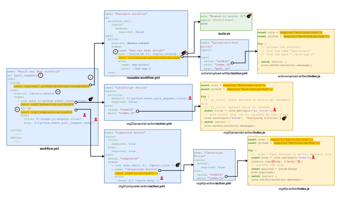
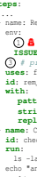
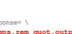
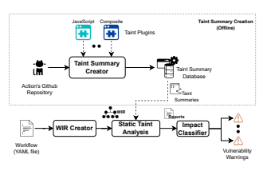
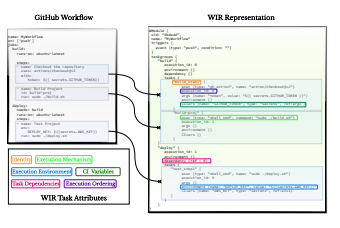
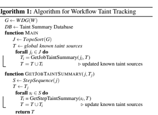
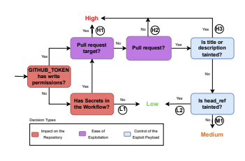
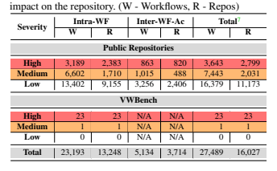
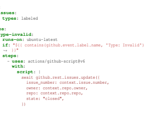
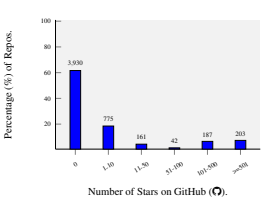

Argus: A Framework for Staged Static Taint Analysis of GitHub Workflows and Actions Siddharth Muralee, *Purdue University;* Igibek Koishybayev, Aleksandr Nahapetyan, Greg Tystahl, and Brad Reaves, *North Carolina State University;* 
Antonio Bianchi, *Purdue University;* **William Enck and Alexandros Kapravelos,** 
North Carolina State University; Aravind Machiry, *Purdue University* https://www.usenix.org/conference/usenixsecurity23/presentation/muralee This paper is included in the Proceedings of the 32nd USENIX Security Symposium.

August 9–11, 2023 - Anaheim, CA, USA
978-1-939133-37-3 Open access to the Proceedings of the 32nd USENIX Security Symposium is sponsored by USENIX.

# Argus**: A Framework For Staged Static Taint Analysis** Of Github Workflows And Actions

Siddharth Muralee‡∗, Igibek Koishybayev†∗, Aleksandr Nahapetyan†, Greg Tystahl†,
Brad Reaves†, Antonio Bianchi‡, William Enck†, Alexandros Kapravelos†, Aravind Machiry‡
‡ *Purdue University, {smuralee, antoniob, amachiry}@purdue.edu*
† *North Carolina State University, {ikoishy, anahape, gttystah, bgreaves, whenck, akaprav}@ncsu.edu*

## Abstract

Millions of software projects leverage automated workflows, like GitHub Actions, for performing common build and deploy tasks. While GitHub Actions have greatly improved the software build process for developers, they pose significant risks to the software supply chain by adding more dependencies and code complexity that may introduce security bugs.

This paper presents ARGUS, the first static taint analysis system for identifying code injection vulnerabilities in GitHub Actions. We used ARGUS to perform a large-scale evaluation on 2,778,483 Workflows referencing 31,725 Actions and discovered critical code injection vulnerabilities in 4,307 Workflows and 80 Actions. We also directly compared ARGUS to two existing pattern-based GitHub Actions vulnerability scanners, demonstrating that our system exhibits a marked improvement in terms of vulnerability detection, with a discovery rate more than seven times (7x) higher than the state-of-the-art approaches.

These results demonstrate that command injection vulnerabilities in the GitHub Actions ecosystem are not only pervasive but also require taint analysis to be detected.

## 1 Introduction

Continuous Integration and Continuous Deployment (CI/CD) pipelines [29] have become ubiquitous in the software development lifecycle. They automate various software development processes, such as building, testing, and deploying code. There are several well-maintained CI/CD frameworks, including TravisCI [51], CircleCI [9], and Gitlab CI [43].

Since its introduction, the GitHub Actions platform has gained tremendous popularity due to its convenience over other public CI/CD providers [52]. Developers specify automation tasks using *GitHub Workflows*.

1 A key convenience is an ability to easily use third-party plugins called *Actions*,
∗Both authors made equal contributions to this work 1We use "Workflows" to refer to GitHub Workflows throughout this paper.

which bundle common tasks, such as checking out a repository. Actions enable developers to easily create Workflows by referencing Actions rather than specifying all of the steps [32].

Securing CI/CD pipelines is essential to supply chain security. Researchers have discovered various GitHub Workflows are vulnerable to code injection vulnerabilities [28, 31]. OWASP has also the Top 10 CI/CD security risks [39] to raise awareness on CI/CD vulnerabilities, defining Poisoned Pipeline Execution (PPE) as a specific type of code injection.

Static analysis is commonly used to detect vulnerabilities.

Recent works [7, 23, 33] have tried to find vulnerabilities in Workflows using pattern-matching. However, the complexity of a typical Workflow demands more sophisticated analysis to track the data flows that occur within it, particularly when detecting code injection vulnerabilities. The prior approaches also fail to analyze third-party Actions and reusable workflows, which are pervasive in the GitHub Actions ecosystem.

Consequently, prior approaches fail to identify many nontrivial vulnerabilities, as we show in Section 5.5.

Static Taint Tracking (STA) is a well-known technique for tracking untrusted (tainted) data flow and is effective for vulnerability detection [3,4,34,36,41,55]. This paper proposes an STA framework for holistic analysis of GitHub Workflows and uses it to detect code injection vulnerabilities. There are two key challenges for performing STA on Workflows:
1. *Non-linear execution semantics of Workflows:* At a high level, a Workflow consists of jobs, each with a sequence of steps. A job may depend on one or more other jobs and will only be executed after all its dependencies are complete. If there are no dependencies, multiple jobs can run concurrently. Additionally, there may be data flows between jobs, making it difficult to model the execution flow, requiring new Control Flow Graph (CFG) structures to perform flow-based static analysis.

2. *Handling interactions with third-party Actions:* Workflows reference Actions by specifying their repository and input parameters. Actions can generate outputs, access untrusted input, and pass data to sensitive sinks. Outputs of an Action are used by workflows to perform other tasks or as input to additional Actions. For effective STA, tracking data flow through Actions requires the context of a Workflow.

In this paper, we present the ARGUS2framework for staged static taint analysis of GitHub Workflows and Actions. AR- GUS identifies code injection vulnerabilities by untrusted taint sources to sensitive taint sinks derived from GitHub documentation [19] and language libraries [46]. A key component of ARGUS is its Workflow Intermediate Representation (WIR), which tackles the first challenge by uniformly capturing the Workflow execution flow, irrespective of the complex and evolving specifications. We handle third-party Actions (the second challenge) by decoupling their flow behavior from implementation. Specifically, we create programming-languagespecific plugins that analyze Actions and create taint summaries describing which inputs flow to which outputs. The summaries are created offline and stored in a *Taint Summary* Database. To analyze a given Workflow, ARGUS uses the WIR to track the flow of tainted data across steps according to the execution flow. When a step references an Action, AR-
GUS uses its taint summary and stitches in the taint tracking information. Finally, ARGUS raises an alert whenever tainted data reaches a sensitive sink. We further rank each alert based on its impact on the underlying repository.

We performed a large-scale evaluation on 2,778,483 Workflows (1,014,819 repositories) referencing 31,725 Actions, and ARGUS raised alerts on 27,465 Workflows (16,003 repositories). We selected 5,643 workflows for manual verification and confirmed the presence of code injection vulnerabilities in 5,298 workflows. Out of these, 4,307 (High and Medium severity) could be exploited to compromise the underlying repository. We also identified 80 vulnerable Actions, which render any Workflow that uses them vulnerable.

We also directly compared ARGUS to two state-of-the-art pattern-based GitHub Actions vulnerability scanners, finding seven times more vulnerabilities.

We make the following contributions in this paper.

- We designed a Workflow Intermediate Representation
(WIR) that provides a uniform representation of GitHub Workflows.

- *We propose* ARGUS, the first static taint tracking framework for GitHub Workflows. ARGUS works on the WIR and uses taint summaries to track flow across Actions. ARGUS will be publicly available upon publication.

- *We demonstrate the scalability and effectiveness of* AR-
GUS by performing a large scale evaluation on 2,778,483 Workflows and 31,725 Actions. We found code injection vulnerabilities in 5,298 Workflows and 80 Actions.

## 2 Background

A GitHub Workflow is defined as a YAML file in the .github/workflows directory of a repository. This section uses Figure 1 to describe Workflow components and execution and why analysis is nontrivial.

## 2.1 Workflow Components

A Workflow represents a group of tasks and their execution ordering, *e.g.,* workflow.yml in Figure 1. Each Workflow is composed of jobs listed under the **jobs** key. A job can use other Workflows (called Reusable Workflows) as indicated by 1 . However, a job is usually composed of a sequence of steps listed under the **steps** key. Steps form the basic unit of computation. A step can either (a) be a shell command, as indicated by s in reusable-workflow.yml, or (b) reference an Action, as indicated by a .

Actions enable code reuse inside Workflows. A step references actions with the **uses** keyword. The reference should be to a public repository containing code for the corresponding Action. For example, org2/javascript-action@v2 resolves to code in the github.com/org2/javascript-act ion respository under the tag v2. GitHub has a marketplace where developers can discover Actions.

GitHub supports three types of Actions. JavaScript Actions are written in JavaScript and can use npm packages. In Figure 1, org2/javascript-action/action.yml is an example of JavaScript Action. Most of the standalone actions are JavaScript-based [33]. Composite Actions combine commands and Actions. They are specified in a similar manner to Workflows. In Figure 1, org3/composite-action/action.yml shows an example Composite Action. Finally, *Docker Actions* use an implementation of a Docker container, which may be referenced directly from DockerHub or from the repository containing the Dockerfile. This paper focuses on JavaScript and Composite actions, because (a) Docker Actions contain arbitrary binaries, and (b) 70% of Actions in our dataset are either JavaScript or Composite Actions (Table 2).

## 2.2 Workflow Execution

Workflows are executed in response to specific events. Event triggers are specified using the on keyword as indicated by T in Figure 1. For instance, the Workflow in Figure 1 is executed when a pull_request occurs for the containing repository.

When triggered, the GitHub runner [20] executes jobs based on the configuration. Job Dependencies: A job can depend on other jobs, specified using the **needs** keyword. A job will be executed only when all of its dependencies finish executing. Multiple jobs can run in parallel if there is no dependency relation. For instance, the build and scan jobs in workflow.yml of Figure 1 will run in



parallel as there are no dependencies. Each job is executed in an isolated virtual machine, having a configuration specified by using the **runs-on** keyword (*e.g.,* m in Figure 1). For instance, the build job in Figure 1 will be executed on an ubuntu-latest VM. Executing a Job: For each job, all steps are executed sequentially within the same virtual machine. If one step fails, the next will not be executed, unless specified otherwise. During the execution of an individual step, the runner will first set up an environment for it and spawn a new process. For example, if a step is a NodeJS action, the runner will spawn a NodeJS process and call the entry point of the action. Similar setups will be performed for Docker actions and shell commands. Communication between Steps: The steps can communicate through the runner. For example, a step can produce an output variable using the **::set-output=<name>=<value>** keyword. Another step can consume that output by referencing steps.<id>.outputs.<output_name>. After the execution of a step, the runner will check if the step created any outputs, environment variables, or artifacts. If so, the runner will store their values and pass them to the relevant next steps.

Triggering Event Data: A Workflow triggering event usually contains data associated that can be controlled by the user who triggered the event. For example, the title text associated with an issue_open event (*i.e.,* github.event.issue.title)
can be controlled by the user who opened the issue. In the same manner, the source branch name (github.head_ref) of a pull request event can be externally controlled. However, there are certain data elements that the user does not directly control, *e.g.,* the issue number of an issue_open event. The event data can be used by any component of a Workflow, as indicated by w in Figure 1.

## 2.3 Workflow Secrets And Permissions

Developers might need to access sensitive information in a Workflow, such as AWS keys to automatically deploy the latest version of a website. GitHub provides the *secrets* feature [15], enabling developers to securely use sensitive information in a Workflow. Specifically, repository owners can store sensitive information using secrets (key-value pair), *e.g.,* AWS_KEY=abcd12dfs. These can be used in a Workflow by their name (*i.e.,* key), *e.g.,* **${{ secrets.AWS_KEY }}**. During Workflow execution, these references will be replaced by the corresponding value. Furthermore, as shown by the recent work [33], values of all secrets referenced in a Workflow are stored in a file on the runner.

GITHUB_TOKEN: For each Workflow run, GitHub automatically generates a temporary access token called GITHUB_TOKEN. This enables Workflows to interact with the repository and carry out specific operations such as pushing changes, creating releases, adding labels and tags, etc. This token can be accessed using the GitHub context, denoted as ${{github.token}}.

Permissions: By default, GitHub assigns the GITHUB_TOKEN
read/write permissions across all scopes 3. Users can also modify permissions of GITHUB_TOKEN for a specific workflow using the **permissions** keyword within workflows. This keyword can be utilized both at a workflow level as well as at a job level.

Access Based on Triggers: Workflows triggered because of a forked repository (*e.g.,* pull request from a fork) will not have access to any repository secrets (Even if they are specified in the Workflow) and GITHUB_TOKEN will have only *read-only* access. Developers can avoid this by using pull_request_target trigger, which also triggers Workflows on pull requests, but in addition, the Workflow will have default privileges for GITHUB_TOKEN and access to secrets - same as other triggers. The Table 1 summarizes a Workflow's access to secrets and GITHUB_TOKEN permissions based on triggers. Intra-repository pull request: During our experiments, we found an *undocumented* feature that GitHub allows arbitrary users to raise pull requests between different branches of the same repository, *e.g.,* merging dev to main. This clearly violates the pull-request policy [10], which requires the user to have write access to either source or destination. Furthermore, as shown in the second column of Table 1, Workflows triggered because of such pull requests have privileged GITHUB_TOKEN and access to secrets. We provide details of this behavior in Appendix A.1.

## 3 Motivation And Threat Model

Listing 1 shows a real-world code injection vulnerability (discovered by ARGUS) in the issue_type_predicter.yaml Workflow of the DynamoDS/Dynamo [12] repository (1,300 stars). The Workflow can be triggered by opening an issue, the body of which can be controlled by an attacker. The untrusted input github.event.issue.body (w) is first saved into an environment variable ISSUE_BODY ( 1 ). Next, it is passed as input to the frabert/replace-string-action@v1.2 action ( 2 ), which replaces " with - and returns the output through a variable named replaced ( 3 ). Later, replaced is used in a shell command ( 4 ). While the string replacement prevents the attacker from terminating the ",
it does not prevent the attacker from performing a command substitution attack. For example, an attacker can exploit the vulnerability by opening an issue and using $(set +e; curl evil.com?token=$GITHUB_TOKEN;) as the issue body to exfiltrate the GITHUB_TOKEN.

3GitHub in Feb 2023, reduced the permissions for GITHUB_TOKEN to
'read-only' by default for all *newly-created* repositories [11].

```
name: Issue Predicter
on:
 issues:
   types: [opened,edited]
jobs:
 issuePredicterType:
   name: Issue Predicter
   runs-on: ubuntu-latest
   ...
   steps:
    ...
    - name: Remove conflicting chars
     env:
        1 w
       ISSUE_BODY: ${{github.event.issue.body}}
      3 # produces output with the name: replaced
     uses: frabert/replace-string-action@v1.2
     id: rem_quot
     with:
        pattern: "\""
        string: ${{ 2 env.ISSUE_BODY}}
        replace-with: '-'
    - name: Check Information
     id: check-info
     run:
       ls -la
     echo "analysis_response= \
        $(.. "${{ 4 steps.rem_quot.outputs.replaced}}"..)"



```



Listing 1: Snippet of the issue_type_predicter.yaml Workflow in the DynamoDS/Dynamo [12] repo demonstrating an Arbitrary code execution vulnerability requiring Inter-
Workflow-Action analysis - newly found by ARGUS.

| Sensitive         | Pull request   | Other     |         |
|-------------------|----------------|-----------|---------|
| Component         | b/w branches   | Triggers  |         |
| from              |                |           |         |
| of the same repo  | fork           |           |         |
| GITHUB_TOKEN      | default        | read-only | default |
| Access to Secrets | YES            | NO        | YES     |

To find this vulnerability through static taint tracking, we need to track the flow of the tainted values within the Workflow to correctly determine that replaced contains a tainted value. Doing so requires analyzing the frabert/replace-string-action@v1.2 Action. Finally, we should track the flow of this output to the echo command
(a sensitive sink). In summary, this analysis requires tracking tainted data flow across all the components of a Workflow.

## 3.1 Threat Model

As suggested by OWASP [39] recommendations for building a secure CI/CD pipeline, we assume that an attacker should not be able to: (i) execute arbitrary commands on the server where the pipeline is executed, without visible code changes;
(ii) gain unauthorized read/write access to the repository (violating GitHub privilege model); and (iii) exfiltrate confidential secrets. Hence, if an attacker can achieve any of these malicious goals, we assume a Workflow to be vulnerable. Attacker Capabilities: We make the assumption that an attacker can trigger a Workflow and alter any user data that is part of the event. For instance, for the issue_open event in Figure 1, the attacker can control the content of github.event.issue.body (i.e., the body of the issue) but not the issue number, which is auto-generated by GitHub. The complete list of event data that can be manipulated by an attacker is displayed in Table 12 (in Appendix).

Impact: Arbitrary code execution in CI/CD platforms has a severe impact, including performing supply chain attacks [50] that silently inject vulnerabilities into a repository [27], bitcoin mining [21], and DDoS attacks.

The presence of sensitive information, such as secrets and GITHUB_TOKEN (Section 2.3), further increases the severity of arbitrary code execution vulnerabilities. For example, an attacker can exfiltrate GITHUB_TOKEN with a read/write scope and silently push malicious code into the repository resulting in invisible attacks [37]. There can be cases where Workflows have reduced permissions for GITHUB_TOKEN, *e.g.,* using **permissions** keyword or if the trigger is a pull
_request from a fork. In such cases, code execution vulnerabilities have a limited impact on the repository.

## 4 Argus **Design**

This section presents ARGUS's design and the details of the staged static taint analysis algorithm. Figure 2 depicts an overview of our approach. There are two main components in ARGUS: Taint Summary Creator and Workflow Analysis.

The Taint Summary Creator is an offline or on-demand component that is executed for every unique Action or a reusable Workflow. We store these summaries in a Taint Summary Database, which will be used during the Workflow analysis.

Given a Workflow, we convert it into its Workflow Intermediate Representation (WIR) representation. Then, we construct the Workflow Dependency Graph (WDG) from the created WIR and perform taint analysis by traversing the WDG. At each step, we propagate taint according to its inputs and output. If a step references an Action, we will use the Action's taint summary and stitch the taint flow. However, if there are no pre-stored taint summaries for an Action, ARGUS will generate it on the fly. Lastly, if ARGUS identifies tainted data being utilized in a sink, it categorizes the vulnerability based on its potential impact and subsequently generates a report for the user.

## 4.1 Taint Sources And Sinks

In this section, we define the *taint sources* and *taint sinks* that we are going to use throughout our taint analysis.



## 4.1.1 Taint Sources

As explained in Section 2.2, Workflows are triggered through events, which might contain associated data. We consider taint sources as all the data associated with an event that can be completely controlled by the user triggering the event. For instance, we consider the issue body to be a taint source for an issue event (triggered when a user opens a issue in a GitHub repository). We do not consider the issue number as a taint source as it is auto-generated by GitHub, and, for this reason, not-controllable by a user.

We analyzed the GitHub documentation [19] and identified all user-controllable data fields of each triggering event. Note that in some cases, there might be limitations on which fields can be controlled, such as intra-repository pull requests (Appendix A.1).

We consider all these data fields as taint sources. Table 12
(in Appendix) provides the complete list along with the number of Workflows using each taint source.

GitHub also enables JavaScript Actions to use event data through acccesing a Context object. We also handle this feature by mapping members of this object to the corresponding event data fields (Table 13 in Appendix).

## 4.1.2 Taint Sinks

As mentioned in Section 3, in CI/CD pipelines, we do not want an attacker to be able to execute arbitrary commands as part of a Workflow. This is important in GitHub CI, where the runner executes Workflows with sudo privileges. Consequently, an attacker with the ability to execute arbitrary commands as part of a Workflow has complete control of the machine and the Workflow environment. Furthermore, by default, the GITHUB_TOKEN available in a Workflow execution environment has the privilege to modify its parent repository (*i.e.,* change the source code, add/delete artifacts, tags, branches, etc.), thereby enabling supply chain attacks.

For these reasons, our taint sinks involve all entities enabling command execution. In the case of workflows, we consider every **run:** statement as a sink, as they are used to construct a bash script (as depicted in Figure 1). As for JavaScript, all functions capable of running arbitrary commands are classified as sinks.

## 4.2 Taint Summary Creator

As mentioned before, this component generates taint summaries for Actions or, more in general, any component that a step can reference, such as a composite Action or a reusable Workflow (as shown in Figure 1). Based on the type of Action, we follow different methods, which we call **Plugins** (see Figure 2). The generated summaries are saved in a database and will be used by the Workflow analysis component.

## 4.2.1 Composite Action

This type of Actions contains a sequence of steps. In this case, we generate a summary by combining the summaries of each step. For instance, consider a step that contains a sequence of shell commands under the run key. We analyze each of these commands to see if any of these commands use a tainted value or produce any output. ARGUS
uses regexes to parse the commands to look for output variables and stores the output as tainted if any input is tainted. We focus on the two common ways a run step can set outputs. (1) echo "::set-output name=value::" (deprecated, but still in use); (2) echo "name=value" >> $GITHUB_OUTPUT. We only consider cases where the value is a template string (${{}}), *e.g.,* "OUT=${{TVAR}}". If the variable used as part of the value is tainted (*i.e.,* TVAR), then we consider the output variable (*i.e.,* OUT) tainted. Similar steps are performed for environment variables. If a step references a JavaScript Action, then we will get its taint summary (or create one if it does not exist in the database) and stitch the taint flow. Finally, we will save the taint summary in the database.

## 4.2.2 Javascript Actions

This type of Actions (which is the most common) uses JavaScript code to perform its functionality. To handle it, we developed a dedicated static flow analysis using CodeQL [6], a framework that converts code into a relational database and enables easy implementation of static analysis techniques as relational queries. Also, CodeQL supports all Node JS versions that are supported by GitHub CI.

We first defined the taint sources (Table 13 in Appendix)
and dangerous sinks in JavaScript. As a taint source, we defined all the JavaScript-specific APIs that can be used to read from taint sources, *e.g.,* the getInput function from the "@actions/core" library, as shown in Figure 1.

Then, we defined specific JavaScript APIs that are used to generate (1) output for other steps to consume, and (2) new code and/or commands as taint sinks. For example, in Figure 1 the "org2/javascript-action/index.js" file

```
1 CommitMessage: core.getInput('commit_message'),
2
3 const commitMessage = getCommitMessage(
4 inps.CommitMessage,
5 ...
6 );
7 await commit(inps.AllowEmptyCommit, commitMessage);
8
9 export async function commit(allowEmptyCommit: boolean, msg:
      ,→ string): Promise<void> {
10 ...
11 await exec.exec('git', ['commit', '-m', `${msg}`]);
12 ...
13 }

```

Listing 2: The peaceiris/actions-gh-pages [40] action uses an input argument ('commit_message') in the exec function, but this is not vulnerable as it's provided as a list of options uses the setOutput function to set new output, and, in the "org4/js-action/index.js" file, a tainted source reaches the infamous eval function.

Our CodeQL queries will search if there is a dataflow path from any of the taint sources to a dangerous sink. We run the CodeQL query before analyzing the workflow to create a map of all taint sources into all taint sinks seen in the JavaScript Action and store the results in the database. The final summaries of the JavaScript actions will include a list of new taint sources created by using setOutput-like functions and a list of taint sinks reached by the given taint sources.

Handling Sanitization: We take care of implicit sanitizations that occur because of using tainted values in composite data structures such as a list (Listing 2) using pattern matching. We ignore explicit sanitizations, such as if-conditions, because
(i) the majority of actions are small with simple data flows and do not perform any sanitization; (ii) Identifying valid sanitization routines is hard and, if performed incorrectly, could result in false negatives. The high precision of our taint analysis, as shown in Section 5.2, demonstrates that ignoring explicit sanitization is a reasonable design choice.

## 4.3 Workflow Analysis

Given a Workflow, we first convert it to WIR and generate its WDG. Next, we analyze the WDG and track taint flows.

Workflow Intermediate Representation (WIR): The main design principle of WIR is to have a generic representation to specify job dependencies and data used and produced by each step along with its execution environment. Figure 3 shows an example of a Workflow and its WIR representation. We use taskgroups to represent jobs. Each taskgroup has a numerical identifier execution_id which is used to encode dependency. As shown on the left of Figure 3, the job deploy depends on the build job as indicated by its name specified under needs key. In WIR, this gets translated as dependency under the "deploy" taskgroup where the execution_id of the build taskgroup is used.

Each step is called task. Each task has the following

 

## Figure 3: Overview Of Wir.

categories of attributes: (i) *Identity*: it includes the name and other grouping attributes that identify a task. (ii) Execution mechanism (exec): it includes all the information on "how" the task will be executed (*e.g.,* through shell command or GitHub Actions). (iii) *Execution environment*
(environment): it contains the set of environment variables accessed by the task. (iv) *CI Variables* (CIvars): it contains the set of all GitHub variables accessed by the task. (v) *Inputs and Outputs* (inputs and outputs): they represent, respectively, the inputs provided and the variables containing the output values of a task. (vi) *Execution Ordering* (execution_id): it represents the relative order in which the task is executed within the task group. Workflow Dependency Graph: The Workflow Dependency Graph (WDG) is a directed acyclic 4super graph that captures the order in which the various components of a Workflow will be executed. As mentioned in Section 2.1, Workflows can have one or more jobs, that can be executed in parallel or in an order specified by their dependencies. Each job consists of one or more steps that are executed in sequence. The WDG captures the order in which jobs are executed. Each job, in turn, is represented by a StepSequence, a linear sequence representing the control flow order between steps.

Formally, a *Workflow Dependency Graph (WDG)* of a Workflow w is represented as WDG(G) = {J,E}, where:
fl 1. J = { j1*,...,* jn} is a set of nodes representing jobs in the Workflow.

2. E = {(jx, jy) | jx ∈ J ∧ jy ∈ J} is a set of edges, where each tuple (jx, jy) indicates a directed edge from job jx to jy.

Each edge (jx, jy) ∈ E indicates that the job jy is dependent on jx, and thus, jx will be executed before jy. Every job j ∈ J
includes a StepSequence, dictating the execution order of its individual steps.

4Cyclic dependencies between jobs are not allowed by GitHub

## 4.3.1 Workflow Taint Tracking

We follow a staged approach to perform taint tracking. Listing 1 shows the pseudocode of our taint tracking algorithm. Given a Workflow W, we compute its WDG. Next, we get a topological order (TopoSort) of the jobs in WDG representing the execution order of the jobs. When we have multiple topological orders, we randomly select one, because job dependencies with directed edges, and the results will be the same for all valid topological orders. We initialize our taint sources to the initial set of variables shown in Table 12.

For each job j, we call GetJobTaintSummary, which computes the taint summary for j given the current set of tainted variables Tj. The function GetJobTaintSummary returns a summary of additional tainted variables created after analyzing j with Tj. We add Tjto T and continue on to the next jobs.

The function GetJobTaintSummary uses the StepSequence to get the steps of the given job j in sequential order. Then, it analyzes each step s by calling GetStepTaintSummary on s with the current taint state. The GetStepTaintSummary also returns a taint summary of additional tainted variables because of s. The summary will be added to the current taint state and the analysis will continue to the next steps.

The GetStepTaintSummary function checks if a step s is a list of run commands, in which case the commands will be processed as mentioned in Section 4.2.1. If the step references an Action, then the ApplyTaintSummary function will be invoked. This function fetches the taint summary from the database (DB). The summary will be instantiated with the current taint state T to get the new taint state in terms of additional tainted variables. We use scopes to group tainted variables according to the job that produced them. This allows our taint analysis to be precise by ensuring that tainted variables within a job are only visible to its steps, which is the expected behavior.

In the end, we check all taint sinks and see if any of the variables used is part of T. If this condition is true, we emit a warning describing the use of tainted variables at a risky sink.

## 4.4 Impact Classifier

The final step of our system is the Impact Classifier. The goal of this step is to assign severity to each Workflow vulnerability based on three aspects: impact on the repository, ease of exploitation, and control of exploit payload. The Figure 4 shows the decision procedure to classify vulnerabilities.

GITHUB_TOKEN: We use the permissions defined at the Workflow level (*e.g.,* using **permissions** keyword) to determine whether the token has write permissions or is read-only.

Low: We classify all vulnerabilities that have *no impact on* the repository as Low severity. There are two cases: (L1)
Workflow is configured with a read-only GITHUB_TOKEN and has no secrets. (L2) The trigger is a pull_request, and the



function GETSTEPTAINTSUMMARY(s,Ts)
T ← Ts if *s is run* **then**
▷ Process bash commands T = ProcessBashCommands(s, T)
else
▷ Apply taint summary T = ApplyTaintSummary(DB, s, T)
return T
tainted data is head_ref (*i.e.,* branch name) - this requires a pull request from a fork with an attacker-controlled branch name, *e.g.,* Listing 3. As explained in Section 2.3, Workflows triggered from foreign branches do not have access to readonly GITHUB_TOKEN and no access to secrets. High: We classify vulnerabilities impacting the repository
(write access GITHUB_TOKEN or has secrets) as High if the exploitation is easy and does not require maintainer approval. We consider all Workflows with non pull request targets easy to trigger and classify vulnerabilities as High severity (marked as H1 and H2). Even for pull_request trigger, vulnerabilities caused by the title or description can be easily exploited by raising an intra-repository pull-request, and, for this reason, we consider them as High severity (marked as H3), *e.g.,* Listing 6. As mentioned in Section 2.3, Workflows triggered this way have privileged access to the repository and do not require maintainer approval (Appendix A.1). Medium: Finally, as indicated by M1, we consider Medium severity vulnerabilities those that can impact the repository, but triggering the corresponding Workflow requires maintainer approval. For instance, pull_request or push Workflows with taint sources, such as commits.*.author.email (commit author's email) or commit.message (commit message), can only be exploited if the maintainer first approves pull requests without verifying these parameters. After the pull request has been merged, the attacker can raise another intra-repository pull_request from the branch containing the merged commit - thereby controlling the taint sources and having access to write-access GITHUB_TOKEN and secrets.

 

Figure 4: Decision process of Impact Classifier.

on: pull_request
jobs:
build:
runs-on: macos-latest
steps:
...
- name: Update version
uses: reedyuk/write-properties@v1.0.1
with:
 ```  then: 'grade_properties' property: 'version' github.head_ref <- [] value: "\$[{steps.read_version.outputs.value}]-\$[{] $\Rightarrow$ github.head_ref }]-\$[{env.short_sha_}]" ```
Listing 3: GitLiveApp/kotlin-diff-utils [25] contains a workflow vulnerable to *Low severity* Code Injection as it passes Tainted Data (github.head_ref (w)) as the argument for value parameter to the Action (Listing 9) that directly uses it in exec (unsafe sink).

## 5 Evaluation

We evaluate ARGUS by answering the following questions.

Q1 (*Taint Analysis on Actions*): How accurately can our Plugins perform taint analysis on Actions? What is precision and recall?

Q2 (*Taint Analysis on Workflows*): How accurately can AR-
GUS perform taint analysis on Workflows? What is the precision, recall, and performance of our analysis?

Q3 (*Vulnerability Identification*): How effective is ARGUS
at finding vulnerabilities? What is their security impact?

Q4 (*Comparative Evaluation*): How effective is ARGUS
compared to existing state-of-the-art vulnerability detection techniques?
5This count does not include 79 actions due to them being taken down by the time of analysis and one action due to cloc failing to run on the repository

| Workflows   | Repos     | Actions        |        |    |      |
|-------------|-----------|----------------|--------|----|------|
| Type        | Num       | Analyzable     |        |    |      |
| JavaScript  | 22,433    | 22,433 (100%)  |        |    |      |
| Composite   | 9,292     | 9,292 (100%)   |        |    |      |
| 2,778,483   | 1,014,819 | Docker         | 13,445 | 0  | (0%) |
| Total       | 48,369    | 31,725 (70.2%) |        |    |      |

Table 2: Dataset 1: Public Repositories Table 3: Source Line of Code (SLoc) stats for Dataset 1.

| Component   | SLoc Stats (KLoc)   |        |         |        |         |
|-------------|---------------------|--------|---------|--------|---------|
| Min         | Avg                 | Median | St. Dev | Max    |         |
| Workflows   | 0.006               | 0.1041 | 0.058   | 0.1539 | 5.2     |
| Actions 5   | 0.001               | 67.60  | 6.935   | 272.88 | 8,146.2 |

## 5.1 Datasets And Experimental Setup

Dataset 1 (*Public Repositories*): GitHub's rate-limiting policy for its direct search functionality prevented us from simply scraping all of GitHub to get workflows from all public repositories. We overcame this limitation by (1) querying all public repository names from the GHArchive [17] database on November 2022, and then (2) using those repository names and fetching the latest version from GitHub during November- December, 2022. We extracted *Workflows* from each repository by traversing the .github/workflows directory and collecting all Workflow files (*i.e.,* .yml). Each repository can have multiple Workflows. Shown in Table 2, we collected 2.7M Workflows in 1M unique repositories. We also extracted all *Actions* referenced by each Workflow. An action can have multiple versions (*e.g.,* actions/checkout@v2 and actions/checkout@v3), and Workflows can refer to different versions of the same Action. We analyzed every version of an Action that is referenced by a Workflow in our dataset.

Table 2 shows the total number of action/version combinations corresponding to their types. Finally, Table 2 shows the total number of analyzable actions by ARGUS. Even without handling Docker actions, ARGUS could analyze 70% of the actions. Statistical details of the sizes of Workflows and Actions are shown in Table 5.

Dataset 2 (VWBENCH): We collected previously reported vulnerable workflows [28, 31] to create a ground truth vulnerable dataset of 24 workflows, which we call VWBENCH. These Workflows have unsafe sinks to which tainted data can flow, resulting in command injection vulnerabilities. Experimental Setup: We performed all our experiments on an Intel(R) Xeon(R) Gold 5120 CPU with 128GB RAM. We set a time limit of 5 minutes for analyzing each Workflow and a time limit of 30 minutes for analyzing each Action. Most of the Actions (80%) finished within in 3 minutes. As mentioned previously, the Action summaries are computed 6We only count total number of unique workflow here, as some workflows may have both multiple sinks or sources Table 4: Results of Taint Analysis on Actions.

Table 5: Precision of Taint Analysis by ARGUS on Actions.

| Type    | Source    | Sink          | Number of Actions   |       |       |
|---------|-----------|---------------|---------------------|-------|-------|
| JS      | Comp.     | Total         |                     |       |       |
| Input   | Input     | Code Exec     | 3,218               | 5,465 | 8,683 |
| Flow    | Arguments | Arb. File R/W | 2,099               | N/A   | 2,099 |
| Direct  | Tainted   | Code Exec     | 27                  | 109   | 136   |
| Flow    | Values    | Arb. File R/W | 0                   | N/A   | 0     |
| Total 6 | 5,219     | 5,574         | 10,918              |       |       |

Type Javascript **Composite**
TP FP Precision TP FP **Precision**
Input Flow 138 10 93.2 % 46 1 97.9 %
Direct Flow 27 0 100 % 109 4 96.4 % Cumulative 175 10 94.2 % 155 5 96.8 %
offline once for every version of the Action. These summaries are referenced while analyzing Workflows that uses them.

## 5.2 Q1: Taint Analysis On Actions

ARGUS supports JavaScript and Composite actions, which are of 70% of all Actions in our dataset of public repositories (Table 2). For these Actions, Table 4 shows our taint analysis results categorized by the types of sources and sinks. As this evaluation considers Actions in isolation, the table differentiates *input flows* (where an argument to the action flows to an unsafe sink) and *direct flows* (where the Action consumes an attacker controllable taint source that flows to an unsafe sink). Table 6 shows the Top-5 taint sources and sinks used in Actions. Notably, the issue title is one of the top taint sources, and exec is the most popular sink, indicating the prevalence of arbitrary code execution vulnerabilities. We manually verified all the taint summaries for direct flows and all input flows which were passed tainted values, as shown in Table 5. We further grouped root causes by unique Actions and ignoring versions. For example, embano1/wip@v1 and embano1/wip@main are counted as a single unique action. We found that 80 Actions (146 including versions), contained *direct flow* vulernabilities. Precision: As depicted in Table 5, we achieve a precision of 94.2% for Javascript actions. Our false positives arose in cases where, even though the taint flow was accurate, there were checks in place that prevented an attacker from triggering the taint path (e.g., Listing 4).

In contrast, composite Actions had a precision of 96.8%.

The false positives primarily resulted from insufficient handling of specific embedded sanitization constructs, e.g., toJson. Recall: There is no ground truth for taint flows in Actions.

Therefore we used random sampling to compute an approximate metric for recall (true negatives). Specifically, we randomly picked 100 actions that were considered safe by our

| Table 6: Top-5 Taint sources and sinks used in GitHub Actions Taint Sources Taint Sinks (% of Total) (% of Total) github.head_ref (59.64%) exec (49.73%) github.event.pull_request.head.ref (15.10%) spawn (13.28%) github.event.head_commit.message (9.90%) downloadTool (12.99%) github.event.pull_request.title (4.95%) execSync (9.66%) github.event.issue.title (3.91%) spawnSync (4.46%)   |
|--------------------------------------------------------------------------------------------------------------------------------------------------------------------------------------------------------------------------------------------------------------------------------------------------------------------------------------------------------------------------------------------------|

const vercel_bot_name =
,→ core.getInput('vercel_bot_name');
if (comment.user.login !== vercel_bot_name) { µ await cancelAction(); *// exit*
} ... const regex_matches =
,→ comment.body.match(preview_url_regexp); w
...

const vercel_preview_url = regex_matches[1];
if (vercel_preview_url) {
.... core.setOutput('vercel_preview_url',
,→ vercel_preview_url); ï Listing 4: Simplified snippet from binary-com/vercel-previewurl-action [8] Action that contains a sanitization check (µ) before the tainted value (w)–flows into a output funciton (indicated by ï) which is not detected by ARGUS
analysis and manually verified how many of these are indeed safe, *i.e.,* whether any flow identified is missed by ARGUS. Input Flow Examples: Listing 5 (Reedyuk/writeproperties [42]) and Listing 9 (embano1/wip [14] show an example of a Composite and JavaScript Action with input flows newly discovered by ARGUS. The figures annotate input values () and the unsafe sinks (F) to where they flow.

It is important to note that these Actions are only vulnerable when used by a Workflow that allows adversarially-controlled values to pass to the input variables. Listings 6 and 3 show real-world Workflows that use these Actions in a vulnerable way. These examples show the necessity of static taint analysis across Workflows. Without the context of Listing 5, it is not possible to know that Listing 6 uses the default value for inputs.title. Similarly, Listing 3 is needed to know that Listing 9 is passed github.head_ref. We also consider flows from both input arguments and tainted context into output functions such as core.setOutput, that allow it to be used in the future, by the workflow as input flow itself.

Direct Flow Examples: Listing 7 (94dreamer/createreport [1]) shows an Action where the known taint source context.payload.issue.title is directly used in exec.

Any Workflow that uses this Action is vulnerable, regardless of whether or not it uses a known taint source itself. The vulnerable example Action in Listing 7 is used by 64 Workflows, including Tencent/tdesign-vue [47] (Listing 8). We

```
name: "Check WIP"
description: "Checks for WIP patterns in Titles"
...
inputs:
 title: 
   description: "Text to perform pattern match against"
   required: true
   default: "${{ github.event.pull_request.title }}" w
 regex:
   ...
runs:
 using: "composite"
 steps:
   - shell: bash
    run: |
      set -ex
      ...
      F
      if [[ '${{ inputs.title }}' =~ ${{ inputs.regex }} ]]; then
     ...

```

Listing 5: Simplified snippet of embano1/wip [14] composite Action that uses input argument title () in a run command (unsafe sink) indicated by F. Also, note that by default, the Action uses a tainted value (w) for title.

name: Check "WIP" in PR Title

```
on:
 pull_request:
   types: [opened, synchronize, reopened, edited]
jobs:
 wip:
   runs-on: ubuntu-20.04
   steps:
     - name: Check WIP in PR Title
       uses: embano1/wip@v1 a

```

Listing 6: Snippet of a workflow in vmware/govmomi [54] repo that has an *High severity* Arbitrary Code Execution vulnerability because of an Inter-WF-Ac flow. The workflow uses
(indicated by a) embano1/wip@v1 Action (Listing 5) with no arguments. However, the Action uses a user-controllable (tainted) default value for an argument resulting in Arbitrary code execution. found many other examples, including Actions from verified organizations, *e.g.,* tj-actions/branch-names [49], that directly use tainted data (*e.g.,* github.head_ref) into an exec sink, making any Workflow using it vulnerable.

## 5.3 Q2: Taint Analysis On Workflows

ARGUS's taint analysis of a Workflow combines the taint summaries of the Actions used by the Workflow. Table 7 shows our Workflow taint analysis results categorized by the flow type and severity. The table differentiates two types of flows. Intra-Workflow (Intra-WF) flows occur when the taint is passed within the Workflow itself. In contrast, Inter-Workflow-Action (Inter-WF-Ac) flows occur when the taint sink is passed through or originates from an Action.

Section 5.2 showed several real-world Inter-WF-Ac examfunction renderMark() {
return > **${context.payload.action === 'reopened' ?

context.payload.sender.login + 'issue' : 'issue'}**
> **:** ${context.payload.issue.title} w
..

} const markdownString = renderMark(); ï exec(
`curl ${wxhook} \
-H 'Content-Type: application/json' \ -d ' {
...

"markdown": {`
F
`"content": "${markdownString.replaceAll('"',
,→ "'")}"
}
}'`...

);
Listing 7: Simplified snippet from 94dreamer/create-report
[1] Action that unsafely has tainted value (w)–flowing (ï)– into an exec function (indicated by F).

name: Issue Synchronize

```
on:
 issues:
   types: [opened, reopened]
jobs:
  ...
   steps:
     - uses: 94dreamer/create-report@main a
       with:
         wxhook: ${{ secrets.WX_HOOK_URL }}
         token: ${{ secrets.GITHUB_TOKEN }}
         type: 'issue'

```

Listing 8: Tencent/tdesign-vue [47] contains a workflow vulnerable to *High severity* Code Injection as it uses (indicated by a) the Vulnerable Action (Listing 7).

ples discovered by ARGUS. An example Intra-WF flow is shown in Listing 10. Even in this simple case, taint analysis is needed to identify the flow of information from the untrusted github.event.issue.title variable to the developer-defined env.ISSUE_TITLE variable.

ARGUS performed exceptionally well on our VWBench dataset (bottom of Table 7). It successfully and precisely found all the taint flows. This high performance is expected as these workflows contain Intra-Workflow taint flows, and our WIR helps precisely capture flows within a Workflow.

Severity: As mentioned in Section 4.4, we classify all the vulnerabilities into three classes, *i.e.,* High, Medium, and Low. The Table 7 show the distribution of vulnerabilities according to their severity. A few of these are because of the Intrarepository pull request capability (Section 2.3), Table 11 in 7We only count total number of unique workflow here, as some workflows may have both Intra-WF and Inter-WF-Ac flows const **property** = core.getInput('property'); 
console.log(`property:${property}`);
const **value** = core.getInput('value'); 
console.log(`value:${value}`); F exec(`grep -r "^[\#]*\s*${property}=.*" "${path}"`,
(grepError) => {
if(grepError != **null**) {
...

} **else** {
F exec(`sed -ir \
"s/^[\#]*\s*${property}=.*/${property}=${value}/" \
"${**path**}"`,
(error, stderr) => { ...

});
Listing 9: Simplified Snippet of Reedyuk/write-properties
[42] JavaScript action that uses both its inputs arguments () as arguments to exec function (indicated by F).

```
name: close
on:
 issues:
   types: [closed]
...
jobs:
   ...
   env:
    ISSUE_TITLE: ${{ github.event.issue.title }} w
   steps:
   - run: |
      F
      curl -d $'message=${{ env.ISSUE_TITLE }}
          ?\encircle{$t_{2}$}?' -H 'X-TYPETALK-TOKEN: ${{
          secrets.TYPETALK_TOKEN }}'
          https://typetalk.com/api/v1/topics/${{
          secrets.TYPETALK_TOPIC_ID }}
       ,→
       ,→
       ,→
       ,→

```

Listing 10: Snippet of a workflow in yagipy/habit-manager
[58] repo demonstrating *Intra-WF* flow by directly using Tainted Data (*i.e.,* github.event.issue.title w) through ISSUE_TITLE (environment variable) in a unsafe sink (shell run) resulting in *High severity* code injection. Appendix shows the classification excluding them. For workflows with multiple reports, we selected the highest severity report to represent the severity of the workflow. As Workflows (and repositories) can contain multiple vulnerabilities, numbers in Total columns (unique Workflows and repositories)
will be less than the sum of corresponding columns. *Most*
(60%) of the vulnerabilities are Low and have no impact on the repository. There are still a significant number (∼3K) of High severity vulnerabilities, which unauthorized attackers can exploit to gain privileged access to the underlying repository. This demonstrates the prevalence of the problem and the need for a system like ARGUS. Furthermore, it is not easy to fix these vulnerabilities. We present a detailed discussion in Appendix A.4.

Precision: Due to the large number of vulnerabilities identified in the Public Repositories dataset, we focused on sampling based on their severity. Specifically, we manually verified all 3,643 High severity vulnerabilities and randomly



Table 7: Severity Assignment of Vulnerabilities using the Method in Section 4.4 and the Low vulnerabilities have no

name: Docs ... jobs:
prepare_env:
steps:
... - id: skip-docs-comment name: Process comments on Pull Request to skip Docs if: ${{ github.event.issue.pull_request }} run: echo "::set-output name=value::$(echo ${{
contains(github.event.comment.body, '/skip-docs') }})"
,→ ,→
Listing 11: A false positive found by ARGUS in solo-io/gloo [45], where github.event.comment.body is inside a CI function which only returns a boolean sampled *1,000* each from Medium and Low severity vulnerabilities resulting in a total of 5,643. The Table 8 shows the results of our manual verification and precision across each severity. We found that 4,111 (92.65%) *Intra-WF* reports and 1,671 (94.89%) *Intra-WF-Ac* reports were true, resulting in an overall precision of 93.29%. An example of a false positive is shown in Listing 11. The two main reasons for false positives were: (1) not handling certain embedded sanitization constructs such as contains (similar to Actions);
and (2) failure to identify whether members of tainted objects
(*e.g.,* context.payload.issue) are indeed used in certain complex sinks.

Recall: To measure false negatives, we randomly samplied 100 workflows that were considered safe for manually verification. Similar to the Actions, we found all the results to the true. Again, this high performance is due to the fact that Workflows are usually small and have simple dataflows that can be precisely captured by our WIR.

## 5.4 Q3: Vulnerability Identification

In this section, we present previously unknown code injection and arbitrary code execution vulnerabilities detected by AR- GUS, as summarized by Table 8. The *input flow* and *direct flow* columns were explained in Section 5.2 along with corresponding examples. Many of the affected Workflows have the same root cause. For example, Tencent/tdesign-vue-next [48] and Tencent/tdesign-vue [47] both pass tainted data to the same Action and version (94dreamer/create-report [1]). The *Unique* Root Causes column in Table 8 shows the total number of unique root cause groups. The column *Unique Actions* shows grouping according to the unique Actions. These numbers are still large, demonstrating the importance of analyzing Inter-Workflow-Action flows.

The *Intra-WF* and *Inter-WF-ac* rows were explained in Section 5.3 along with corresponding examples. We verified all findings manually and validated them by creating sample exploits on isolated copies of the repositories. We present an analysis of Workflow vulnerabilities and the responsible actions in Appendix A.3. Popularity of Affected Repositories: Although most of the vulnerable Workflows are in less popular repositories, many are popular. For instance, the opencv/opencv [38] repository with more than 66,000 stars contains a vulnerable Workflow. Exploiting such vulnerabilities in popular repositories enables attackers to launch high-impact supply chain attacks and hence an attractive target. We present complete results in Appendix A.2.

Exploitability. To exploit a vulnerable Workflow, an attacker must trigger specific events and and provide exploit payload as inputs through appropriate taint sources. Consequently, the exploitation mechanism varies with different triggers and types of exploit payloads, which depend on tainted data flows and sinks. We identified eight types of triggers (and corresponding taint sources) and three types of taint data flows: Intra-WF, Inter-WF-Ac, or Intra-Ac (Source and Sink both in Action).

For each category, we selected a representative real-world vulnerable Workflow or created a synthetic Workflow (when a real-world case does not exist) and provided proof-of-concept exploits for them 9. Although our exploits are aimed at stealing GITHUB_TOKEN, they can be easily modified to execute any arbitrary code.

## 5.4.1 Responsible Disclosure

Due a large number of affected workflows, we decided to reach out to the GitHub Security Lab [24] for assistance in reporting these vulnerabilities. GitHub Security Lab suggested that the best way to report our vulnerabilities is through GitHub's private vulnerability reporting [22].

9Available as open-source at: https://secureci.org/poc

| precision of the corresponding severity. Flow Type Num. Workflows   | Num. Repos       | Direct Flow Actions   | Input Flow Actions   |                |         |            |         |    |    |
|---------------------------------------------------------------------|------------------|-----------------------|----------------------|----------------|---------|------------|---------|----|----|
| High                                                                | Medium           | Low                   | Total                | Unique         | Unique  | Unique     | Unique  |    |    |
| (Total: 3,643)                                                      | (Sampled: 1,000) | (Sampled: 1,000)      | (Expected: 5,643)    | Root Cause     | Actions | Root Cause | Actions |    |    |
| Public Repositories                                                 |                  |                       |                      |                |         |            |         |    |    |
| Intra-WF                                                            | 2,875            | 467                   | 769                  | 4,111          | 3,226   | N/A        |         |    |    |
| Inter-WF-Ac                                                         | 787              | 597                   | 287                  | 1,671          | 1,257   | 55         | 33      | 34 | 13 |
| Total 8                                                             | 3,322 (91.18%)   | 985 (98.5 %)          | 991 (99.1%)          | 5,298 (93.88%) | 4,000   | 55         | 33      | 34 | 13 |

Table 9: Disclosure status at the time of writing. IC (Issues Created) denotes repositories where we have created issues.

Type IC Reported Confirmed Fixed **Advisory**
Workflow 1730 185 95 93 5 Actions 117 28 15 9 4 However, we found that only a few of repositories had this feature enabled. Hence, we created issues requesting developers to activate the private vulnerability reporting feature in their respective repositories. If the feature was already activated, or once the developers activated it in response to our request, we manually filed a vulnerability report and collaborated closely with the developers to rectify the identified vulnerability. In instances where the repository owners had defined a security policy, we adhered to the specific protocol outlined therein. Our disclosure process is ongoing. We have created issues to request private vulnerability reporting for all repositories with vulnerabilities we classified as High severity. Table 9 shows the disclosure status at the time of writing.

## 5.5 Q4: Comparative Evaluation

ARGUS is not the first security analysis tool for GitHub Workflows. However, prior tools do not have the ability to perform static taint analysis. This section compares ARGUS to stateof-the-art tools to demonstrate the need for taint analysis.

- GHAST [7] is an enhanced variant of GWCHECKER [33]
that uses better pattern-matching to identify seven types of security issues potentially affecting Workflows ranging from incorrect usage of GitHub secrets to the improper usage of Workflows permissions.

- GITSEC **[23]** is a CodeQL query developed by the GitHub Security team to detect command injection and arbitrary code execution vulnerabilities in Workflows.
We configured these tools to detect code injection vulnerabilities and, in a few cases, enhanced them for a more fair comparison. For instance, we modified GITSEC by adding all 9We only count total number of unique workflow here, as some workflows may have both Intra-WF and Inter-WF-Ac flows Table 10: Comparative Evaluation of ARGUS with other stateof-the-art works in finding Code Injection Vulnerabilities.

Tool High/Medium Low TP FP FN P TP FP FN P
GHAST 744 157 3,563 82.6% 331 363 660 47.7% GITSEC 1,527 53 2,780 96.6% 204 3 787 98.5% ARGUS 4,307 336 0 92.8% 991 9 0 99.1%
our taint sources and sinks. And for GHAST we filtered out reports that are related to code injection and ignored others. We then ran both tools on our full dataset of public repositories. Precision (P): From the set of workflows that we manually verified, we compared the results with the reports from GHAST and GITSEC and found that they have the precision of 67.4% and 96.87%, respectively. In contrast, ARGUS has a precision of 93.89% (Section 5.3). We found that out of 5,298 vulnerable Workflows, GHAST and GITSEC identified 1075 and 1,731, respectively. It is important to highlight that these tools do not perform a severity impact assessment. However, we employ our own impact classifier to categorize the workflows reported by these tools.

Table 10 shows the results of our comparative evaluation.

It is interesting to see that ARGUS flagged 27,465 alerts, whereas GHAST and GITSEC raise only 3,775 and 2,607 each.

And among this GHAST flagged 362 Workflows as vulnerable which were not found by ARGUS, but they were all false positives, whereas all alerts from GITSEC were reported by ARGUS. The results are consistent even across different severity levels. Although the precision of GITSEC is slightly higher (96.6% v/s 92.8%) on High/Medium severity Workflows, AR- GUS was able to identify additional 2,780 Workflows missed (*i.e.,* false negatives (FN)) by GITSEC.

## 5.6 Limitations And Future Work

This section describes the current limitations of ARGUS and our plans to handle them as part of our future work.

False negatives: Our current implementation only has support for JavaScript and Composite actions. However, we observed many actions (30%) are developed as Docker containers. Which we do not support and might have missed vulnerabilities resulting in false negatives. Similarly, we do not track taint flows through files. Our extensible framework allows us to add support for this easily. As part of our future work, we plan to add plugins for Docker actions and track flows across files. Conditional Statements: Our current system does not evaluate conditional expressions between steps. However, our framework is designed in such a way that it can be easily extended to support this feature in the future. Impact classifier: We determine the privileges of GITHUB_TOKEN at Workflow level. However, permissions can be defined or modified at job level. Consequently, our approach can result in incorrect impact classification. We plan to add support for job-level permissions in our future work. Tool Limitations: We use CODEQL to develop our taint analysis, and consequently, we also inherit its limitations. For instance, we may not be able to detect taint flows in case of obfuscated JavaScript actions [2]. However, we did not find any such actions in our dataset. Our plugin interface enables us to easily integrate any other better future tools.

## 6 Related Work

GitHub Workflows Analysis: A few recent works implemented automated analysis of Github CI workflows. In particular, Benedetti *et al.* [7] focused on 7 types of security issues potentially affecting GitHub workflows (ranging from incorrect usage of GitHub secrets to the improper usage of workflows' permissions). To detect these issues, the authors developed GHAST, a tool using a pattern-matching approach to analyze each workflows' YAML files. Similarly, Koishybayev *et al.* [33] developed a tool, named GWCHECKER, to automatically audit workflows, aiming at detecting the presence of secrets in plaintext, insecure triggers, and the usage of nonupdated actions. Finally, GitHub has developed a CodeQL- based script to detect Command Injection vulnerabilities in workflows [23]. All these existing tools cannot precisely characterize workflows' execution flows across multiple actions, since they use a pattern-matching, heuristic approach. On the contrary, ARGUS uses static taint analysis to track data flow across workflows and their used actions. CI/CD Security Analysis: Other works explored the security of CI/CD systems without focusing specifically on GitHub workflows. In particular, Dullmann *et al.* [13] highlighted how standard software engineering practices (such as A/B testing and Fault Injection) should also be applied to CD pipelines to guarantee their reliability and security. Shahin *et al.* [44]
further elaborated on this topic by performing a systematic literature review of approaches, tools, and practices related to the deployment of Continues Integration pipelines. More recently, Vassallo *et al.* [53] implemented a tool, named CD-Linter, to automatically identify and fix "configuration smells" (i.e.,
CI pipeline issues caused by improper configuration) affecting GitLab repositories. Additionally, Gruhn *et al.* [26] and Fernandez *et al.* [16] proposed using, respectively, virtual machines and Docker containers to compartmentalize the execution of CI pipelines, mitigating possible security issues. Unfortunately, the adoption of these systems requires significant changes to the existing CI infrastructure. Static Taint Analysis: Static Taint Analysis (STA) has been extensively used in the past for security applications. For instance, Kashyap *et al.* [30] and Madsen *et al.* [35] implemented tools to perform static taint analysis of JavaScript code. Similarly, the tools LeakMiner [59], Flowdroid [5], and Amandroid [56] have been used to perform security vetting of Android apps. None of these approaches could be applied directly to the analysis of GitHub workflows since, in this case, we need to "follow" tainted data across multiple languages (such as Javascript and Bash) and across multiple actions, interacting with each other according to their YAML specification.

## 7 Conclusions

GitHub CI has gained tremendous popularity among developers because of its convenience over other public CI/CD providers and easy use of third-party Actions. It is important to ensure the security of GitHub Workflows to prevent supply chain attacks. We present ARGUS, a framework for static taint analysis of GitHub Workflows and Actions. Our framework is based on the use of WIR for Workflows and taint summaries for Actions. Our large-scale evaluation of over 2M Workflows and 30K Actions revealed a total of 5,298 vulnerable Workflows (including 4,307 critical vulnerabilities) outperforming state-of-the-art tools.

## Acknowledgments

A special note of thanks goes to Jaroslav Lobacevski and ˇ GitHub Security Lab for their assistance and support during our study. We are also grateful to our reviewers and shepherd for their invaluable insights and guidance. We would also like to extend our gratitude to Sourag Cherupattamoolayil, whose assistance and contributions were instrumental in carrying out this research.

This research was supported by in part by the National Science Foundation (NSF) under Grants CNS-2247686, CNS- 2207008, Amazon Research Award (ARA) on "Security Verification and Hardening of CI Workflows" and by Defense Advanced Research Projects Agency (DARPA) under contract number N6600120C4031. The U.S. Government is authorized to reproduce and distribute reprints for Governmental purposes notwithstanding any copyright notation thereon. Any opinions, findings, conclusions, or recommendations expressed in this material are those of the author(s) and do not necessarily reflect the views of the NSF, Amazon or the United States Government.

## References

[1] 94dreamer. 94dreamer/create-report. https://gith ub.com/94dreamer/create-report.

[2] Ismail Adel AL-Taharwa, Hahn-Ming Lee, Albert B
Jeng, Kuo-Ping Wu, Cheng-Seen Ho, and Shyi-Ming Chen. Jsod: Javascript obfuscation detector. Security and Communication Networks, 8(6):1092–1107, 2015.

[3] Nabil Almashfi and Lunjin Lu. Static taint analysis for javascript programs. In *Tools and Methods of Program* Analysis (TMPA): 5th International Conference, Tbilisi, Georgia, Revised Selected Papers, pages 155–167.

Springer, 2021.

[4] Marcelo Arroyo, Francisco Chiotta, and Francisco Bavera. An user configurable clang static analyzer taint checker. In 2016 35th International Conference of the Chilean Computer Science Society (SCCC), pages 1–12.

IEEE, 2016.

[5] Steven Arzt, Siegfried Rasthofer, Christian Fritz, Eric Bodden, Alexandre Bartel, Jacques Klein, Yves Le Traon, Damien Octeau, and Patrick McDaniel. Flowdroid: Precise context, flow, field, object-sensitive and lifecycle-aware taint analysis for android apps. Acm Sigplan Notices, 49(6):259–269, 2014.

[6] Pavel Avgustinov, Oege De Moor, Michael Peyton Jones, and Max Schäfer. Ql: Object-oriented queries on relational data. In 30th European Conference on Object-
Oriented Programming (ECOOP). Schloss Dagstuhl-
Leibniz-Zentrum fuer Informatik, 2016.

[7] Giacomo Benedetti, Luca Verderame, and Alessio Merlo.

Automatic security assessment of github actions workflows. In Proceedings of the ACM Workshop on Software Supply Chain Offensive Research and Ecosystem Defenses, pages 37–45, 2022.

[8] binary-com. binary-com/vercel-preview-url-action. ht tps://github.com/binary-com/vercel-preview
-url-action/.

[9] Continuous Integration and Delivery - CircleCI. https:
//circleci.com/.

[10] Creating a pull request. https://docs.github.com/
en/pull-requests/collaborating-with-pull-r equests/proposing-changes-to-your-work-wit h-pull-requests/creating-a-pull-request.

[11] Default read-only tokens. https://github.blog/ch angelog/2023-02-02-github-actions-updating
-the-default-github_token-permissions-toread-only/.

[12] DynamoDS. DynamoDS/Dynamo. https://github
.com/DynamoDS/Dynamo.
[13] T. F. Düllmann, C. Paule, and A. v. Hoorn. Exploiting devops practices for dependable and secure continuous delivery pipelines. In IEEE/ACM 4th International Workshop on Rapid Continuous Software Engineering (RCoSE), 2018.

[14] embano1. embano1/wip. https://github.com/emb ano1/wip.

[15] Encrypted secrets. https://docs.github.com/en/a ctions/reference/encrypted-secrets.

[16] David Fernández González, Francisco Javier Rodríguez Lera, Gonzalo Esteban, and Camino Fernández Llamas. Secdocker: Hardening the continuous integration workflow: Wrapping the container layer. SN Computer Science, 3:1–13, 2022.

[17] GHarchive. GHarchive's open public dataset. https:
//www.gharchive.org/, 2021.

[18] github. actions/github-script. https://github.com/a ctions/github-script.

[19] Github. Github variables. https://docs.github.co m/en/actions/learn-github-actions/variable s\#using-contexts-to-access-variable-values.

[20] GitHub Action Runner. https://github.com/actio ns/runner.
[21] GitHub investigating crypto-mining campaign abusing its server infrastructure. https://therecord.media/
github-investigating-crypto-mining-campaig n-abusing-its-server-infrastructure/.

[22] Github private vulnerability reporting. https://docs
.github.com/en/code-security/security-advi sories/guidance-on-reporting-and-writing/p rivately-reporting-a-security-vulnerabilit y.

[23] GitHub Security Code Injection Finder. https://gi thub.com/github/codeql/blob/main/javascrip t/ql/src/Security/CWE-094/ExpressionInject ion.ql.

[24] Github security lab. https://securitylab.github
.com/.

[25] GitLiveApp. GitLiveApp/kotlin-diff-utils. https://gi thub.com/GitLiveApp/kotlin-diff-utils.

[26] Volker Gruhn, Christoph Hannebauer, and Christian John. Security of public continuous integration services. In Proceedings of the 9th International Symposium on Open Collaboration, WikiSym '13. Association for Computing Machinery, 2013.
[27] Hackers backdoor PHP source code after breaching internal git server. https://arstechnica.com/gadg ets/2021/03/hackers-backdoor-php-source-co de-after-breaching-internal-git-server/.

[28] How We Discovered Vulnerabilities in CI/CD Pipelines of Popular Open-Source Projects. https://cycode.c om/github-actions-vulnerabilities/.

[29] Jez Humble and David Farley. Continuous delivery:
reliable software releases through build, test, and deployment automation. Pearson Education, 2010.

[30] Vineeth Kashyap, Kyle Dewey, Ethan A. Kuefner, John Wagner, Kevin Gibbons, John Sarracino, Ben Wiedermann, and Ben Hardekopf. Jsai: A static analysis platform for javascript. In Proceedings of the 22nd ACM
SIGSOFT International Symposium on Foundations of Software Engineering. Association for Computing Machinery, 2014.

[31] Keeping your GitHub Actions and workflows secure:
Preventing pwn requests. https://securitylab.gi thub.com/research/github-actions-preventin g-pwn-requests/.

[32] Timothy Kinsman, Mairieli Wessel, Marco A Gerosa, and Christoph Treude. How do software developers use github actions to automate their workflows? arXiv preprint arXiv:2103.12224, 2021.

[33] Igibek Koishybayev, Aleksandr Nahapetyan, Raima Zachariah, Siddharth Muralee, Bradley Reaves, Alexandros Kapravelos, and Aravind Machiry. Characterizing the security of github {CI} workflows. In Proceedings of the USENIX Security Symposium, pages 2747–2763, 2022.

[34] Aravind Machiry, Chad Spensky, Jake Corina, Nick Stephens, Christopher Kruegel, and Giovanni Vigna. Dr. checker: A soundy analysis for linux kernel drivers. In Proceedings of the USENIX Security Symposium, pages 1007–1024, 2017.

[35] Magnus Madsen, Frank Tip, and Ondˇrej Lhoták. Static analysis of event-driven node.js javascript applications. In Proceedings of the ACM SIGPLAN International Conference on Object-Oriented Programming, Systems, Languages, and Applications (OOPSLA). Association for Computing Machinery, 2015.

[36] Abdalla Wasef Marashdih, Zarul Fitri Zaaba, and Khaled Suwais. An enhanced static taint analysis approach to detect input validation vulnerability. Journal of King Saud University-Computer and Information Sciences, 2023.

[37] Florent Moriconi, Axel Ilmari Neergaard, Lucas Georget, Samuel Aubertin, and Aurélien Francillon. Reflections on trusting docker: Invisible malware in continuous integration systems. In 17th IEEE Workshop on Offensive Technologies(WOOT), San Francisco, United States, 2023.

[38] opencv. opencv/opencv. https://github.com/ope ncv/opencv.

[39] OWASP. OWASP Top 10 CI/CD Security Risks. https:
//owasp.org/www-project-top-10-ci-cd-secur ity-risks/, 2022.

[40] peaceiris. peaceiris/actions-gh-pages. https://gith ub.com/peaceiris/actions-gh-pages.

[41] Nilo Redini, Aravind Machiry, Dipanjan Das, Yanick Fratantonio, Antonio Bianchi, Eric Gustafson, Yan Shoshitaishvili, Christopher Kruegel, and Giovanni Vigna. Bootstomp: On the security of bootloaders in mobile devices. In Proceedings of the USENIX Security Symposium, pages 781–798, 2017.

[42] Reedyuk. Reedyuk/write-properties. https://github
.com/Reedyuk/write-properties/.

[43] Set up Automated CI Systems with GitLab. https:
//about.gitlab.com/stages-devops-lifecycle
/continuous-integration/.

[44] M. Shahin, M. Ali Babar, and L. Zhu. Continuous integration, delivery and deployment: A systematic review on approaches, tools, challenges and practices. IEEE Access, 2017.

[45] solo-io. solo-io/gloo. https://github.com/solo-io
/gloo/.

[46] Cristian-Alexandru Staicu, Martin Toldam Torp, Max Schäfer, Anders Møller, and Michael Pradel. Extracting taint specifications for javascript libraries. In Proceedings of the ACM/IEEE 42nd International Conference on Software Engineering, pages 198–209, 2020.

[47] Tencent. Tencent/tdesign-vue. https://github.com
/Tencent/tdesign-vue/.

[48] Tencent. Tencent/tdesign-vue-next. https://github
.com/Tencent/tdesign-vue-next.

[49] tj-actions. tj-actions/branch-names. https://github
.com/tj-actions/branch-names.

[50] Santiago Torres-Arias, Hammad Afzali, Trishank Karthik Kuppusamy, Reza Curtmola, and Justin Cappos. in-toto: Providing farm-to-table guarantees for bits and bytes. In *Proceedings of the* USENIX Security Symposium, 2019.

[51] Travis CI - Test and Deploy Your Code with Confidence.

https://travis-ci.org/.

[52] Pablo Valenzuela-Toledo and Alexandre Bergel. Evolution of github action workflows. In 2022 IEEE International Conference on Software Analysis, Evolution and Reengineering (SANER), pages 123–127. IEEE, 2022.

[53] Carmine Vassallo, Sebastian Proksch, Anna Jancso, Harald C. Gall, and Massimiliano Di Penta. Configuration smells in continuous delivery pipelines: A linter and a six-month study on gitlab. In *Proceedings of the 28th* ACM Joint Meeting on European Software Engineering Conference and Symposium on the Foundations of Software Engineering, ESEC/FSE 2020. Association for Computing Machinery, 2020.

[54] vmware. vmware/govmomi. https://github.com/v mware/govmomi/.

[55] Gary Wassermann and Zhendong Su. Static detection of cross-site scripting vulnerabilities. In Proceedings of the 30th international conference on Software engineering, pages 171–180, 2008.

[56] Fengguo Wei, Sankardas Roy, and Xinming Ou. Amandroid: A precise and general inter-component data flow analysis framework for security vetting of android apps.

ACM Transactions on Privacy and Security (TOPS),
21(3):1–32, 2018.

[57] xamarin. xamarin/backport-bot-action. https://gith ub.com/xamarin/backport-bot-action.

[58] yagipy. yagipy/habit-manager. https://github.com
/yagipy/habit-manager.

[59] Zhemin Yang and Min Yang. Leakminer: Detect information leakage on android with static taint analysis. In 2012 Third World Congress on Software Engineering, pages 101–104, 2012.

## A.2 Popularity A Appendix A.1 Intra-Repository Pull Requests A.3 **Workflow Vulnerabilities And Affecting** Actions

| Severity            | Intra-WF   | Inter-WF-Ac   | Total10   |       |        |        |
|---------------------|------------|---------------|-----------|-------|--------|--------|
| W                   | R          | W             | R         | W     | R      |        |
| Public Repositories |            |               |           |       |        |        |
| High                | 2,909      | 2,130         | 564       | 530   | 3,244  | 2,451  |
| Medium              | 5,699      | 1,436         | 933       | 453   | 6,468  | 1,731  |
| Low                 | 14,585     | 9,682         | 3,637     | 2,731 | 17,753 | 11,821 |
| Total               | 23,193     | 13,248        | 5,134     | 3,714 | 27,465 | 16,003 |

Table 11: Severity Assignment of Vulnerabilities excluding those because of intra-repository pull-request. (W - Workflows, R - Repos)
protections are disabled, GITHUB_TOKEN runs with default permissions, and user-defined secrets are passed to the workflow.

However, since the attacker does not possess write access to the repository, the modifications they can make are limited to pull request parameters, specifically the title (pull_request.title) and body (pull_request.body). This limitation constrains the attacker's ability to manipulate the content of the pull request but does not prevent them from triggering a vulnerable workflow configured to run on the pull_request event - if they manage to get malicious git metadata inserted into the source branch through benign commits.

It is crucial to note that a fix would necessitate changes in the design of our impact classifier. Specifically, the attacker would only be able to trigger vulnerable workflows with a pull_request trigger from a fork, resulting in them not containing secrets and a read-only GITHUB_TOKEN. Table 12 and Table 13 also illustrate these sources with a t icon. Similarly, any workflow with only a pull_request trigger will be automatically classified as low severity. We have implemented this modified version of the impact classifier and present the corresponding results in Table 11. The Figure 5 shows the popularity of the vulnerable Workflows based on GitHub stars. Although most of the vulnerable Workflows are in less popular repositories, many are popular.

For instance, the opencv/opencv [38] repository with more than 66,000 stars contains a Workflow with a Low severity arbitrary code execution vulnerability that can be triggered by any user on GitHub. Exploiting Workflows in popular repositories enables attackers to launch high-impact supply chain attacks and hence an attractive target.

The creation of pull requests between two branches of a repository requires contributor access to that repository or membership in the organization to which the repository belongs [10]. However, we found that it is possible to create a pull request between two branches of a repository without possessing such access rights.

This is significant because an attacker could misuse this to trigger a vulnerable workflow, which is configured to run on the pull_request event. And, since this event is triggered from a branch of the same repository, first-time contributor 10We only count total number of unique workflow here, as some workflows may have both Intra-WF and Inter-WF-Ac flows

1 on:


 2 **issues**: 3 **types**: labeled 4 5 **jobs**: 6 **type-invalid**:  9 **steps**:
11 **with**: 12 **script**: | 18 })
Listing 12: facebook/react-native [25] contains a Workflow that uses actions/github-script [18] (an Input flow action) in a safe way.

Unlike, Direct Flow Actions, not all Workflows that use Input Flow Actions are vulnerable. For instance, Listing 12 shows an example of the Workflow that correctly uses an Input Flow Action by not passing tainted data. We found that most workflows use these Input Flow Actions in a safe way. In contrast, some Actions such as backport-bot-action [57] have no safe usages.

## A.4 Challenges In Fixing Workflow Vulnerabilities

The adoption of GitHub Workflow is on the rise. Unfortunately, this also increases the prevalence of vulnerabilities. Although, in general, fixing the taint vulnerabilities is relatively easy and requires adding proper sanitization. But depending on the type of vulnerability, the fix should be done on the action or the Workflow. For actions that directly use tainted values, we need to fix the corresponding action by adding proper sanitization (*e.g.,* Listing 7). But for other actions, the fix might have to happen on the Workflow. For instance, the purpose of actions/github-script [18] is to execute the command provided as input. So, it is the responsibility of the Workflow not to pass tainted value to the actions/github-script. In these cases, the fix needs to be added on the Workflow side.



| capability—Appendix A.1) Name                      | Workflows Count   |
|----------------------------------------------------|-------------------|
| github.event.issue.title                           | 3,579             |
| github.event.issue.body                            | 3056              |
| github.event.discussion.title                      | 395               |
| github.event.discussion.body                       | 312               |
| github.event.comment.body                          | 3,371             |
| github.event.review.body                           | 105               |
| github.event.pages.*.page_name                     | 0                 |
| github.event.commits.*.message                     | 4                 |
| github.event.commits.*.author.email                | 1                 |
| github.event.commits.*.author.name                 | 2                 |
| github.event.head_commit.message                   | 7,374             |
| github.event.head_commit.author.email              | 140               |
| github.event.head_commit.author.name               | 321               |
| github.event.head_commit.committer.email           | 44                |
| github.event.workflow_run.head_branch              | 2114              |
| github.event.workflow_run.head_commit.message      | 338               |
| github.event.workflow_run.head_commit.author.email | 13                |
| github.event.workflow_run.head_commit.author.name  | 117               |
| t github.event.pull_request.title                  | 6,469             |
| t github.event.pull_request.body                   | 7,154             |
| github.event.pull_request.head.label               | 624               |
| github.event.pull_request.head.repo.default_branch | 0                 |
| github.head_ref                                    | 32,568            |
| github.event.pull_request.head.ref                 | 16,102            |
| github.event.workflow_run.pull_requests.*.head.ref | 0                 |

| Table 12 are also applicable to actions) –Appendix A.1) Module name Properties/Functions @actions/github All sources present in Table 12 are sources in JavaScript as well and can be accessed using the context parameter (e.g., issue.title can be accessed using context.payload.issue.title) @actions/core getInput() getMultilineInput() Global objects process.env   |
|---|
